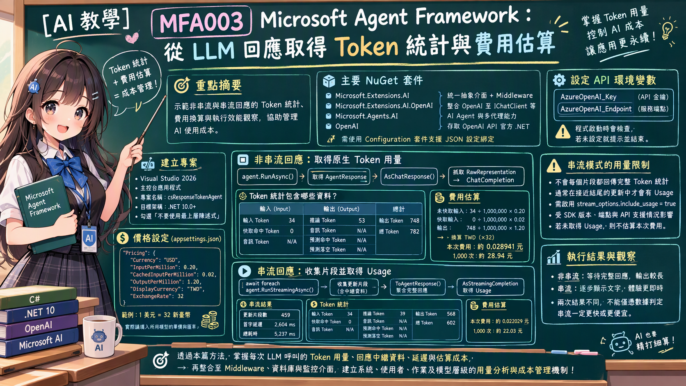

# MFA003 Microsoft Agent Framework 從 LLM 回應中取得 Token 統計 

在上一篇關於 Microsoft Agent Framework 系列教學文章 "MFA002 Microsoft Agent Framework 串流輸出回應" 中，我們了解在使用 MAF 套件的時候，對於 Agent 要做到同步與非同步串流的作法，也看到執行上的差異。通常我們在進行Agent應用系統開發的時候，都會專注於如何發揮與設計 AI Agent 的能力，可是，對於這套系統的管理者而言，每一次 Agent 的運行，就代表了至少一次的 LLM Model API 的呼叫，每一次的呼叫都會產生相應的費用與資源消耗，有了這些資訊，便可以知道當使用者使用這個系統的時候，對於有使用到 AI API 的頁面，實際的資源消耗與成本情況如何，當然，也可以知道整體系統、每個使用者、不同AI模型的使用情況，進而做出更有效的資源管理與成本控制，進一步進行分析與呈現使用量的趨勢圖。



就像我最近開發的知識庫與會議記錄生成系統，我也想知道，最近 30 天，系統在使用 LLM Model API 時的 Token 使用情況與費用統計。我也想知道，哪個使用者或者哪個作業消費到這麼多的費用，接著我也想看看他們究竟是如何在使用 LLM API 的，造成這麼多的費用，究竟是正常操作還是使用上出了問題呢?

針對這樣的需求，將會透過 MAF 內提供的中介軟體（Middleware）管線，來即時收集每一次 LLM Model API 呼叫的 Token 使用統計，而在這篇文章中，將會使用了 ChatCompletion 這個類別內的 TokenUsage 屬性來進行分析這些數據。

這篇文章將會展示透過同步與非同步串流的方式，取得這次 API 呼叫所造成的 Token & 費用使用量。

# 建立 Console 專案
* 開啟 Visual Studio 2026
* 選擇「建立新專案」
* 在 [建立新的專案] 視窗中，在右方清單內，找到並選擇「主控台應用程式」 項目
* 然後點擊右下方「下一步」按鈕
* 此時將會看到 [設定新的專案] 對話窗
* 在該對話窗的 [專案名稱] 欄位中，輸入專案名稱，例如 "csResponseTokenAgent"
* 然後點擊右下方「下一步」按鈕
* 接著會看到 [其他資訊] 對話窗
* 在這個對話窗內，確認使用底下的選項
    * 架構：.NET 10.0 (或更新版本)
    * 勾選 不要使用最上層陳述式 (這是我的個人習慣)
* 然後點擊右下方「建立」按鈕
* 現在，已經完成了這個 Console 主控台 專案的建立

## 安裝需要用到的 NuGet 套件

要完成這個第一次接觸 Microsoft Agent Framework 練習專案，需要安裝以下幾個 NuGet 套件：

### Microsoft.Extensions.AI

這個套件將會為生成式 AI 定義的一層「統一抽象介面 + Middleware 管線」，讓開發者可以更方便地整合不同的生成式 AI 模型，並且在應用程式中使用一致的方式進行呼叫與管理。

* 滑鼠右擊 [csResponseTokenAgent] 專案節點
* 點選彈出功能表的 [管理 NuGet 套件] 項
* 在 [瀏覽] 索引標籤中，搜尋並且安裝底下的 NuGet 套件
    * Microsoft.Extensions.AI
    
### Microsoft.Extensions.AI.OpenAI

這個套件是微軟官方為 .NET 整合 AI 服務所提供的擴充套件。它實現了 IChatClient 與 IEmbeddingGenerator 核心抽象介面，讓開發人員能以一致的程式碼，輕鬆串接 OpenAI 或相容的 API 端點（例如 Azure OpenAI、GitHub Models 等）。

* 滑鼠右擊 [csResponseTokenAgent] 專案節點
* 點選彈出功能表的 [管理 NuGet 套件] 項
* 在 [瀏覽] 索引標籤中，搜尋並且安裝底下的 NuGet 套件
    * Microsoft.Extensions.AI.OpenAI
    
### Microsoft.Agents.AI

這個套件是微軟官方推出 Microsoft Agent Framework（微軟智慧代理框架）的核心 .NET 套件。它主要用於在 .NET 環境中建構、協調與部署 AI 代理（AI Agents） 及多代理工作流（Multi-agent workflows），是用來取代舊版 AutoGen 的企業級解決方案。

* 滑鼠右擊 [csResponseTokenAgent] 專案節點
* 點選彈出功能表的 [管理 NuGet 套件] 項
* 在 [瀏覽] 索引標籤中，搜尋並且安裝底下的 NuGet 套件
    * Microsoft.Agents.AI
     
### OpenAI

這個套件為官方的 OpenAI .NET 客戶端類別庫，是 OpenAI NuGet 套件。此套件由 OpenAI 與 Microsoft 合作開發，提供直接存取 OpenAI 官方 REST API 的便利管道。

* 滑鼠右擊 [csResponseTokenAgent] 專案節點
* 點選彈出功能表的 [管理 NuGet 套件] 項
* 在 [瀏覽] 索引標籤中，搜尋並且安裝底下的 NuGet 套件
    * OpenAI

# 宣告 API 端點與 Key 環境變數

關於這個小節的內容，將會在這個系列每篇文章中都會用到，因此，可以參考 [MFA001 Microsoft Agent Framework 初次體驗開發出 AI 代理](https://csharpkh.blogspot.com/2026/10/mfa001-microsoft-agent-framework-ai.html) 文章中的 [宣告 API 端點與 Key 環境變數] 說明內容，若這裡提到的環境變數已經建立好了，則可以跳過這個小節內容。

# 修改 Program.cs 程式碼

為了要完成這個需求 : 如何用 Azure OpenAI 的 gpt-5.6-luna 聊天模型建立一個簡單 AI 代理，並產生一篇與鵝有關的詩。
因此，我們需要修改 Program.cs 程式碼，這時需要完成底下的操作。

* 在專案內，找到並且開啟 [Program.cs] 檔案
* 使用底下程式碼內容來取代 [Program.cs] 檔案的內容

```csharp
using Microsoft.Agents.AI;
using Microsoft.Extensions.AI;
using Microsoft.Extensions.Configuration;
using OpenAI;
using OpenAI.Chat;
using System.ClientModel;
using System.Diagnostics;
using System.Text;

namespace csResponseTokenAgent;

internal class Program
{
    private const string Prompt = "寫一首關於鵝的長詩，至少八段，每段四行。";

    static async Task Main(string[] args)
    {
        Console.OutputEncoding = Encoding.UTF8;

        var apiKey = Environment.GetEnvironmentVariable("AzureOpenAI_Key");
        var endpoint = Environment.GetEnvironmentVariable("AzureOpenAI_Endpoint");
        var model = "gpt-5.6-luna";

        if (string.IsNullOrWhiteSpace(apiKey) || string.IsNullOrWhiteSpace(endpoint))
        {
            Console.WriteLine("請先設定環境變數 AzureOpenAI_Key 與 AzureOpenAI_Endpoint 後再執行。");
            return;
        }

        var pricing = new ConfigurationBuilder()
            .SetBasePath(AppContext.BaseDirectory)
            .AddJsonFile("appsettings.json", optional: false)
            .Build()
            .GetSection("Pricing")
            .Get<Pricing>() ?? new Pricing();

        var options = new OpenAIClientOptions { Endpoint = new Uri(endpoint) };

        IChatClient chatClient =
            new ChatClient(
                    model,
                    new ApiKeyCredential(apiKey),
                    options)
                .AsIChatClient();

        AIAgent agent = new ChatClientAgent(
            chatClient,                      // 聊天用戶端
            "詩人",                          // 代理名稱
            "創作引人入勝、富有創意的詩。",  // 系統提示詞
            null);                           // 其他設定

        Console.WriteLine($"{DateTime.Now} 使用的模型: {model}");

        await RunNonStreamingAsync(agent, pricing);
        await RunStreamingAsync(agent, pricing);
    }

    private static async Task RunNonStreamingAsync(AIAgent agent, Pricing pricing)
    {
        Header("執行 1 / 非串流 (RunAsync)");

        var stopwatch = Stopwatch.StartNew();
        AgentResponse response = await agent.RunAsync(Prompt);
        stopwatch.Stop();

        Console.WriteLine(response.Text);
        Console.WriteLine();

        var chatResponse = response.AsChatResponse();
        var completion = AsCompletion(chatResponse.RawRepresentation) ?? AsCompletion(response.RawRepresentation);

        Section("回應中繼資料");
        Meta("ModelId", chatResponse.ModelId);
        Meta("ResponseId", response.ResponseId);
        Meta("AgentId", response.AgentId);
        Meta("CreatedAt", response.CreatedAt?.ToString("yyyy-MM-dd HH:mm:ss zzz"));
        Meta("FinishReason", response.FinishReason?.ToString());
        Meta("原生 FinishReason", completion?.FinishReason.ToString());
        Meta("訊息則數", response.Messages.Count.ToString());
        Meta("總耗時", $"{stopwatch.Elapsed.TotalMilliseconds:F0} ms");
        PrintAdditionalProperties(response.AdditionalProperties);

        PrintUsageTable(completion?.Usage);
        PrintCost(completion?.Usage, pricing);
    }

    private static async Task RunStreamingAsync(AIAgent agent, Pricing pricing)
    {
        Header("執行 2 / 串流 (RunStreamingAsync)");

        var stopwatch = Stopwatch.StartNew();
        TimeSpan? timeToFirstToken = null;
        var updates = new List<AgentResponseUpdate>();

        await foreach (var update in agent.RunStreamingAsync(Prompt))
        {
            updates.Add(update);

            if (string.IsNullOrEmpty(update.Text))
            {
                continue;   // 部分更新只帶中繼資料、沒有文字內容
            }

            timeToFirstToken ??= stopwatch.Elapsed;
            Console.Write(update.Text);
        }

        stopwatch.Stop();
        Console.WriteLine();
        Console.WriteLine();

        var aggregated = updates.ToAgentResponse();

        ChatTokenUsage? nativeUsage = null;
        foreach (var update in updates)
        {
            var streamingUpdate = AsStreamingCompletion(update.RawRepresentation);
            if (streamingUpdate?.Usage is not null)
            {
                nativeUsage = streamingUpdate.Usage;
            }
        }

        Section("回應中繼資料");
        Meta("ResponseId", aggregated.ResponseId);
        Meta("AgentId", aggregated.AgentId);
        Meta("CreatedAt", aggregated.CreatedAt?.ToString("yyyy-MM-dd HH:mm:ss zzz"));
        Meta("FinishReason", aggregated.FinishReason?.ToString());
        Meta("收到片段 chunk 數", updates.Count.ToString("N0"));
        Meta("首字延遲", $"{timeToFirstToken?.TotalMilliseconds ?? 0:F0} ms");
        Meta("總耗時", $"{stopwatch.Elapsed.TotalMilliseconds:F0} ms");

        PrintUsageTable(nativeUsage);

        if (nativeUsage is null)
        {
            Console.WriteLine();
            Console.WriteLine("  ※ 本次串流未回傳 usage。說明：");
            Console.WriteLine("     1. 串流模式下，token 統計不會隨每個 chunk 回傳，只會出現在最後一個 chunk。");
            Console.WriteLine("     2. 伺服器要送出那個 chunk，請求必須帶 stream_options.include_usage = true。");
            Console.WriteLine("     3. OpenAI SDK 2.13.0 的 ChatCompletionOptions.StreamOptions 型別未公開，");
            Console.WriteLine("        無法從外部設定；是否自動帶上取決於 SDK 版本與端點（Azure 部分版本不支援）。");
            Console.WriteLine("     4. 需要精準計費時，改用非串流呼叫。");
        }

        PrintCost(nativeUsage, pricing);
    }

    private static ChatCompletion? AsCompletion(object? raw) => raw switch
    {
        ChatCompletion completion => completion,
        ChatResponse chatResponse => AsCompletion(chatResponse.RawRepresentation),
        AgentResponse agentResponse => AsCompletion(agentResponse.RawRepresentation),
        _ => null
    };

    private static StreamingChatCompletionUpdate? AsStreamingCompletion(object? raw) => raw switch
    {
        StreamingChatCompletionUpdate streamingUpdate => streamingUpdate,
        ChatResponseUpdate chatUpdate => AsStreamingCompletion(chatUpdate.RawRepresentation),
        AgentResponseUpdate agentUpdate => AsStreamingCompletion(agentUpdate.RawRepresentation),
        _ => null
    };

    private const int LabelWidth = 34;
    private const int ValueWidth = 22;

    private static void PrintUsageTable(ChatTokenUsage? native)
    {
        Section("Token 用量（OpenAI 原生 SDK）");

        Console.WriteLine("  " + PadR("欄位", LabelWidth) + PadL("Token 數", ValueWidth));
        Console.WriteLine("  " + new string('-', LabelWidth + ValueWidth));

        UsageRow("輸入 Input", native?.InputTokenCount);
        UsageRow("  ├─ 快取命中 Cached", native?.InputTokenDetails?.CachedTokenCount);
        UsageRow("  └─ 音訊 Audio", native?.InputTokenDetails?.AudioTokenCount);
        UsageRow("輸出 Output", native?.OutputTokenCount);
        UsageRow("  ├─ 推論 Reasoning", native?.OutputTokenDetails?.ReasoningTokenCount);
        UsageRow("  ├─ 音訊 Audio", native?.OutputTokenDetails?.AudioTokenCount);
#pragma warning disable OPENAI001
        UsageRow("  ├─ 預測命中 Accepted", native?.OutputTokenDetails?.AcceptedPredictionTokenCount);
        UsageRow("  └─ 預測落空 Rejected", native?.OutputTokenDetails?.RejectedPredictionTokenCount);
#pragma warning restore OPENAI001
        UsageRow("總計 Total", native?.TotalTokenCount);
    }

    private static void UsageRow(string label, long? value)
        => Console.WriteLine("  " + PadR(label, LabelWidth) + PadL(Num(value), ValueWidth));

    private static string Num(long? value) => value?.ToString("N0") ?? "N/A";

    private static void PrintCost(ChatTokenUsage? native, Pricing pricing)
    {
        Section("費用估算");

        if (pricing.InputPerMillion == 0m && pricing.CachedInputPerMillion == 0m && pricing.OutputPerMillion == 0m)
        {
            Console.WriteLine("  尚未設定單價。請編輯 appsettings.json 的 Pricing 區段，");
            Console.WriteLine("  填入每 1,000,000 tokens 的實際單價後重新執行。");
            return;
        }

        if (native is null)
        {
            Console.WriteLine("  取不到 usage，無法估算本次費用。");
            return;
        }

        long input = native.InputTokenCount;
        long output = native.OutputTokenCount;

        long cached = native.InputTokenDetails?.CachedTokenCount ?? 0;
        long freshInput = Math.Max(0, input - cached);

        var rate = pricing.ExchangeRate;
        var inputCost = freshInput / 1_000_000m * pricing.InputPerMillion;
        var cachedCost = cached / 1_000_000m * pricing.CachedInputPerMillion;
        var outputCost = output / 1_000_000m * pricing.OutputPerMillion;
        var total = inputCost + cachedCost + outputCost;

        Console.WriteLine($"  匯率：1 {pricing.Currency} = {pricing.DisplayCurrency} {rate:N2}");
        Console.WriteLine($"  未快取輸入  {freshInput,10:N0} tokens x {pricing.InputPerMillion,8:N4} {pricing.Currency}/M = {pricing.DisplayCurrency} {inputCost * rate,12:F6}");
        Console.WriteLine($"  快取輸入    {cached,10:N0} tokens x {pricing.CachedInputPerMillion,8:N4} {pricing.Currency}/M = {pricing.DisplayCurrency} {cachedCost * rate,12:F6}");
        Console.WriteLine($"  輸出        {output,10:N0} tokens x {pricing.OutputPerMillion,8:N4} {pricing.Currency}/M = {pricing.DisplayCurrency} {outputCost * rate,12:F6}");
        Console.WriteLine($"  合計                                             = {pricing.DisplayCurrency} {total * rate,12:F6}   （{pricing.Currency} {total:F6}）");
        Console.WriteLine($"  換算：同樣用量跑 1,000 次約 {pricing.DisplayCurrency} {total * rate * 1000:N2}");
    }

    private static void Header(string title)
    {
        Console.WriteLine();
        Console.WriteLine("" + new string('=', 74) + "");
        Console.WriteLine("  " + title + "");
        Console.WriteLine("" + new string('=', 74) + "");
        Console.WriteLine();
    }

    private static void Section(string title)
    {
        Console.WriteLine();
        Console.WriteLine("【" + title + "】");
    }

    private static void Meta(string label, string? value)
    {
        Console.WriteLine("  " + PadR(label, 24) + ": " + (string.IsNullOrWhiteSpace(value) ? "N/A" : value));
    }

    private static void PrintAdditionalProperties(IDictionary<string, object?>? properties)
    {
        if (properties is not { Count: > 0 })
        {
            return;
        }

        foreach (var entry in properties)
        {
            Meta("  " + entry.Key, entry.Value?.ToString());
        }
    }

    private static int DisplayWidth(string text)
    {
        var width = 0;
        foreach (var rune in text.EnumerateRunes())
        {
            var value = rune.Value;
            var isWide =
                (value >= 0x1100 && value <= 0x115F) ||
                (value >= 0x2E80 && value <= 0xA4CF && value != 0x303F) ||
                (value >= 0xAC00 && value <= 0xD7A3) ||
                (value >= 0xF900 && value <= 0xFAFF) ||
                (value >= 0xFE30 && value <= 0xFE6F) ||
                (value >= 0xFF00 && value <= 0xFF60) ||
                (value >= 0xFFE0 && value <= 0xFFE6);
            width += isWide ? 2 : 1;
        }
        return width;
    }

    private static string PadR(string text, int width) => text + new string(' ', Math.Max(0, width - DisplayWidth(text)));
    private static string PadL(string text, int width) => new string(' ', Math.Max(0, width - DisplayWidth(text))) + text;
}

internal sealed class Pricing
{
    public string Currency { get; set; } = "USD";
    public decimal InputPerMillion { get; set; }
    public decimal CachedInputPerMillion { get; set; }
    public decimal OutputPerMillion { get; set; }
    public string DisplayCurrency { get; set; } = "NT$";
    public decimal ExchangeRate { get; set; } = 1m;
}
```

這個程式一開始將會讀取 API Key 與服務端點的數據，接著使用 ConfigurationBuilder 來讀取 appsettings.json 中的價格表。在這裡將會採用靜態的費用計算方式。

```csharp
        // 價格表放在 appsettings.json，改單價不必重新編譯
var pricing = new ConfigurationBuilder()
    .SetBasePath(AppContext.BaseDirectory)
    .AddJsonFile("appsettings.json", optional: false)
    .Build()
    .GetSection("Pricing")
    .Get<Pricing>() ?? new Pricing();
```

因此，這樣就知道使用了多少 token，將會需要支付多少美元，而我希望能夠讓使用者看到的台幣金額，所以，在這個範例中，我們會將價格表中的美元金額換算成台幣顯示。對於 appsettings.json 檔案的內容，可以從底下看到，對於面對不同的設計需求，可以自行增刪這個 json 檔案內容。

```json
{
  "Pricing": {
    "_comment": "InputPerMillion / CachedInputPerMillion / OutputPerMillion 為每 1,000,000 tokens 的單價，幣別由 Currency 指定；金額會以 ExchangeRate 換算成 DisplayCurrency 顯示。",
    "Currency": "USD",
    "InputPerMillion": 0.20,
    "CachedInputPerMillion": 0.02,
    "OutputPerMillion": 1.20,
    "DisplayCurrency": "NT$",
    "ExchangeRate": 32.0
  }
}
```

* Pricing : 這個物件用來存放價格表的資訊，包括每百萬 token 的費用、顯示幣別以及匯率。
* _comment : 用來對價格表中的各個欄位進行註解說明。
* Currency : 價格表中使用的幣別。
* InputPerMillion : 每百萬個輸入 token 的費用。
* CachedInputPerMillion : 每百萬個快取命中輸入 token 的費用。
* OutputPerMillion : 每百萬個輸出 token 的費用。
* DisplayCurrency : 顯示的幣別。
* ExchangeRate : 將 Currency 換算成 DisplayCurrency 的匯率。

接下來則是如同前面的範例相同，先建立一個 IChatClient 物件，接者建立一個 AIAgent 物件，並使用它來與模型進行互動。這部分的說明，可以參考 [MFA001 Microsoft Agent Framework 初次體驗開發出 AI 代理] 或者 [MFA002 Microsoft Agent Framework 串流輸出回應] 文章。

為了要說明採用同步與非同步串流的使用方式，這裡將會分別呼叫 `await RunNonStreamingAsync(agent, pricing);` 與 `await RunStreamingAsync(agent, pricing);` 方法。對於這兩個方法，將會分別傳送兩個引數：`agent` 與 `pricing`。這兩個引數代表了與模型互動的代理物件以及價格表資訊。

## RunNonStreamingAsync

以下範例示範了如何使用同步方式與模型互動，並計算 token 的使用量與費用。

在執行這個方法，將會計算整個方法執行完成後，將會花費多少時間，所以，在這裡使用 Stopwatch.StartNew() 來啟動計時器。

現在，使用了 `AgentResponse response = await agent.RunAsync(Prompt);` 敘述，來呼叫 AI 模型進行處理，這裡傳送進去的提示詞為 "寫一首關於鵝的長詩，至少八段，每段四行。"

有了 response 物件，接下來就是要取得 ChatCompletion 物件，在這裡將會把 chatResponse.RawRepresentation 或者 response.RawRepresentation 物件傳送到 AsCompletion 方法內，底下將會 AsCompletion 方法

```csharp
private static ChatCompletion? AsCompletion(object? raw) => raw switch
{
    ChatCompletion completion => completion,
    ChatResponse chatResponse => AsCompletion(chatResponse.RawRepresentation),
    AgentResponse agentResponse => AsCompletion(agentResponse.RawRepresentation),
    _ => null
};
```

這個方法使用 switch 型別比對：
•	已經是 ChatCompletion：直接回傳。
•	是 ChatResponse 或 AgentResponse：讀取其 RawRepresentation，遞迴往內層找。
•	是其他型別（包含 null）：回傳 null。
這是因為回應可能被 Agent 和 Microsoft.Extensions.AI 的型別包了好幾層。找到原生 ChatCompletion (這個型別將會定義在 OpenAI.Chat 命名空間中) 後，程式就能讀取原生的結束原因與 token 用量。

接下來就是把 chatResponse 物件內的一些屬性顯示在螢幕上，這包括了模型Id、回應Id、代理Id、建立時間以及結束原因等資訊。底下為這些輸出的範例內容

```plaintext
【回應中繼資料】
  ModelId                 : gpt-5.6-luna-2026-07-09
  ResponseId              : chatcmpl-EYNvyS4KPWN4R7IWq1J3YlXjCcGfM
  AgentId                 : aac5e6d826dd4c6193a9f1b4c7447904
  CreatedAt               : 2026-10-13 03:57:42 +00:00
  FinishReason            : stop
  原生 FinishReason       : Stop
  訊息則數                : 1
  總耗時                  : 8456 ms
```

對於 PrintUsageTable 方法將會是接下來要執行的程式碼，這個方法會將 ChatCompletion 物件中的 token 使用量以表格的形式顯示出來，方便開發者了解每個回應所消耗的 token 數量。這個方法將會接收到 ChatTokenUsage 物件，底下的執行結果，將會是透過 ChatTokenUsage 物件所產生的。

```plaintext
【Token 用量（OpenAI 原生 SDK）】
  欄位                                            Token 數
  --------------------------------------------------------
  輸入 Input                                            34
    ├─ 快取命中 Cached                                   0
    └─ 音訊 Audio                                        0
  輸出 Output                                          674
    ├─ 推論 Reasoning                                   49
    ├─ 音訊 Audio                                        0
    ├─ 預測命中 Accepted                                 0
    └─ 預測落空 Rejected                                 0
  總計 Total                                           708
```

在 OpenAI 原生 SDK 中，ChatTokenUsage 物件會記錄每個回應的 token 使用量，從上面的輸出傑可以看到會有輸入與輸出這兩個區塊，在輸入區塊中，將會有快取命中與音訊所消耗的 token，這兩個分別表示了從快取取得的 token 與音訊處理所消耗的 token。在輸出區塊中，則會有推論、音訊、預測命中與預測落空所消耗的 token，這些分別表示了模型推論、音訊處理、預測命中與預測落空所消耗的 token。更多關於這方面的說明，可以參考 [官方 ResponseUsage 文件](https://developers.openai.com/api/reference/resources/responses#(resource)%20responses%20%3E%20(model)%20response_usage%20%3E%20(schema))

708 是怎麼算出來的`:
  這個數字是輸入與輸出 token 數量的總和：
  輸入 Input: 34
  輸出 Output: 674
  總計 Total: 34 + 674 = 708

最後，將會呼叫 PrintCost 方法，這個方法會計算並顯示每個回應的成本，方便開發者了解使用該模型所產生的費用。

這個方法會先檢查對於大語言模型的價錢計算單價是否有定義，接著將會取得這次呼叫 API 的輸入與輸出 Token 的數量是多少，依據 大語言模型廠商對於不同類型 Token 的計價方式，計算出這次回應的總成本，另外，這裡會使用美金對台幣的匯率進行換算，方便開發者了解實際花費。最後，依據計算，將會得到底下最終的結果。

```plaintext
【費用估算】
  匯率：1 USD = NT$ 32.00
  未快取輸入          34 tokens x   0.2000 USD/M = NT$     0.000218
  快取輸入             0 tokens x   0.0200 USD/M = NT$     0.000000
  輸出               674 tokens x   1.2000 USD/M = NT$     0.022003
  合計                                             = NT$     0.022221   （USD 0.000694）
  換算：同樣用量跑 1,000 次約 NT$ 22.22
```

## RunNonStreamingAsync

剛剛說明了使用同步呼叫 API 方式來取得所花費 Token 並且計算與顯示出費用的作法，接下來這裡將會來說明使用非同步串流的方式，該如何做到同樣的事情，當系統完成了同步方式的呼叫之後，接著將會進行非同步串流的呼叫，這裡將會呼叫 RunNonStreamingAsync 這個方法，呼叫這個方法的時候，將會傳入同樣的兩個引數，分別是 agent & pricing 物件，這兩個物件為先前建立的代理與定價設定。

在這個方法內，同樣會使用 Stopwatch 來計算 API 呼叫的耗時，接著使用非同步串流呼叫 API 的做法，使用 await foreach 語法，分別逐一取得串流回應的文字內容，直到整個回應完成。每次取得串流回應物件，這個物件的型別為 AgentResponseUpdate，就會將其加入到 update 這個 List 集合內。

在這個 AgentResponseExtensions 類別內，有定義一個 ToAgentResponse 擴充方法，這個方法會將多個串流回應的 chunk 聚合成一個完整的 AgentResponse，方便取得 ResponseId、CreatedAt 與 FinishReason 等資訊。

接下來宣告了一個 nativeUsage 物件，他的型別為 ChatTokenUsage ，該型別將會由 OpenAI.Chat 命名空間來提供，用來記錄每個回應的 token 使用量。因此，這裡使用一個 foreach 迴圈，遍歷所有的串流回應，檢查每個回應的 RawRepresentation 是否包含 usage 資訊，如果有的話，就將其賦值給 nativeUsage。

在每次迴圈要執行的時候，會執行 AsStreamingCompletion 方法，將 RawRepresentation 轉換成 StreamingCompletion 物件，然後檢查其 Usage 屬性是否為 null，如果不是 null，就將其賦值給 nativeUsage。

實際執行的時候，這個 updates 集合內，將會有 635 個串流回應的 chunk。將會檢查每一個 updates 內的物件，最終將會在最後一個物件中，檢查出有 Usage 的屬性有值，並將其賦值給 nativeUsage。這樣一來，就可以取得整個回應的 token 使用統計資訊。

有了這些資訊，將會顯示出 回應中繼資料 內容，接著使用剛剛在同步呼叫 LLM API 用到的 PrintUsageTable 方法，將 nativeUsage 傳入，顯示出 token 使用統計資訊。並且使用同樣的 PrintCost 方法，將 nativeUsage 傳入，顯示出費用估算。最後，整個非同步串流的呼叫流程就完成了。

# 執行結果

現在來看看這個範例程式碼的執行結果。由於使用了串流方式，文字會逐步湧出，而不是一次性全部顯示。

* 在 Visual Studio 2026 下，按下 F5 鍵執行程式，將會看到程式輸出的結果。

```plaintext
2026/10/13 上午 09:34:16 使用的模型: gpt-5.6-luna

==========================================================================
  執行 1 / 非串流 (RunAsync)
==========================================================================

### 《鵝行長歌》

一
清晨的河岸還披著薄霜，
一群白鵝踏醒沉睡的蘆葦，
它們把長頸伸向初升的太陽，
像舉起一面面潔白的旗幟。

二
水面收藏著藍天的倒影，
鵝掌劃開一圈圈微光，
遠山在它們身後慢慢醒來，
雲朵也學著低頭梳理羽裳。

三
牠們不懂宮殿裡的金冠，
也不羨慕高臺上的掌聲，
只在泥濘中留下深深腳印，
把平凡走成坦蕩的道路。

四
當風從北方吹過田野，
蘆花紛紛飄向黃昏，
領頭的鵝發出悠長的呼喚，
彷彿在召集失散的星辰。

五
村口的孩子追著牠們奔跑，
笑聲落滿斑駁的石橋，
鵝群昂首穿過夕陽的火焰，
影子卻溫柔地伏在水草旁。

六
夜裡，月亮停在池塘中央，
白羽如霜，靜靜浮動，
牠們把夢藏進翅膀深處，
守著一片不肯熄滅的水光。

七
有時雷聲震動黑色的天幕，
雨點如鼓敲打屋簷，
鵝仍站在風暴的門前，
用一聲高鳴回答大地的疑問。

八
牠們知道遠方不只春天，
也有寒潮、荒草與漫長冬日，
然而每一次渡過陰影之後，
羽毛依然朝著光亮生長。

九
老鵝的眼中藏著許多河流，
走過落葉，也走過霜雪，
牠回頭看著年輕的同伴，
像一位沉默而慈祥的旅者。

十
當黎明再次推開東方的門，
群鵝列隊游向金色的水面，
牠們用樸素而洪亮的歌聲，
替世間唱出自由的誓言。

十一
若我有一天迷失在城市，
被高樓遮住星辰與田園，
願聽見遠處那熟悉的鵝鳴，
引我回到有風的河邊。

十二
那裡的天仍然寬廣清澈，
那裡的路仍然蜿蜒向前，
一群白鵝穿過暮色與晨光，
把生命寫成潔白的長篇。


【回應中繼資料】
  ModelId                 : gpt-5.6-luna-2026-07-09
  ResponseId              : chatcmpl-EYLhDlo1OIygMc6Y30JfudZb02EAM
  AgentId                 : 124dca37f3ff436e8d115a18e01c92e3
  CreatedAt               : 2026-10-13 01:34:19 +00:00
  FinishReason            : stop
  原生 FinishReason       : Stop
  訊息則數                : 1
  總耗時                  : 10029 ms

【Token 用量（OpenAI 原生 SDK）】
  欄位                                            Token 數
  --------------------------------------------------------
  輸入 Input                                            34
    ├─ 快取命中 Cached                                   0
    └─ 音訊 Audio                                        0
  輸出 Output                                          748
    ├─ 推論 Reasoning                                   53
    ├─ 音訊 Audio                                        0
    ├─ 預測命中 Accepted                                 0
    └─ 預測落空 Rejected                                 0
  總計 Total                                           782

【費用估算】
  匯率：1 USD = NT$ 32.00
  未快取輸入          34 tokens x   0.2000 USD/M = NT$     0.000218
  快取輸入             0 tokens x   0.0200 USD/M = NT$     0.000000
  輸出               748 tokens x   1.2000 USD/M = NT$     0.028723
  合計                                             = NT$     0.028941   （USD 0.000904）
  換算：同樣用量跑 1,000 次約 NT$ 28.94

```


```plaintext
==========================================================================
  執行 2 / 串流 (RunStreamingAsync)
==========================================================================

### 《湖畔的鵝》

晨霧從蘆葦間慢慢升起，
一隻白鵝踏醒沉睡的湖，
牠把長頸伸向初亮的天際，
像一支潔白而悠遠的笛。

腳掌划開淡金色的水紋，
湖面收藏牠搖曳的身影，
每一圈波光都向遠方奔，
追隨牠不慌不忙的歌聲。

牠曾走過結霜的田野，
也曾穿越暴雨的黃昏，
羽毛沾滿泥土與落葉，
眼中仍守著清澈的春。

村口的孩子追著牠笑，
夕陽把影子拉得很長，
牠回頭高唱一聲驕傲，
驚飛樹梢最後一群斜陽。

夜色降臨，星星低垂，
湖水像黑色的玻璃，
鵝群依偎在蘆花深處，
夢裡仍游向月亮的彼岸。

北風吹來漫天的雪，
封住小橋，也封住渡口，
牠以翅膀守護胸前的熱，
在寒冷裡站成一座白丘。

春天終於解開河流的鎖，
嫩草從泥土探出小小的頭，
鵝聲穿過新綠的村落，
像古老鐘聲再次敲響自由。

牠不懂地圖，也不問歸期，
只循著雲影與水的方向，
每一次展翅，都是一次決意，
每一次回眸，都帶著故鄉。

若有人問牠何處是家，
牠便望向天邊緩緩流霞：
有水的地方，便能安睡，
有風的地方，便可出發。

多年以後，湖仍如此寬，
蘆葦仍在晚風中低語，
只有那白色的身影漸遠，
留下一路閃亮的羽翅。


【回應中繼資料】
  ResponseId              : chatcmpl-EYLhKS8aNVDAoN2ul1q9RFxD6zwbP
  AgentId                 : 124dca37f3ff436e8d115a18e01c92e3
  CreatedAt               : 2026-10-13 01:34:26 +00:00
  FinishReason            : stop
  收到片段 chunk 數       : 459
  首字延遲                : 2604 ms
  總耗時                  : 5237 ms

【Token 用量（OpenAI 原生 SDK）】
  欄位                                            Token 數
  --------------------------------------------------------
  輸入 Input                                            34
    ├─ 快取命中 Cached                                   0
    └─ 音訊 Audio                                        0
  輸出 Output                                          568
    ├─ 推論 Reasoning                                   39
    ├─ 音訊 Audio                                        0
    ├─ 預測命中 Accepted                                 0
    └─ 預測落空 Rejected                                 0
  總計 Total                                           602

【費用估算】
  匯率：1 USD = NT$ 32.00
  未快取輸入          34 tokens x   0.2000 USD/M = NT$     0.000218
  快取輸入             0 tokens x   0.0200 USD/M = NT$     0.000000
  輸出               568 tokens x   1.2000 USD/M = NT$     0.021811
  合計                                             = NT$     0.022029   （USD 0.000688）
  換算：同樣用量跑 1,000 次約 NT$ 22.03
```


