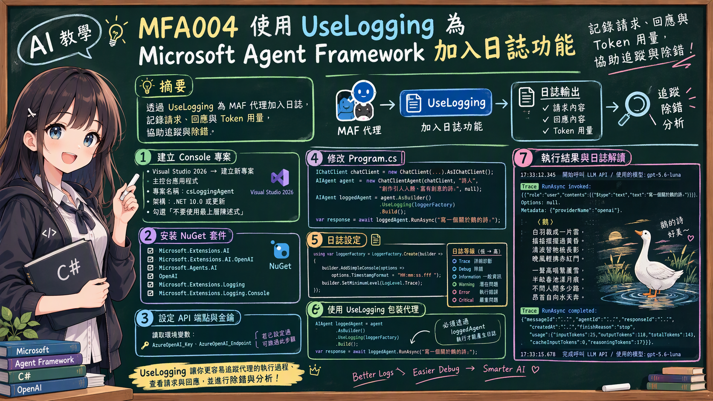

# MFA004 使用 UseLogging 將 MAF 掛上日誌能力並且查看日誌內容 

在上一篇關於 Microsoft Agent Framework 系列教學文章 "MFA003 Microsoft Agent Framework 從 LLM 回應中取得 Token 統計" 中，我們學會了如何使用 MAF 提供的物件，得到呼叫 LLM API 的 Token 統計資訊。接下來就是我們再開發系統的時候，經常會用到的日誌能力，因為當系統有了日誌功能後，我們可以更方便地追蹤系統的運作狀況，了解每一次對 LLM API 的呼叫細節，並且在需要時進行除錯與分析。



在這裡的範例中可以看到，MAF 提供的日誌能力可以讓我們在呼叫 LLM API 時，將每一次的請求與回應詳細記錄下來，方便後續的追蹤與分析。這裡將會透過 UseLogging 中介軟體來實現這個功能。

接下來看看如何做到這樣的效果。


# 建立 Console 專案
* 開啟 Visual Studio 2026
* 選擇「建立新專案」
* 在 [建立新的專案] 視窗中，在右方清單內，找到並選擇「主控台應用程式」 項目
* 然後點擊右下方「下一步」按鈕
* 此時將會看到 [設定新的專案] 對話窗
* 在該對話窗的 [專案名稱] 欄位中，輸入專案名稱，例如 "csLoggingAgent"
* 然後點擊右下方「下一步」按鈕
* 接著會看到 [其他資訊] 對話窗
* 在這個對話窗內，確認使用底下的選項
    * 架構：.NET 10.0 (或更新版本)
    * 勾選 不要使用最上層陳述式 (這是我的個人習慣)
* 然後點擊右下方「建立」按鈕
* 現在，已經完成了這個 Console 主控台 專案的建立

## 安裝需要用到的 NuGet 套件

要完成這個第一次接觸 Microsoft Agent Framework 練習專案，需要安裝以下幾個 NuGet 套件：

### Microsoft.Extensions.AI

這個套件將會為生成式 AI 定義的一層「統一抽象介面 + Middleware 管線」，讓開發者可以更方便地整合不同的生成式 AI 模型，並且在應用程式中使用一致的方式進行呼叫與管理。

* 滑鼠右擊 [csLoggingAgent] 專案節點
* 點選彈出功能表的 [管理 NuGet 套件] 項
* 在 [瀏覽] 索引標籤中，搜尋並且安裝底下的 NuGet 套件
    * Microsoft.Extensions.AI
    
### Microsoft.Extensions.AI.OpenAI

這個套件是微軟官方為 .NET 整合 AI 服務所提供的擴充套件。它實現了 IChatClient 與 IEmbeddingGenerator 核心抽象介面，讓開發人員能以一致的程式碼，輕鬆串接 OpenAI 或相容的 API 端點（例如 Azure OpenAI、GitHub Models 等）。

* 滑鼠右擊 [csLoggingAgent] 專案節點
* 點選彈出功能表的 [管理 NuGet 套件] 項
* 在 [瀏覽] 索引標籤中，搜尋並且安裝底下的 NuGet 套件
    * Microsoft.Extensions.AI.OpenAI
    
### Microsoft.Agents.AI

這個套件是微軟官方推出 Microsoft Agent Framework（微軟智慧代理框架）的核心 .NET 套件。它主要用於在 .NET 環境中建構、協調與部署 AI 代理（AI Agents） 及多代理工作流（Multi-agent workflows），是用來取代舊版 AutoGen 的企業級解決方案。

* 滑鼠右擊 [csLoggingAgent] 專案節點
* 點選彈出功能表的 [管理 NuGet 套件] 項
* 在 [瀏覽] 索引標籤中，搜尋並且安裝底下的 NuGet 套件
    * Microsoft.Agents.AI
     
### OpenAI

這個套件為官方的 OpenAI .NET 客戶端類別庫，是 OpenAI NuGet 套件。此套件由 OpenAI 與 Microsoft 合作開發，提供直接存取 OpenAI 官方 REST API 的便利管道。

* 滑鼠右擊 [csLoggingAgent] 專案節點
* 點選彈出功能表的 [管理 NuGet 套件] 項
* 在 [瀏覽] 索引標籤中，搜尋並且安裝底下的 NuGet 套件
    * OpenAI

### Logging

這個套件為 Microsoft.Extensions.Logging 的官方 NuGet 套件，是用來在 .NET 應用程式中提供日誌功能的。此套件由 Microsoft 官方開發，提供統一的日誌介面與多種日誌後端的整合能力。

* 滑鼠右擊 [csLoggingAgent] 專案節點
* 點選彈出功能表的 [管理 NuGet 套件] 項
* 在 [瀏覽] 索引標籤中，搜尋並且安裝底下的 NuGet 套件
    * Microsoft.Extensions.Logging

### Logging.Console

這個套件為 Microsoft.Extensions.Logging.Console 的官方 NuGet 套件，是用來在 .NET 應用程式中提供控制台日誌功能的。此套件由 Microsoft 官方開發，提供統一的日誌介面與多種日誌後端的整合能力。

* 滑鼠右擊 [csLoggingAgent] 專案節點
* 點選彈出功能表的 [管理 NuGet 套件] 項
* 在 [瀏覽] 索引標籤中，搜尋並且安裝底下的 NuGet 套件
    * Microsoft.Extensions.Logging.Console

# 宣告 API 端點與 Key 環境變數

關於這個小節的內容，將會在這個系列每篇文章中都會用到，因此，可以參考 [MFA001 Microsoft Agent Framework 初次體驗開發出 AI 代理](https://csharpkh.blogspot.com/2026/10/mfa001-microsoft-agent-framework-ai.html) 文章中的 [宣告 API 端點與 Key 環境變數] 說明內容，若這裡提到的環境變數已經建立好了，則可以跳過這個小節內容。

# 修改 Program.cs 程式碼

為了要完成這個需求 : 如何用 Azure OpenAI 的 gpt-5.6-luna 聊天模型建立一個簡單 AI 代理，並產生一篇與鵝有關的詩。
因此，我們需要修改 Program.cs 程式碼，這時需要完成底下的操作。

* 在專案內，找到並且開啟 [Program.cs] 檔案
* 使用底下程式碼內容來取代 [Program.cs] 檔案的內容

```csharp
using Microsoft.Agents.AI;
using Microsoft.Extensions.AI;
using Microsoft.Extensions.Logging;
using OpenAI;
using OpenAI.Chat;
using System.ClientModel;
using System.Text;

namespace csLoggingAgent;

internal class Program
{
    static async Task Main(string[] args)
    {
        Console.OutputEncoding = Encoding.UTF8;

        var apiKey = Environment.GetEnvironmentVariable("AzureOpenAI_Key");
        var endpoint = Environment.GetEnvironmentVariable("AzureOpenAI_Endpoint");
        var model = "gpt-5.6-luna";

        if (string.IsNullOrWhiteSpace(apiKey) || string.IsNullOrWhiteSpace(endpoint))
        {
            Console.WriteLine("請先設定環境變數 AzureOpenAI_Key 與 AzureOpenAI_Endpoint 後再執行。");
            return;
        }

        using var loggerFactory = LoggerFactory.Create(builder =>
        {
            builder.AddSimpleConsole(options => options.TimestampFormat = "HH:mm:ss.fff ");
            builder.SetMinimumLevel(LogLevel.Trace);
        });

        IChatClient chatClient =
            new ChatClient(
                    model,
                    new ApiKeyCredential(apiKey),
                    new OpenAIClientOptions { Endpoint = new Uri(endpoint) })
                .AsIChatClient();

        AIAgent agent = new ChatClientAgent(
            chatClient,                      // 聊天用戶端
            "詩人",                          // 代理名稱
            "創作引人入勝、富有創意的詩。",  // 系統提示詞
            null);                           // 其他設定

        AIAgent loggedAgent = agent
            .AsBuilder()
            .UseLogging(loggerFactory)
            .Build();

        Console.WriteLine($"{DateTime.Now} 開始呼叫 LLM API / 使用的模型: {model}");

        var response = await loggedAgent.RunAsync("寫一個關於鵝的詩。");

        Console.WriteLine();
        Console.WriteLine(response.Text);
        Console.WriteLine($"{DateTime.Now} 完成呼叫 LLM API / 使用的模型: {model}");
    }
}
```

這個程式一開始將會讀取 API Key 與服務端點的數據，接著如同前面的範例相同，先建立一個 IChatClient 物件，接者建立一個 AIAgent 物件，並使用它來與模型進行互動。這部分的說明，可以參考 [MFA001 Microsoft Agent Framework 初次體驗開發出 AI 代理] 或者 [MFA002 Microsoft Agent Framework 串流輸出回應] 文章。

在這個範例中，系統提示詞宣告為 "創作引人入勝、富有創意的詩。"，這表示代理將會以創作詩歌為主要任務，並且在生成內容時會注重創意與吸引力。

在這個程式一開頭，我們就建立了一個 `loggerFactory`，用來配置日誌輸出格式與日誌等級。這樣一來，後續所有使用這個 `loggerFactory` 的代理都能夠自動產生日誌，方便我們追蹤程式的執行過程。這裡使用了 SetMinimumLevel(LogLevel.Trace) 來設定日誌的最小等級為 Trace，確保所有等級的日誌都能被輸出。在日誌系統中，每筆日誌紀錄都會有個等級 Level 屬性值，這些屬性值可以為 Trace、Debug、Information、Warning、Error 或 Critical。這些等級意義為：
- Trace: 最詳細的日誌訊息，通常用於診斷問題。
- Debug: 調試過程中使用的日誌訊息。
- Information: 一般資訊性日誌。
- Warning: 警告訊息，表示可能的問題。
- Error: 錯誤訊息，表示程式執行中發生了問題。
- Critical: 致命錯誤訊息，表示程式可能無法繼續執行。

```csharp
using var loggerFactory = LoggerFactory.Create(builder =>
{
    builder.AddSimpleConsole(options => options.TimestampFormat = "HH:mm:ss.fff ");
    builder.SetMinimumLevel(LogLevel.Trace);
});
```

除了一開始建立了一個型別為 AIAgent 的 agent 物件，接著又使用 `AsBuilder()` 方法將其轉換為建構器，並使用 `UseLogging(loggerFactory)` 來為代理掛上日誌能力，最後再呼叫 `Build()` 方法建立出帶有日誌功能的 `loggedAgent` 物件。這樣一來，所有透過 `loggedAgent` 執行的操作都會自動產生日誌，方便開發者追蹤代理的行為與模型的回應。

```csharp
AIAgent loggedAgent = agent
    .AsBuilder()
    .UseLogging(loggerFactory)
    .Build();
```

最後執行 `var response = await loggedAgent.RunAsync("寫一個關於鵝的詩。");`
這行程式碼會觸發代理與模型的互動，並且由於我們之前為代理掛上了日誌功能，因此在執行過程中會自動產生日誌，顯示代理的行為與模型的回應。

# 執行結果

現在來看看這個範例程式碼的執行結果。

* 在 Visual Studio 2026 下，按下 F5 鍵執行程式，將會看到程式輸出的結果。

```plaintext
2026/10/14 下午 03:16:10 開始呼叫 LLM API / 使用的模型: gpt-5.6-luna
15:16:11.034 trce: LoggingAgent[805843669]
      RunAsync invoked: [{"role":"user","contents":[{"$type":"text","text":"寫一個關於鵝的詩。"}]}]. Options: null. Metadata: {"providerName":"openai"}.

15:16:14.414 trce: LoggingAgent[384896670]
      RunAsync completed: {"messages":[{"authorName":"創作引人入勝、富有創意的詩。","createdAt":"2026-10-14T07:16:12+00:00","role":"assistant","contents":[{"$type":"text","text":"**〈鵝〉**\n\n白羽裁成一片雲，  \n搖搖擺擺過黃昏。  \n清波替牠梳長影，  \n晚風輕拂赤紅門。  \n\n一聲高唱驚蘆雪，  \n半畝春池漾月痕。  \n不問人間多少路，  \n昂首自向水天奔。"}],"messageId":"chatcmpl-EYnVciPuQQ1cMnUCCnP3f4vV8BCQK"}],"agentId":"dcc3ea8594a243f082abcade0784f727","responseId":"chatcmpl-EYnVciPuQQ1cMnUCCnP3f4vV8BCQK","createdAt":"2026-10-14T07:16:12+00:00","finishReason":"stop","usage":{"inputTokenCount":25,"outputTokenCount":118,"totalTokenCount":143,"cachedInputTokenCount":0,"reasoningTokenCount":17,"additionalCounts":{"InputTokenDetails.AudioTokenCount":0,"OutputTokenDetails.AudioTokenCount":0,"OutputTokenDetails.AcceptedPredictionTokenCount":0,"OutputTokenDetails.RejectedPredictionTokenCount":0}}}.
**〈鵝〉**

白羽裁成一片雲，
搖搖擺擺過黃昏。
清波替牠梳長影，
晚風輕拂赤紅門。

一聲高唱驚蘆雪，
半畝春池漾月痕。
不問人間多少路，
昂首自向水天奔。
2026/10/14 下午 03:16:14 完成呼叫 LLM API / 使用的模型: gpt-5.6-luna
```

從上面的執行後輸出內容，可以看到有兩個 trace 日誌紀錄，第一筆為

RunAsync invoked: [{"role":"user","contents":[{"$type":"text","text":"寫一個關於鵝的詩。"}]}]. Options: null. Metadata: {"providerName":"openai"}.

從第一筆日誌紀錄可以看出，這是要送給 LLM API 的內容，也就是使用者的請求訊息。在 contents 屬性中可以看到使用者輸入的文字 "寫一個關於鵝的詩。"

第二筆為

RunAsync completed: {"messages":[{"authorName":"創作引人入勝、富有創意的詩。","createdAt":"2026-10-14T07:16:12+00:00","role":"assistant","contents":[{"$type":"text","text":"**〈鵝〉**\n\n白羽裁成一片雲，  \n搖搖擺擺過黃昏。  \n清波替牠梳長影，  \n晚風輕拂赤紅門。  \n\n一聲高唱驚蘆雪，  \n半畝春池漾月痕。  \n不問人間多少路，  \n昂首自向水天奔."}],"messageId":"chatcmpl-EYnVciPuQQ1cMnUCCnP3f4vV8BCQK"}],"agentId":"dcc3ea8594a243f082abcade0784f727","responseId":"chatcmpl-EYnVciPuQQ1cMnUCCnP3f4vV8BCQK","createdAt":"2026-10-14T07:16:12+00:00","finishReason":"stop","usage":{"inputTokenCount":25,"outputTokenCount":118,"totalTokenCount":143,"cachedInputTokenCount":0,"reasoningTokenCount":17,"additionalCounts":{"InputTokenDetails.AudioTokenCount":0,"OutputTokenDetails.AudioTokenCount":0,"OutputTokenDetails.AcceptedPredictionTokenCount":0,"OutputTokenDetails.RejectedPredictionTokenCount":0}}}.

從第二筆日誌紀錄可以看出，這是 LLM API 回傳的結果，也就是模型的回應訊息。在 contents 屬性中可以看到模型生成的詩歌內容 "**〈鵝〉**
白羽裁成一片雲，
搖搖擺擺過黃昏。
清波替牠梳長影，
晚風輕拂赤紅門。

一聲高唱驚蘆雪，
半畝春池漾月痕。
不問人間多少路，
昂首自向水天奔."

在 messages 屬性內，可以看到模型回應的訊息陣列，每一個元素都包含了作者名稱、建立時間、角色、內容等資訊。這裡的內容就是模型生成的詩歌。

剩下的如 messageId、agentId、responseId、createdAt、finishReason、usage 等屬性，則是描述這次 API 呼叫的相關資訊，例如訊息的唯一識別碼、代理程式的識別碼、回應的識別碼、建立時間、完成原因以及使用的資源等。

