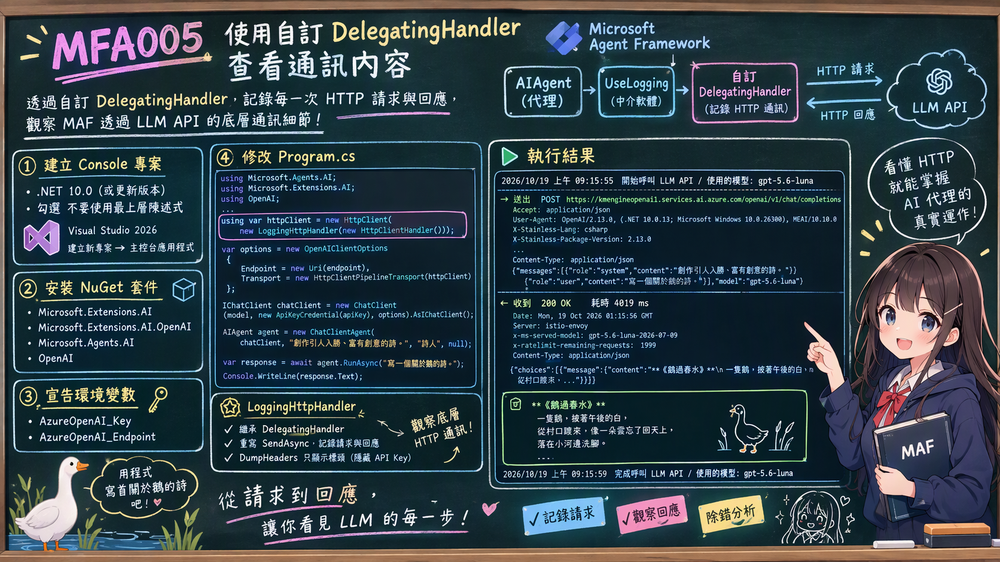

# MFA005 使用自訂 DelegatingHandler 查看通訊內容

在上一篇關於 Microsoft Agent Framework 系列教學文章 "MFA004 使用 UseLogging 將 MAF 掛上日誌能力並且查看日誌內容" 中，我們學會了如何使用 UseLogging 中介軟體，將每一次對 LLM API 的請求與回應詳細記錄下來，方便後續的追蹤與分析。而在 MAF 內的 UseLogging 是一個中介軟體，在 MAF 內的中介軟體管線中扮演著記錄請求與回應的角色。這裡列出更多關於中介軟體的應用例如，記錄 Agent 執行時間、輸入輸出、工具呼叫及錯誤，這樣的應用可以用於追蹤 AI 客服處理過哪些問題、呼叫哪些工具以及發生了哪些錯誤。又如API 逾時、429、暫時性服務錯誤時執行重試或降級，這樣情境可以用於Azure OpenAI 暫時失敗時，依政策重試或切換備援模型。



透過 MAF 的中介軟體機制，就可以設計出各種自訂的中介軟體。在這裡可以自訂一個 DelegatingHandler，將每一次的 HTTP 請求與回應內容記錄下來，從而觀察底層的通訊細節。

在這裡的範例中將要透過 HTTP 通訊內容，觀察 MAF 是如何使用 LLM API，在實際底層運作的過程中，發送了哪些請求以及接收到哪些回應。

接下來看看如何做到這樣的效果。


# 建立 Console 專案
* 開啟 Visual Studio 2026
* 選擇「建立新專案」
* 在 [建立新的專案] 視窗中，在右方清單內，找到並選擇「主控台應用程式」 項目
* 然後點擊右下方「下一步」按鈕
* 此時將會看到 [設定新的專案] 對話窗
* 在該對話窗的 [專案名稱] 欄位中，輸入專案名稱，例如 "csHttpHandlerAgent"
* 然後點擊右下方「下一步」按鈕
* 接著會看到 [其他資訊] 對話窗
* 在這個對話窗內，確認使用底下的選項
    * 架構：.NET 10.0 (或更新版本)
    * 勾選 不要使用最上層陳述式 (這是我的個人習慣)
* 然後點擊右下方「建立」按鈕
* 現在，已經完成了這個 Console 主控台 專案的建立

## 安裝需要用到的 NuGet 套件

要完成這個第一次接觸 Microsoft Agent Framework 練習專案，需要安裝以下幾個 NuGet 套件：

### Microsoft.Extensions.AI

這個套件將會為生成式 AI 定義的一層「統一抽象介面 + Middleware 管線」，讓開發者可以更方便地整合不同的生成式 AI 模型，並且在應用程式中使用一致的方式進行呼叫與管理。

* 滑鼠右擊 [csHttpHandlerAgent] 專案節點
* 點選彈出功能表的 [管理 NuGet 套件] 項
* 在 [瀏覽] 索引標籤中，搜尋並且安裝底下的 NuGet 套件
    * Microsoft.Extensions.AI
    
### Microsoft.Extensions.AI.OpenAI

這個套件是微軟官方為 .NET 整合 AI 服務所提供的擴充套件。它實現了 IChatClient 與 IEmbeddingGenerator 核心抽象介面，讓開發人員能以一致的程式碼，輕鬆串接 OpenAI 或相容的 API 端點（例如 Azure OpenAI、GitHub Models 等）。

* 滑鼠右擊 [csHttpHandlerAgent] 專案節點
* 點選彈出功能表的 [管理 NuGet 套件] 項
* 在 [瀏覽] 索引標籤中，搜尋並且安裝底下的 NuGet 套件
    * Microsoft.Extensions.AI.OpenAI
    
### Microsoft.Agents.AI

這個套件是微軟官方推出 Microsoft Agent Framework（微軟智慧代理框架）的核心 .NET 套件。它主要用於在 .NET 環境中建構、協調與部署 AI 代理（AI Agents） 及多代理工作流（Multi-agent workflows），是用來取代舊版 AutoGen 的企業級解決方案。

* 滑鼠右擊 [csHttpHandlerAgent] 專案節點
* 點選彈出功能表的 [管理 NuGet 套件] 項
* 在 [瀏覽] 索引標籤中，搜尋並且安裝底下的 NuGet 套件
    * Microsoft.Agents.AI
     
### OpenAI

這個套件為官方的 OpenAI .NET 客戶端類別庫，是 OpenAI NuGet 套件。此套件由 OpenAI 與 Microsoft 合作開發，提供直接存取 OpenAI 官方 REST API 的便利管道。

* 滑鼠右擊 [csHttpHandlerAgent] 專案節點
* 點選彈出功能表的 [管理 NuGet 套件] 項
* 在 [瀏覽] 索引標籤中，搜尋並且安裝底下的 NuGet 套件
    * OpenAI

# 宣告 API 端點與 Key 環境變數

關於這個小節的內容，將會在這個系列每篇文章中都會用到，因此，可以參考 [MFA001 Microsoft Agent Framework 初次體驗開發出 AI 代理](https://csharpkh.blogspot.com/2026/10/mfa001-microsoft-agent-framework-ai.html) 文章中的 [宣告 API 端點與 Key 環境變數] 說明內容，若這裡提到的環境變數已經建立好了，則可以跳過這個小節內容。

# 修改 Program.cs 程式碼

為了要完成這個需求 : 如何用 Azure OpenAI 的 gpt-5.6-luna 聊天模型建立一個簡單 AI 代理，並產生一篇與鵝有關的詩。
因此，我們需要修改 Program.cs 程式碼，這時需要完成底下的操作。

* 在專案內，找到並且開啟 [Program.cs] 檔案
* 使用底下程式碼內容來取代 [Program.cs] 檔案的內容

```csharp
using Microsoft.Agents.AI;
using Microsoft.Extensions.AI;
using OpenAI;
using OpenAI.Chat;
using System.ClientModel;
using System.ClientModel.Primitives;
using System.Diagnostics;
using System.Net.Http.Headers;
using System.Text;

namespace csHttpHandlerAgent;

internal class Program
{
    static async Task Main(string[] args)
    {
        Console.OutputEncoding = Encoding.UTF8;

        var apiKey = Environment.GetEnvironmentVariable("AzureOpenAI_Key");
        var endpoint = Environment.GetEnvironmentVariable("AzureOpenAI_Endpoint");
        var model = "gpt-5.6-luna";

        if (string.IsNullOrWhiteSpace(apiKey) || string.IsNullOrWhiteSpace(endpoint))
        {
            Console.WriteLine("請先設定環境變數 AzureOpenAI_Key 與 AzureOpenAI_Endpoint 後再執行。");
            return;
        }

        using var httpClient = new HttpClient(new LoggingHttpHandler(new HttpClientHandler()));

        var options = new OpenAIClientOptions
        {
            Endpoint = new Uri(endpoint),
            Transport = new HttpClientPipelineTransport(httpClient)
        };

        IChatClient chatClient =
            new ChatClient(
                    model,
                    new ApiKeyCredential(apiKey),
                    options)
                .AsIChatClient();

        AIAgent agent = new ChatClientAgent(
            chatClient,                      // 聊天用戶端
            "創作引人入勝、富有創意的詩。",  // 系統提示詞 instructions
            "詩人",                          // 代理名稱   name
            null);                           // 代理描述   description

        Console.WriteLine($"{DateTime.Now} 開始呼叫 LLM API / 使用的模型: {model}");

        var response = await agent.RunAsync("寫一個關於鵝的詩。");

        Console.WriteLine();
        Console.WriteLine(response.Text);
        Console.WriteLine($"{DateTime.Now} 完成呼叫 LLM API / 使用的模型: {model}");
    }
}

internal sealed class LoggingHttpHandler : DelegatingHandler
{
    private static readonly string[] SecretHeaders =
        ["api-key", "Authorization", "OpenAI-Organization", "OpenAI-Project"];

    public LoggingHttpHandler(HttpMessageHandler innerHandler) : base(innerHandler)
    {
    }

    protected override async Task<HttpResponseMessage> SendAsync(
        HttpRequestMessage request, CancellationToken cancellationToken)
    {
        Console.WriteLine();
        Console.WriteLine(new string('─', 74));
        Console.WriteLine($"→ 送出  {request.Method} {request.RequestUri}");
        DumpHeaders(request.Headers);

        if (request.Content is not null)
        {
            DumpHeaders(request.Content.Headers);
            Console.WriteLine($"  {await request.Content.ReadAsStringAsync(cancellationToken)}");
        }

        var stopwatch = Stopwatch.StartNew();
        var response = await base.SendAsync(request, cancellationToken);
        stopwatch.Stop();

        Console.WriteLine();
        Console.WriteLine($"← 收到  {(int)response.StatusCode} {response.ReasonPhrase}   耗時 {stopwatch.ElapsedMilliseconds} ms");
        DumpHeaders(response.Headers);
        DumpHeaders(response.Content.Headers);

        await response.Content.LoadIntoBufferAsync(cancellationToken);
        Console.WriteLine($"  {await response.Content.ReadAsStringAsync(cancellationToken)}");
        Console.WriteLine(new string('─', 74));

        return response;
    }

    private static void DumpHeaders(HttpHeaders headers)
    {
        foreach (var header in headers)
        {
            var value = SecretHeaders.Contains(header.Key, StringComparer.OrdinalIgnoreCase)
                ? "***"
                : string.Join(", ", header.Value);

            Console.WriteLine($"  {header.Key}: {value}");
        }
    }
}
```

這個程式一開始將會讀取 API Key 與服務端點的數據，接著如同前面的範例相同，先建立一個 IChatClient 物件，接者建立一個 AIAgent 物件，並使用它來與模型進行互動。不過，由於這裡希望能夠觀察底層的 HTTP 通訊內容，所以，使用這個 `using var httpClient = new HttpClient(new LoggingHttpHandler(new HttpClientHandler()));` 來建立 HttpClient物件，在建構函式內將其傳入 OpenAIClientOptions 的 Transport 屬性，這樣所有的 HTTP 請求都會經過 LoggingHttpHandler，從而記錄下請求與回應的內容，將會傳入一個 LoggingHttpHandler，而這個類別的建構式將會接收到一個 HttpClientHandler 作為內部處理器。

對於這個 LoggingHttpHandler 類別，它繼承自 DelegatingHandler，並且重寫了 SendAsync 方法，在每一次的 HTTP 請求發送前與回應接收後，分別記錄下請求與回應的內容，從而實現對底層通訊的監控。所謂的 SendAsync 將會在每一次 HTTP 請求被發送時被呼叫，並且會在收到回應後才完成，這使得我們能夠在請求與回應的整個過程中插入自訂的日誌邏輯。在這裡複寫了 SendAsync 方法，在這裡會使用 DumpHeaders 方法來列印請求與回應的標頭。

之後將會呼叫 `await base.SendAsync(request, cancellationToken);` 這行程式碼會將 HTTP 請求傳遞給內部的處理器（在這裡是 HttpClientHandler），並等待回應。當接收到 SendAsync 的回應後，才會繼續執行後續的程式碼，這使得我們能夠在請求發送前與回應接收後，分別記錄下相關的日誌資訊。在前面呼叫 DumpHeaders 方法時候，使用了 request.Headers 來記錄下請求的標頭，當 SendAsync 處理完成後，將會呼叫 DumpHeaders 方法，並且將 response.Headers 與 response.Content.Headers 傳入，以記錄回應的標頭。這樣一來，我們就能夠完整地觀察到整個 HTTP 通訊的過程，包括請求與回應的標頭與內容。

而對於 `await response.Content.LoadIntoBufferAsync(cancellationToken);` 這行程式碼，它會將回應的內容讀取到緩衝區中，確保後續對 `response.Content.ReadAsStringAsync(cancellationToken)` 的呼叫不會因為內容已經被讀取而失敗。這樣一來，我們就能夠安全地多次讀取回應的內容，並將其輸出到日誌中。

上面說明了要建立 HttpClient 物件的準備與建置工作，一旦取得 HttpClient 物件之後，接下來將會建立一個 OpenAIClientOptions 物件，並將剛剛建立的 HttpClient 傳入其 Transport 屬性，這樣所有的 HTTP 請求都會經過 LoggingHttpHandler，從而實現對底層通訊的監控。對於 OpenAIClientOptions.Transport 屬性，它接受一個 HttpPipelineTransport 物件，這個物件封裝了我們自訂的 HttpClient，確保所有的請求都會經過我們的 LoggingHttpHandler。

現在已經有了 OpenAIClientOptions 物件，接下來就可以使用它來建立 ChatClient，並將其轉換為 IChatClient 介面，從而開始與模型進行互動。在這裡會將 OpenAIClientOptions 傳入 ChatClient 的建構函式，確保所有的 HTTP 請求都會經過我們自訂的 LoggingHttpHandler。從底下的程式碼，可以看到 options 這個變數就是一個 OpenAIClientOptions 物件，並且已經包含了我們自訂的 HttpClient。

```csharp
IChatClient chatClient =
    new ChatClient(
            model,
            new ApiKeyCredential(apiKey),
            options)
        .AsIChatClient();
```

接下來如何 MAF 框架的基本操作一般，建立一個 AIAgent 物件，並使用它來與模型進行互動。這裡會將剛剛建立的 IChatClient 物件傳入 AIAgent 的建構函式，確保所有的互動都會通過我們自訂的 LoggingHttpHandler，從而能夠觀察到底層的 HTTP 通訊內容。對於這個 AIAgent 物件，還是使用他來寫詩，當使用 `agent.RunAsync` 方法時，使用的提示詞為 寫一個關於鵝的詩。 這樣一來，我們就能夠在日誌中看到整個 HTTP 請求與回應的過程，從而更好地理解模型與 API 之間的通訊細節。

# 執行結果

現在來看看這個範例程式碼的執行結果。

* 在 Visual Studio 2026 下，按下 F5 鍵執行程式，將會看到程式輸出的結果。

```plaintext
2026/10/19 上午 09:15:55 開始呼叫 LLM API / 使用的模型: gpt-5.6-luna

──────────────────────────────────────────────────────────────────────────
→ 送出  POST https://kmengineopenai1.services.ai.azure.com/openai/v1/chat/completions
  Accept: application/json
  User-Agent: OpenAI/2.13.0, (.NET 10.0.13; Microsoft Windows 10.0.26300), MEAI/10.10.0
  X-Stainless-Lang: csharp
  X-Stainless-Package-Version: 2.13.0
  X-Stainless-Runtime: dotnet
  X-Stainless-Runtime-Version: 10.0.13
  X-Stainless-OS: Windows
  X-Stainless-Arch: x64
  Authorization: ***
  Content-Type: application/json
  {"messages":[{"role":"system","content":"創作引人入勝、富有創意的詩。"},{"role":"user","content":"寫一個關於鵝的詩。"}],"model":"gpt-5.6-luna"}

← 收到  200 OK   耗時 4019 ms
  Date: Mon, 19 Oct 2026 01:15:56 GMT
  Server: istio-envoy
  Vary: Origin
  azureai-fe-is-streaming: False
  azureai-fe-offer-type: paygo
  azureml-model-session: d20261019001926-86bfbd7d
  skip-error-remapping: true
  x-accel-buffering: no
  x-ms-is-spilled-over: false
  x-ms-rai-invoked: true
  x-ms-served-model: gpt-5.6-luna-2026-07-09
  x-ratelimit-abusepenalty-active: False
  x-ratelimit-key: gpt-5.6-luna
  x-ratelimit-limit-requests: 2000
  x-ratelimit-limit-tokens: 2000000
  x-ratelimit-remaining-requests: 1999
  x-ratelimit-remaining-tokens: 1999963
  x-ratelimit-renewalperiod-requests: 60
  x-ratelimit-renewalperiod-tokens: 60
  x-ratelimit-reset-requests: 0
  x-ratelimit-reset-tokens: 0
  X-Request-ID: 6b557577-f154-4d63-bfba-3d17131cc8ad
  apim-request-id: c375c211-5950-4b71-ad35-c27279f45f4c
  x-http2-stream-id: 659
  Strict-Transport-Security: max-age=31536000; includeSubDomains; preload
  x-ms-client-request-id: Not-Set
  X-Content-Type-Options: nosniff
  x-ms-region: East US 2
  Content-Length: 2171
  Content-Type: application/json
  {"choices":[{"content_filter_results":{"hate":{"filtered":false,"severity":"safe"},"protected_material_code":{"detected":false,"filtered":false},"protected_material_text":{"detected":false,"filtered":false},"self_harm":{"filtered":false,"severity":"safe"},"sexual":{"filtered":false,"severity":"safe"},"violence":{"filtered":false,"severity":"safe"}},"finish_reason":"stop","index":0,"logprobs":null,"message":{"annotations":[],"content":"**《鵝過春水》**\n\n一隻鵝，披著午後的白，  \n從村口踱來，  \n像一朵雲忘了回天上，  \n落在小河邊洗腳。\n\n它伸長脖子，  \n向夕陽索要一枚金幣；  \n夕陽沒有回答，  \n只把滿河的碎光  \n塞進它搖晃的羽毛。\n\n「嘎——」  \n一聲，驚醒蘆葦深處的風，  \n也驚醒遠山沉睡的鐘。  \n水面於是開出一圈圈藍，  \n像有人把春天  \n輕輕推向更遠的地方。\n\n夜來時，鵝回到籬笆旁，  \n月亮跟在它身後，  \n學著它昂首、踱步，  \n學著用一聲清亮的叫喊，  \n守住人間  \n最後一盞燈。","refusal":null,"role":"assistant"}}],"created":1792372557,"id":"chatcmpl-EaWGjQ76SJGQltByY5aJwUvskmoQb","model":"gpt-5.6-luna-2026-07-09","object":"chat.completion","prompt_filter_results":[{"prompt_index":0,"content_filter_results":{"hate":{"filtered":false,"severity":"safe"},"jailbreak":{"detected":false,"filtered":false},"self_harm":{"filtered":false,"severity":"safe"},"sexual":{"filtered":false,"severity":"safe"},"violence":{"filtered":false,"severity":"safe"}}}],"routing":{"serving_pipereplica":"d20261019001926-86bfbd7d-prefill-r12-dp0-prefill"},"service_tier":"default","system_fingerprint":null,"usage":{"completion_tokens":253,"completion_tokens_details":{"accepted_prediction_tokens":0,"audio_tokens":0,"reasoning_tokens":22,"rejected_prediction_tokens":0},"latency_checkpoint":{"engine_tbt_ms":7,"engine_ttft_ms":70,"engine_ttlt_ms":1876,"pre_inference_ms":134,"service_tbt_ms":7,"service_ttft_ms":367,"service_ttlt_ms":2191,"user_visible_ttft_ms":233},"prompt_tokens":37,"prompt_tokens_details":{"audio_tokens":0,"cache_write_tokens":0,"cached_tokens":0},"total_tokens":290}}

──────────────────────────────────────────────────────────────────────────

**《鵝過春水》**

一隻鵝，披著午後的白，
從村口踱來，
像一朵雲忘了回天上，
落在小河邊洗腳。

它伸長脖子，
向夕陽索要一枚金幣；
夕陽沒有回答，
只把滿河的碎光
塞進它搖晃的羽毛。

「嘎——」
一聲，驚醒蘆葦深處的風，
也驚醒遠山沉睡的鐘。
水面於是開出一圈圈藍，
像有人把春天
輕輕推向更遠的地方。

夜來時，鵝回到籬笆旁，
月亮跟在它身後，
學著它昂首、踱步，
學著用一聲清亮的叫喊，
守住人間
最後一盞燈。
2026/10/19 上午 09:15:59 完成呼叫 LLM API / 使用的模型: gpt-5.6-luna
```

從這裡的執行結果，可以看到 "→ 送出  POST https://kmengineopenai1.services.ai.azure.com/openai/v1/chat/completions" 的請求，在控制台中，底下將會看到完整的請求內容。在前半部，將會看到 Header 的內容，不過，由於 API Key 將會放在 Authorization Header 中，送到後端的 LLM 模型中，為了避免外洩，因此不會在這裡顯示。緊接著就是 Request Body 的內容，也就是實際送到後端的資料。

```plaintext
{"messages":[{"role":"system","content":"創作引人入勝、富有創意的詩。"},{"role":"user","content":"寫一個關於鵝的詩。"}],"model":"gpt-5.6-luna"}
```

從這裡的請求內容可以看到，這裡先使用了 system 角色，指定了系統提示詞 "創作引人入勝、富有創意的詩。"，接著使用 user 角色，指定了使用者的輸入 "寫一個關於鵝的詩。"。這樣的設計可以讓模型知道系統的整體指引，並根據使用者的需求生成對應的內容。最後，指定使用了 gpt-5.6-luna 這個模型 來生成內容。

將下來將會看到 "← 收到  200 OK   耗時 4019 ms" 的回應，在控制台中，底下將會看到完整的回應內容。這裡會包含 Header 的資訊，以及實際的 Response Body，也就是模型生成的內容。

```plaintext
{"choices":[{"content_filter_results":{"hate":{"filtered":false,"severity":"safe"},"protected_material_code":{"detected":false,"filtered":false},"protected_material_text":{"detected":false,"filtered":false},"self_harm":{"filtered":false,"severity":"safe"},"sexual":{"filtered":false,"severity":"safe"},"violence":{"filtered":false,"severity":"safe"}},"finish_reason":"stop","index":0,"logprobs":null,"message":{"annotations":[],"content":"**《鵝過春水》**\n\n一隻鵝，披著午後的白，  \n從村口踱來，  \n像一朵雲忘了回天上，  \n落在小河邊洗腳。\n\n它伸長脖子，  \n向夕陽索要一枚金幣；  \n夕陽沒有回答，  \n只把滿河的碎光  \n塞進它搖晃的羽毛。\n\n「嘎——」  \n一聲，驚醒蘆葦深處的風，  \n也驚醒遠山沉睡的鐘。  \n水面於是開出一圈圈藍，  \n像有人把春天  \n輕輕推向更遠的地方。\n\n夜來時，鵝回到籬笆旁，  \n月亮跟在它身後，  \n學著它昂首、踱步，  \n學著用一聲清亮的叫喊，  \n守住人間  \n最後一盞燈。","refusal":null,"role":"assistant"}}],"created":1792372557,"id":"chatcmpl-EaWGjQ76SJGQltByY5aJwUvskmoQb","model":"gpt-5.6-luna-2026-07-09","object":"chat.completion","prompt_filter_results":[{"prompt_index":0,"content_filter_results":{"hate":{"filtered":false,"severity":"safe"},"jailbreak":{"detected":false,"filtered":false},"self_harm":{"filtered":false,"severity":"safe"},"sexual":{"filtered":false,"severity":"safe"},"violence":{"filtered":false,"severity":"safe"}}}],"routing":{"serving_pipereplica":"d20261019001926-86bfbd7d-prefill-r12-dp0-prefill"},"service_tier":"default","system_fingerprint":null,"usage":{"completion_tokens":253,"completion_tokens_details":{"accepted_prediction_tokens":0,"audio_tokens":0,"reasoning_tokens":22,"rejected_prediction_tokens":0},"latency_checkpoint":{"engine_tbt_ms":7,"engine_ttft_ms":70,"engine_ttlt_ms":1876,"pre_inference_ms":134,"service_tbt_ms":7,"service_ttft_ms":367,"service_ttlt_ms":2191,"user_visible_ttft_ms":233},"prompt_tokens":37,"prompt_tokens_details":{"audio_tokens":0,"cache_write_tokens":0,"cached_tokens":0},"total_tokens":290}}
```

在 response 回應內容中，可以看到模型生成的詩文，包含了完整的詩句與格式。這裡的 content 欄位即為模型生成的內容，而其他欄位則包含了回應的元資料，例如 content_filter_results 用來表示內容是否符合安全規範，finish_reason 表示生成的結束原因，role 表示回應的角色等。

透過這樣的方式，我們可以完整地觀察到與 LLM 模型之間的通訊內容，無論是送出的請求還是收到的回應，都能在控制台中清楚地呈現，方便進行除錯與分析。

