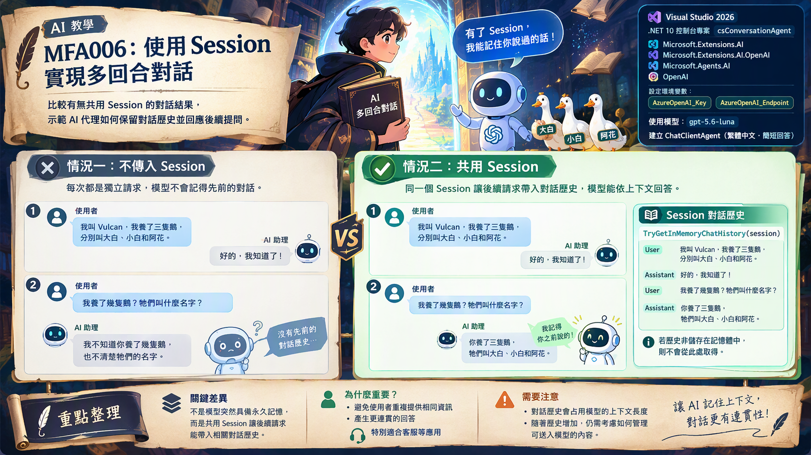

# MFA006 多回合對話

在上一篇關於 Microsoft Agent Framework 系列教學文章 "MFA005 使用自訂 DelegatingHandler 查看通訊內容" 中，我們學會了如何使用自訂的 DelegatingHandler 來記錄每一次 HTTP 請求與回應的內容，從而觀察底層的通訊細節。在這篇 MAF 教學文章中，我們將學習如何在多回合對話中，讓 AI 代理記住之前的對話內容，從而實現更自然的對話體驗。為什麼需要說明多回合對話呢？這是因為在大語言模型的原始設計架構中，就是為了單一回合對話而設計的，當使用者送入一份提示詞之後，模型只會根據這一次的輸入生成回應，而不會記住之前的對話內容。這樣的設計雖然簡單，但在實際應用中，往往需要 AI 代理能夠記住對話歷史，從而提供更連貫的回應。

在真實環境應用中，這些系統是需要能夠記憶住之前對話的內容，如此便可以降低幻覺產生更大的機率，舉的例子來說，在一個使用AI為基礎的客服系統中，如果代理能夠記住使用者之前的問題與回應，那麼在後續的對話中，代理就能提供更精準的建議與解答，而不會因為每次都是單一回合對話而遺忘之前的上下文。若是系統忘記了之前對話的內容，將會造成使用者需要重複提供相同的資訊，降低使用者體驗，並可能導致錯誤的建議或解答。不過，若要記住之前所有的詢問與回答內容，將會面臨到記憶空間的問題，對於大語言模型而言，這是一個需要平衡的挑戰。在大語言模型中，每一輪對話將會受限於大語言模型的上下文長度（context length），也就是模型在生成回應時，能夠考慮的歷史對話內容的最大範圍。當對話歷史超過這個限制時，模型將無法記住更早的對話內容，因此在設計多回合對話系統時，需要考慮如何有效管理和利用對話歷史。



有了這樣的背景說明之後，在這個練習專案內，將會示範如何建立一個能夠記住多回合對話歷史的 AI 代理，從而實現更自然的對話體驗。這裡將會進行兩輪的對話，第一個使用沒有多回合記憶的 AI 代理，第二個使用具備多回合記憶的 AI 代理，從而比較兩者在對話連貫性上的差異。

接下來看看如何做到這樣的效果。


# 建立 Console 專案
* 開啟 Visual Studio 2026
* 選擇「建立新專案」
* 在 [建立新的專案] 視窗中，在右方清單內，找到並選擇「主控台應用程式」 項目
* 然後點擊右下方「下一步」按鈕
* 此時將會看到 [設定新的專案] 對話窗
* 在該對話窗的 [專案名稱] 欄位中，輸入專案名稱，例如 "csConversationAgent"
* 然後點擊右下方「下一步」按鈕
* 接著會看到 [其他資訊] 對話窗
* 在這個對話窗內，確認使用底下的選項
    * 架構：.NET 10.0 (或更新版本)
    * 勾選 不要使用最上層陳述式 (這是我的個人習慣)
* 然後點擊右下方「建立」按鈕
* 現在，已經完成了這個 Console 主控台 專案的建立

## 安裝需要用到的 NuGet 套件

要完成這個第一次接觸 Microsoft Agent Framework 練習專案，需要安裝以下幾個 NuGet 套件：

### Microsoft.Extensions.AI

這個套件將會為生成式 AI 定義的一層「統一抽象介面 + Middleware 管線」，讓開發者可以更方便地整合不同的生成式 AI 模型，並且在應用程式中使用一致的方式進行呼叫與管理。

* 滑鼠右擊 [csConversationAgent] 專案節點
* 點選彈出功能表的 [管理 NuGet 套件] 項
* 在 [瀏覽] 索引標籤中，搜尋並且安裝底下的 NuGet 套件
    * Microsoft.Extensions.AI
    
### Microsoft.Extensions.AI.OpenAI

這個套件是微軟官方為 .NET 整合 AI 服務所提供的擴充套件。它實現了 IChatClient 與 IEmbeddingGenerator 核心抽象介面，讓開發人員能以一致的程式碼，輕鬆串接 OpenAI 或相容的 API 端點（例如 Azure OpenAI、GitHub Models 等）。

* 滑鼠右擊 [csConversationAgent] 專案節點
* 點選彈出功能表的 [管理 NuGet 套件] 項
* 在 [瀏覽] 索引標籤中，搜尋並且安裝底下的 NuGet 套件
    * Microsoft.Extensions.AI.OpenAI
    
### Microsoft.Agents.AI

這個套件是微軟官方推出 Microsoft Agent Framework（微軟智慧代理框架）的核心 .NET 套件。它主要用於在 .NET 環境中建構、協調與部署 AI 代理（AI Agents） 及多代理工作流（Multi-agent workflows），是用來取代舊版 AutoGen 的企業級解決方案。

* 滑鼠右擊 [csConversationAgent] 專案節點
* 點選彈出功能表的 [管理 NuGet 套件] 項
* 在 [瀏覽] 索引標籤中，搜尋並且安裝底下的 NuGet 套件
    * Microsoft.Agents.AI
     
### OpenAI

這個套件為官方的 OpenAI .NET 客戶端類別庫，是 OpenAI NuGet 套件。此套件由 OpenAI 與 Microsoft 合作開發，提供直接存取 OpenAI 官方 REST API 的便利管道。

* 滑鼠右擊 [csConversationAgent] 專案節點
* 點選彈出功能表的 [管理 NuGet 套件] 項
* 在 [瀏覽] 索引標籤中，搜尋並且安裝底下的 NuGet 套件
    * OpenAI

# 宣告 API 端點與 Key 環境變數

關於這個小節的內容，將會在這個系列每篇文章中都會用到，因此，可以參考 [MFA001 Microsoft Agent Framework 初次體驗開發出 AI 代理](https://csharpkh.blogspot.com/2026/10/mfa001-microsoft-agent-framework-ai.html) 文章中的 [宣告 API 端點與 Key 環境變數] 說明內容，若這裡提到的環境變數已經建立好了，則可以跳過這個小節內容。

# 修改 Program.cs 程式碼

為了要完成這個需求 : 如何用 Azure OpenAI 的 gpt-5.6-luna 聊天模型建立一個簡單 AI 代理，並產生一篇與鵝有關的詩。
因此，我們需要修改 Program.cs 程式碼，這時需要完成底下的操作。

* 在專案內，找到並且開啟 [Program.cs] 檔案
* 使用底下程式碼內容來取代 [Program.cs] 檔案的內容

```csharp
using Microsoft.Agents.AI;
using Microsoft.Extensions.AI;
using OpenAI;
using OpenAI.Chat;
using System.ClientModel;
using System.Text;

namespace csConversationAgent;

internal class Program
{
    private const string Turn1 = "我叫 Vulcan，我養了三隻鵝，分別叫大白、小白和阿花。";
    private const string Turn2 = "我養了幾隻鵝？牠們叫什麼名字？";

    static async Task Main(string[] args)
    {
        Console.OutputEncoding = Encoding.UTF8;

        var apiKey = Environment.GetEnvironmentVariable("AzureOpenAI_Key");
        var endpoint = Environment.GetEnvironmentVariable("AzureOpenAI_Endpoint");
        var model = "gpt-5.6-luna";

        if (string.IsNullOrWhiteSpace(apiKey) || string.IsNullOrWhiteSpace(endpoint))
        {
            Console.WriteLine("請先設定環境變數 AzureOpenAI_Key 與 AzureOpenAI_Endpoint 後再執行。");
            return;
        }

        IChatClient chatClient =
            new ChatClient(
                    model,
                    new ApiKeyCredential(apiKey),
                    new OpenAIClientOptions { Endpoint = new Uri(endpoint) })
                .AsIChatClient();

        AIAgent agent = new ChatClientAgent(
            chatClient,                                    // 聊天用戶端
            "你是一位友善的助理，請用繁體中文簡短回答。",  // 系統提示詞 instructions
            "助理",                                        // 代理名稱   name
            null);                                         // 代理描述   description

        Console.WriteLine($"{DateTime.Now} 使用的模型: {model}");

        await RunWithoutSessionAsync(agent);   // 對照組：會失憶
        await RunWithSessionAsync(agent);      // 正解：記得
    }

    // ────────────────────────────────────────────────────────────────
    // 執行 1：不傳 session —— 代理會失憶
    // ────────────────────────────────────────────────────────────────
    private static async Task RunWithoutSessionAsync(AIAgent agent)
    {
        Header("執行 1 / 不傳 session —— 代理會失憶");

        Say("你", Turn1);
        var answer1 = await agent.RunAsync(Turn1);
        Say("助理", answer1.Text);

        Say("你", Turn2);
        var answer2 = await agent.RunAsync(Turn2);
        Say("助理", answer2.Text);
    }

    // ────────────────────────────────────────────────────────────────
    // 執行 2：兩輪共用同一個 session —— 代理記得
    // ────────────────────────────────────────────────────────────────
    private static async Task RunWithSessionAsync(AIAgent agent)
    {
        Header("執行 2 / 共用同一個 session —— 代理記得");

        var session = await agent.CreateSessionAsync();

        Say("你", Turn1);
        var answer1 = await agent.RunAsync(Turn1, session);
        Say("助理", answer1.Text);

        Say("你", Turn2);
        var answer2 = await agent.RunAsync(Turn2, session);
        Say("助理", answer2.Text);

        Console.WriteLine();
        Console.WriteLine("【session 裡實際存放的對話歷史】");

        if (session.TryGetInMemoryChatHistory(out var history) && history is not null)
        {
            foreach (var message in history)
            {
                Say(message.Role.ToString(), message.Text);
            }
        }
        else
        {
            Console.WriteLine("  這個 session 沒有把歷史存在記憶體（例如改由服務端保存時）。");
        }
    }

    private static void Header(string title)
    {
        Console.WriteLine();
        Console.WriteLine(new string('=', 74));
        Console.WriteLine($"  {title}");
        Console.WriteLine(new string('=', 74));
    }

    private static void Say(string who, string? text)
    {
        Console.WriteLine();
        Console.WriteLine($"  {who} ▸ {text}");
    }
}
```

這個程式一開始將會讀取 API Key 與服務端點的數據，接著如同前面的範例相同，先建立一個 IChatClient 物件，接者建立一個 AIAgent 物件，並使用它來與模型進行互動。在建立 AIAgent 物件時，使用的系統提示詞為 "你是一位友善的助理，請用繁體中文簡短回答。"

首先將會來體驗沒有記憶的多回合對話，這裡將會呼叫 `await RunWithoutSessionAsync(agent);` 來執行第一輪對話，觀察代理在沒有 session 的情況下是否能記住之前的對話內容。

在這個 RunWithoutSessionAsync 方法內，使用不同的提示詞，呼叫了兩次 RunAsync 方法來與代理互動，但由於沒有傳入 session，因此代理不會記住之前的對話內容，每次都是獨立的回合。

```csharp
Say("你", Turn1);
var answer1 = await agent.RunAsync(Turn1);
Say("助理", answer1.Text);

Say("你", Turn2);
var answer2 = await agent.RunAsync(Turn2);
Say("助理", answer2.Text);
```

由於 LLM 產生的結果是隨機的，因此，底下為可能的輸出範例，實際結果可能會有所不同。

```plaintext
==========================================================================
  執行 1 / 不傳 session —— 代理會失憶
==========================================================================

  你 ▸ 我叫 Vulcan，我養了三隻鵝，分別叫大白、小白和阿花。

  助理 ▸ 你好，Vulcan！你養了三隻鵝，分別是大白、小白和阿花，真可愛！

  你 ▸ 我養了幾隻鵝？牠們叫什麼名字？

  助理 ▸ 我目前不知道你養了幾隻鵝，也不知道牠們的名字。
```

從這裡的可以看到，在第一輪對話中，使用者說明自己的名字與養的三隻鵝的名字，但由於代理沒有記憶，因此在第二個回合中 這裡送出提示詞 "我養了幾隻鵝？牠們叫什麼名字？"，代理無法回答使用者的問題，這裡看到LLM回答的是 "我目前不知道你養了幾隻鵝，也不知道牠們的名字。" ，一般人看到這樣結果，都會覺得 AI 患了失憶症。開始在胡說八道。

接著，將會呼叫 `await RunWithSessionAsync(agent);` 來執行第二輪對話，在這個方法一開始，將會透過 `var session = await agent.CreateSessionAsync();` 程式碼建立一個 session，之後的每一次與代理的互動都會傳入這個 session，從而讓代理能夠記住之前的對話歷史。接著將剛剛 RunWithoutSessionAsync 方法內同樣的呼叫 AIAgent 物件的方法，都在執行一次，但這次會傳入 session，這樣可以看看會有甚麼變化，這裡用的程式碼如下:

```csharp
Say("你", Turn1);
var answer1 = await agent.RunAsync(Turn1, session);
Say("助理", answer1.Text);

Say("你", Turn2);
var answer2 = await agent.RunAsync(Turn2, session);
Say("助理", answer2.Text);
```

底下為執行結果範例

```plaintext
==========================================================================
  執行 2 / 共用同一個 session —— 代理記得
==========================================================================

  你 ▸ 我叫 Vulcan，我養了三隻鵝，分別叫大白、小白和阿花。

  助理 ▸ 你好，Vulcan！大白、小白和阿花，三隻鵝的名字都很可愛呢。

  你 ▸ 我養了幾隻鵝？牠們叫什麼名字？

  助理 ▸ 你養了三隻鵝，牠們叫大白、小白和阿花。

【session 裡實際存放的對話歷史】

  user ▸ 我叫 Vulcan，我養了三隻鵝，分別叫大白、小白和阿花。

  assistant ▸ 你好，Vulcan！大白、小白和阿花，三隻鵝的名字都很可愛呢。

  user ▸ 我養了幾隻鵝？牠們叫什麼名字？

  assistant ▸ 你養了三隻鵝，牠們叫大白、小白和阿花。
```

在這個文字 "【session 裡實際存放的對話歷史" 之前，可以看到這兩輪對話，AI是有記住之前的對話內容的，因此能夠在第二個回合中正確回答使用者的問題。他回答的是 : "你養了三隻鵝，牠們叫大白、小白和阿花。" 這樣回答的結果是正確的，這也說明了在共用同一個 session 的情況下，代理能夠保持對話的連貫性。

在這個文字 "【session 裡實際存放的對話歷史】" 之後，可以看到代理是如何將使用者與助理的對話歷史存放在 session 中的。這也說明了在共用同一個 session 的情況下，代理能夠保持對話的連貫性。

其實，在這個程式碼的背後運作方式為，在第二輪對話的時候，AIAgent 不只送出 "我養了幾隻鵝？牠們叫什麼名字？" 這個提示詞，還會將整個 session 中的對話歷史一併送出給 LLM，這樣 LLM 才能根據之前的對話內容，給出連貫且正確的回應。


