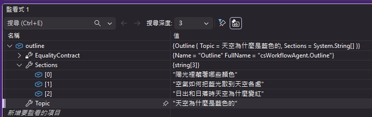
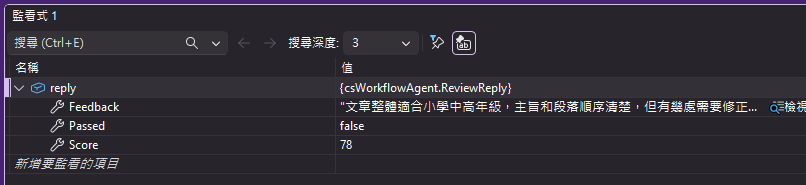
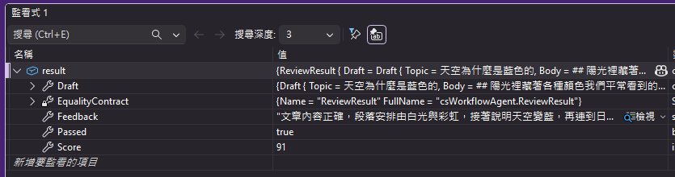

# MFA007 用 MAF 的 Workflow 把多個代理接成一張圖

在上一篇關於 Microsoft Agent Framework 系列教學文章 "MFA006 多回合對話" 中，我們學會了如何使用多回合對話的方式，讓 AI 代理能夠記住之前的對話內容，從而提供更連貫的回應。

在這篇文章中，我們將學習如何使用 Microsoft Agent Framework 的 多代理工作流（Multi-agent workflows） 功能，將多個 AI 代理串接成一個完整的工作流，從而實現更複雜的代理協作場景。在之前的練習中，都是在同一個時間內進行單一代理的操作，當在系統中建立了多個代理物件，並且依據需要指定並行或者循序來執行時，就需要有一個統一的工作流來協調這些代理的行為。


在這篇文章中，我們將會建立一個簡單的多代理工作流示範，這裡需要寫出一篇關於 "天空為什麼是藍色的" 的文章，展示如何將把多個代理接成一張圖：大綱 → 三個寫手平行撰稿 → 組稿 → 審稿，再用帶條件的邊做「過關就發布、沒過就退回重改」的回圈，這樣運作流程可以從底下流程圖看到這樣的做法。

```plaintext
   主題 ─► 大綱 ─┬─► 寫手1 ─┐
                ├─► 寫手2 ─┼─► 組稿 ─► 審稿 ─┬─(過關)─► 發布
                └─► 寫手3 ─┘                 └─(退稿)─► 改稿 ─┐
                                                 ▲           │
                                                 └───────────┘
```

一次示範序列／扇出／扇入／條件路由與回圈五種結構。光從這裡內容來看，就可以知道多代理工作流程的強大與靈活性，只要事先理解需求的工作流，確認要如何進行工作的處理，建立好各種代理人物件，接下來就是讓程式跑起來，再來觀察結果。

接下來看看如何做到這樣的效果。

# 建立 Console 專案
* 開啟 Visual Studio 2026
* 選擇「建立新專案」
* 在 [建立新的專案] 視窗中，在右方清單內，找到並選擇「主控台應用程式」 項目
* 然後點擊右下方「下一步」按鈕
* 此時將會看到 [設定新的專案] 對話窗
* 在該對話窗的 [專案名稱] 欄位中，輸入專案名稱，例如 "csWorkflowAgent"
* 然後點擊右下方「下一步」按鈕
* 接著會看到 [其他資訊] 對話窗
* 在這個對話窗內，確認使用底下的選項
    * 架構：.NET 10.0 (或更新版本)
    * 勾選 不要使用最上層陳述式 (這是我的個人習慣)
* 然後點擊右下方「建立」按鈕
* 現在，已經完成了這個 Console 主控台 專案的建立

## 安裝需要用到的 NuGet 套件

要完成這個第一次接觸 Microsoft Agent Framework 練習專案，需要安裝以下幾個 NuGet 套件：

### Microsoft.Extensions.AI

這個套件將會為生成式 AI 定義的一層「統一抽象介面 + Middleware 管線」，讓開發者可以更方便地整合不同的生成式 AI 模型，並且在應用程式中使用一致的方式進行呼叫與管理。

* 滑鼠右擊 [csWorkflowAgent] 專案節點
* 點選彈出功能表的 [管理 NuGet 套件] 項
* 在 [瀏覽] 索引標籤中，搜尋並且安裝底下的 NuGet 套件
    * Microsoft.Extensions.AI
    
### Microsoft.Extensions.AI.OpenAI

這個套件是微軟官方為 .NET 整合 AI 服務所提供的擴充套件。它實現了 IChatClient 與 IEmbeddingGenerator 核心抽象介面，讓開發人員能以一致的程式碼，輕鬆串接 OpenAI 或相容的 API 端點（例如 Azure OpenAI、GitHub Models 等）。

* 滑鼠右擊 [csWorkflowAgent] 專案節點
* 點選彈出功能表的 [管理 NuGet 套件] 項
* 在 [瀏覽] 索引標籤中，搜尋並且安裝底下的 NuGet 套件
    * Microsoft.Extensions.AI.OpenAI
    
### Microsoft.Agents.AI

這個套件是微軟官方推出 Microsoft Agent Framework（微軟智慧代理框架）的核心 .NET 套件。它主要用於在 .NET 環境中建構、協調與部署 AI 代理（AI Agents） 及多代理工作流（Multi-agent workflows），是用來取代舊版 AutoGen 的企業級解決方案。

* 滑鼠右擊 [csWorkflowAgent] 專案節點
* 點選彈出功能表的 [管理 NuGet 套件] 項
* 在 [瀏覽] 索引標籤中，搜尋並且安裝底下的 NuGet 套件
    * Microsoft.Agents.AI
     
### OpenAI

這個套件為官方的 OpenAI .NET 客戶端類別庫，是 OpenAI NuGet 套件。此套件由 OpenAI 與 Microsoft 合作開發，提供直接存取 OpenAI 官方 REST API 的便利管道。

* 滑鼠右擊 [csWorkflowAgent] 專案節點
* 點選彈出功能表的 [管理 NuGet 套件] 項
* 在 [瀏覽] 索引標籤中，搜尋並且安裝底下的 NuGet 套件
    * OpenAI
    
### Microsoft.Agents.AI.Workflows

這個套件是微軟官方推出 Microsoft Agent Framework（微軟智慧代理框架）中，專門用於多代理工作流（Multi-agent workflows）的擴充套件。它提供了在 .NET 環境中，將多個 AI 代理串接成工作流的能力，方便開發者設計複雜的代理協作場景。

* 滑鼠右擊 [csWorkflowAgent] 專案節點
* 點選彈出功能表的 [管理 NuGet 套件] 項
* 在 [瀏覽] 索引標籤中，搜尋並且安裝底下的 NuGet 套件
    * Microsoft.Agents.AI.Workflows

# 宣告 API 端點與 Key 環境變數

關於這個小節的內容，將會在這個系列每篇文章中都會用到，因此，可以參考 [MFA001 Microsoft Agent Framework 初次體驗開發出 AI 代理](https://csharpkh.blogspot.com/2026/10/mfa001-microsoft-agent-framework-ai.html) 文章中的 [宣告 API 端點與 Key 環境變數] 說明內容，若這裡提到的環境變數已經建立好了，則可以跳過這個小節內容。

# 修改 Program.cs 程式碼

為了要完成這個需求 : 如何用 Azure OpenAI 的 gpt-5.6-luna 聊天模型建立一個簡單 AI 代理，並產生一篇與鵝有關的詩。
因此，我們需要修改 Program.cs 程式碼，這時需要完成底下的操作。

* 在專案內，找到並且開啟 [Program.cs] 檔案
* 使用底下程式碼內容來取代 [Program.cs] 檔案的內容

```csharp
using Microsoft.Agents.AI;
using Microsoft.Agents.AI.Workflows;
using Microsoft.Extensions.AI;
using OpenAI;
using OpenAI.Chat;
using System.ClientModel;
using System.Text;
using System.Text.Json;
using System.Text.Json.Serialization;

namespace csWorkflowAgent;

internal class Program
{
    internal const string Topic = "天空為什麼是藍色的";

    internal const int SectionCount = 3;

    internal const int MaxRounds = 2;

    private const int PromptPreviewChars = 400;

    private const int FeedbackPreviewChars = 60;

    static async Task Main(string[] args)
    {
        Console.OutputEncoding = Encoding.UTF8;

        var apiKey = Environment.GetEnvironmentVariable("AzureOpenAI_Key");
        var endpoint = Environment.GetEnvironmentVariable("AzureOpenAI_Endpoint");
        var model = "gpt-5.6-luna";

        if (string.IsNullOrWhiteSpace(apiKey) || string.IsNullOrWhiteSpace(endpoint))
        {
            Console.WriteLine("請先設定環境變數 AzureOpenAI_Key 與 AzureOpenAI_Endpoint 後再執行。");
            return;
        }

        IChatClient chatClient =
            new ChatClient(
                    model,
                    new ApiKeyCredential(apiKey),
                    new OpenAIClientOptions { Endpoint = new Uri(endpoint) })
                .AsIChatClient();

        // ────────────────────────────────────────────────────────────────
        // 一、三個代理：各司其職，共用同一個聊天用戶端
        // ────────────────────────────────────────────────────────────────
        AIAgent outlineAgent = CreateJsonAgent(
            chatClient,
            "大綱規劃師",
            $"你是兒童科普文章的大綱規劃師。針對使用者給的主題，規劃剛好 {SectionCount} 個段落小標，" +
            "每段各談一個面向、彼此不可重疊，並用小學中高年級學生看得懂的說法。只輸出 JSON。",
            typeof(OutlineReply));

        AIAgent writerAgent = new ChatClientAgent(
            chatClient,                                      // 聊天用戶端
            "你是兒童科普作家，讀者是小學中高年級學生。" +
            "用生活中看得到的例子解釋，句子短、不用專業術語，一律使用繁體中文。",  // 系統提示詞 instructions
            "撰稿員",                                        // 代理名稱   name
            null);                                           // 代理描述   description

        AIAgent reviewAgent = CreateJsonAgent(
            chatClient,
            "審稿員",
            // ⚠️「嚴格」與 85 分門檻是刻意的：審稿夠嚴，首輪才會退稿，
            //    範例才示範得出「審稿 → 改稿 → 審稿」那個回圈。放寬門檻等於讓示範消失。
            "你是**嚴格**的兒童科普編輯，讀者是小學中高年級學生。逐項檢查：有沒有超出年齡的詞彙、" +
            "比喻是否精確（不能為了好懂就講錯）、段落之間是否連貫。" +
            "評分 0~100，**85 分以上才算通過**；只要有一項不到位就給 passed=false，" +
            "並在 feedback 寫出具體可執行的修改指示。只輸出 JSON。",
            typeof(ReviewReply));

        // ────────────────────────────────────────────────────────────────
        // 二、六個執行器：工作流圖上的節點
        // ────────────────────────────────────────────────────────────────
        var outline = new OutlineExecutor(outlineAgent);

        ExecutorBinding[] writers =
            [.. Enumerable.Range(0, SectionCount).Select(i => new SectionWriterExecutor(i, writerAgent))];

        var assemble = new AssembleExecutor(SectionCount);
        var review = new ReviewExecutor(reviewAgent);
        var revise = new ReviseExecutor(writerAgent);
        var publish = new PublishExecutor();

        Workflow workflow = new WorkflowBuilder(outline)
            .AddFanOutEdge(outline, writers)
            .AddFanInBarrierEdge(writers, assemble, "三段到齊才放行")
            .AddEdge(assemble, review)
            .AddEdge<ReviewResult>(review, publish,
                r => r is not null && (r.Passed || r.Draft.Round >= MaxRounds))
            .AddEdge<ReviewResult>(review, revise,
                r => r is not null && !r.Passed && r.Draft.Round < MaxRounds)
            .AddEdge(revise, review)
            .WithOutputFrom(publish)
            .Build();

        Header("工作流拓撲圖（Mermaid）");
        Console.WriteLine(WorkflowVisualizer.ToMermaidString(workflow));

        Header($"開始執行工作流 / 使用的模型: {model}");
        Say("主題", Topic);
        Console.WriteLine();

        await using StreamingRun run = await InProcessExecution.RunStreamingAsync(workflow, Topic);

        await foreach (WorkflowEvent evt in run.WatchStreamAsync())
        {
            switch (evt)
            {
                case ExecutorInvokedEvent invoked:
                    Stage("▶", invoked.ExecutorId, "收到", Describe(invoked.Data));
                    break;

                case StageNoteEvent note:
                    Note(note.Title, note.Body);
                    break;

                case ExecutorCompletedEvent completed:
                    Stage("■", completed.ExecutorId, "產出", Describe(completed.Data));
                    break;

                case WorkflowOutputEvent output:
                    Header("最終成品");
                    Console.WriteLine(output.Data);
                    return;

                case WorkflowErrorEvent error:
                    Header("工作流發生錯誤");
                    Console.WriteLine(error.Data);
                    return;
            }
        }
    }

    private static AIAgent CreateJsonAgent(
        IChatClient chatClient, string name, string instructions, Type replyType) =>
        new ChatClientAgent(chatClient, new ChatClientAgentOptions
        {
            Name = name,
            ChatOptions = new ChatOptions
            {
                Instructions = instructions,
                ResponseFormat = Microsoft.Extensions.AI.ChatResponseFormat.ForJsonSchema(
                    AIJsonUtilities.CreateJsonSchema(replyType)),
            },
        });

    private static string Describe(object? data) => data switch
    {
        null => "（這一步沒有往下送訊息）",
        string s => $"主題「{s}」",
        Outline o => $"{o.Sections.Length} 個小標：{string.Join(" / ", o.Sections)}",
        SectionDraft d => $"第 {d.Index + 1} 段「{d.Title}」，{d.Content.Length} 字",
        Draft d => $"第 {d.Round} 版全文，共 {d.Body.Length} 字",
        ReviewResult r =>
            $"{r.Score} 分・{(r.Passed ? "通過" : "退稿")}：{Ellipsis(r.Feedback, FeedbackPreviewChars)}",
        _ => data.ToString() ?? string.Empty,
    };

    private static string Ellipsis(string text, int maxChars)
    {
        var flat = text.ReplaceLineEndings(" ");
        return flat.Length > maxChars
            ? flat[..maxChars] + $"…（共 {flat.Length} 字）"
            : flat;
    }

    private static void Stage(string mark, string executorId, string verb, string detail)
        => Console.WriteLine($"  [{DateTime.Now:HH:mm:ss.fff}] {mark} {executorId,-4} {verb} {detail}");

    private static void Note(string title, string body)
    {
        var text = body.Length > PromptPreviewChars
            ? body[..PromptPreviewChars] + $"…（共 {body.Length} 字，此處截斷）"
            : body;

        Console.WriteLine();
        Console.WriteLine($"                   │ {title}");
        foreach (var line in text.Split('\n'))
        {
            Console.WriteLine($"                   │   {line.TrimEnd()}");
        }
    }

    private static void Header(string title)
    {
        Console.WriteLine();
        Console.WriteLine(new string('=', 74));
        Console.WriteLine($"  {title}");
        Console.WriteLine(new string('=', 74));
    }

    private static void Say(string who, string? text)
        => Console.WriteLine($"  {who} ▸ {text}");
}

/// <summary>大綱：主題 + 各段小標。</summary>
internal sealed record Outline(string Topic, string[] Sections);

internal sealed record SectionDraft(int Index, string Topic, string Title, string Content);

internal sealed record Draft(string Topic, string Body, int Round);

internal sealed record ReviewResult(Draft Draft, bool Passed, int Score, string Feedback);

internal sealed class StageNoteEvent(string executorId, string title, string body)
    : WorkflowEvent(body)
{
    public string ExecutorId { get; } = executorId;

    public string Title { get; } = title;

    public string Body { get; } = body;
}

internal sealed class OutlineReply
{
    [JsonPropertyName("sections")]
    public string[] Sections { get; set; } = [];
}

internal sealed class ReviewReply
{
    [JsonPropertyName("passed")]
    public bool Passed { get; set; }

    [JsonPropertyName("score")]
    public int Score { get; set; }

    [JsonPropertyName("feedback")]
    public string Feedback { get; set; } = string.Empty;
}

internal sealed class OutlineExecutor(AIAgent agent) : Executor<string, Outline>("大綱")
{
    public override async ValueTask<Outline> HandleAsync(
        string topic, IWorkflowContext context, CancellationToken cancellationToken = default)
    {
        var prompt = $"文章主題：{topic}";

        await context.AddEventAsync(new StageNoteEvent(Id, "提示詞", prompt), cancellationToken);

        var response = await agent.RunAsync(prompt, cancellationToken: cancellationToken);

        var reply = JsonSerializer.Deserialize<OutlineReply>(response.Text) ?? new OutlineReply();
        return new Outline(topic, reply.Sections);
    }
}

internal sealed class SectionWriterExecutor(int index, AIAgent agent)
    : Executor<Outline, SectionDraft>($"寫手{index + 1}")
{
    public override async ValueTask<SectionDraft> HandleAsync(
        Outline outline, IWorkflowContext context, CancellationToken cancellationToken = default)
    {
        var title = outline.Sections.ElementAtOrDefault(index) ?? $"第 {index + 1} 段";

        var prompt =
            $"文章主題：{outline.Topic}{Environment.NewLine}" +
            $"這一段的小標：{title}{Environment.NewLine}{Environment.NewLine}" +
            "請只寫這一段的內文，約 150 字。不要重述主題、不要寫結論、不要加小標。";

        await context.AddEventAsync(new StageNoteEvent(Id, "提示詞", prompt), cancellationToken);

        var response = await agent.RunAsync(prompt, cancellationToken: cancellationToken);

        return new SectionDraft(index, outline.Topic, title, response.Text.Trim());
    }
}

[SendsMessage(typeof(Draft))]
internal sealed class AssembleExecutor(int expected) : Executor<SectionDraft>("組稿")
{
    private readonly List<SectionDraft> _parts = [];

    public override async ValueTask HandleAsync(
        SectionDraft part, IWorkflowContext context, CancellationToken cancellationToken = default)
    {
        _parts.Add(part);

        await context.AddEventAsync(
            new StageNoteEvent(Id, "進度", $"收到 {_parts.Count}/{expected} 篇「{part.Title}」"),
            cancellationToken);

        if (_parts.Count < expected)
        {
            return; 
        }

        var body = string.Join(
            Environment.NewLine + Environment.NewLine,
            _parts.OrderBy(p => p.Index)
                  .Select(p => $"## {p.Title}{Environment.NewLine}{p.Content}"));

        await context.SendMessageAsync(
            new Draft(part.Topic, body, Round: 1), cancellationToken: cancellationToken);
    }
}

internal sealed class ReviewExecutor(AIAgent agent) : Executor<Draft, ReviewResult>("審稿")
{
    public override async ValueTask<ReviewResult> HandleAsync(
        Draft draft, IWorkflowContext context, CancellationToken cancellationToken = default)
    {
        var prompt =
            $"請審查以下文章（第 {draft.Round} 版）：{Environment.NewLine}{Environment.NewLine}" +
            draft.Body;

        await context.AddEventAsync(new StageNoteEvent(Id, "提示詞", prompt), cancellationToken);

        var response = await agent.RunAsync(prompt, cancellationToken: cancellationToken);

        var reply = JsonSerializer.Deserialize<ReviewReply>(response.Text) ?? new ReviewReply();
        return new ReviewResult(draft, reply.Passed, reply.Score, reply.Feedback);
    }
}

internal sealed class ReviseExecutor(AIAgent agent) : Executor<ReviewResult, Draft>("改稿")
{
    public override async ValueTask<Draft> HandleAsync(
        ReviewResult result, IWorkflowContext context, CancellationToken cancellationToken = default)
    {
        var nl = Environment.NewLine;
        var prompt =
            $"以下是文章原稿：{nl}{nl}{result.Draft.Body}{nl}{nl}" +
            $"審稿意見（{result.Score} 分）：{nl}{result.Feedback}{nl}{nl}" +
            "請依照審稿意見改寫全文，保留原有的段落結構與 ## 小標，只輸出改寫後的全文。";

        await context.AddEventAsync(new StageNoteEvent(Id, "提示詞", prompt), cancellationToken);

        var response = await agent.RunAsync(prompt, cancellationToken: cancellationToken);

        return result.Draft with { Body = response.Text.Trim(), Round = result.Draft.Round + 1 };
    }
}

[YieldsOutput(typeof(string))]
internal sealed class PublishExecutor() : Executor<ReviewResult>("發布")
{
    public override async ValueTask HandleAsync(
        ReviewResult result, IWorkflowContext context, CancellationToken cancellationToken = default)
    {
        var nl = Environment.NewLine;

        var verdict = result.Passed
            ? $"審稿通過（{result.Score} 分）"
            : $"已達最大審稿輪數 {Program.MaxRounds}，以第 {result.Draft.Round} 版定稿（{result.Score} 分）";

        await context.YieldOutputAsync(
            $"【{verdict}】共 {result.Draft.Round} 版{nl}{nl}" +
            $"# {result.Draft.Topic}{nl}{nl}" +
            result.Draft.Body,
            cancellationToken);
    }
}
```

這個程式一開始將會讀取 API Key 與服務端點的數據，接著如同前面的範例相同，先建立一個 IChatClient 物件。

接者建立3個 AIAgent 物件： outlineAgent / writerAgent / reviewAgent，分別負責文章大綱的生成、文章內容的撰寫以及文章的審稿。

對於 outlineAgent 這個代理人物件，將會用於生成文章大綱，透過這裡產生出來的文件大綱內容，將會提供給 writerAgent 作為撰寫文章的依據，系統提示詞為 "你是兒童科普文章的大綱規劃師。針對使用者給的主題，規劃剛好 {SectionCount} 個段落小標，每段各談一個面向、彼此不可重疊，並用小學中高年級學生看得懂的說法。只輸出 JSON。" ，這個代理人物件將會透過 CreateJsonAgent 方法來建立，在這個方法內將會建立一個 ChatOptions 物件，並且設定系統提示詞到 Instructions 屬性，而對於 ResponseFormat，也會設定成 JSON 格式，也就是說，outlineAgent 將會以 JSON 格式與模型互動。

對於 writerAgent 這個代理人物件，將會用於撰寫文章內容，依據 outlineAgent 所生成的文章大綱來撰寫完整的文章，系統提示詞為 "用生活中看得到的例子解釋，句子短、不用專業術語，一律使用繁體中文。"，這個代理人物件將會透過 CreateAgent 方法來建立。

對於 reviewAgent 這個代理人物件，將會用於審稿，對文章提出修改建議，系統提示詞為 "你是**嚴格**的兒童科普編輯，讀者是小學中高年級學生。逐項檢查：有沒有超出年齡的詞彙、比喻是否精確（不能為了好懂就講錯）、段落之間是否連貫。評分 0~100，**85 分以上才算通過**；只要有一項不到位就給 passed=false，並在 feedback 寫出具體可執行的修改指示。只輸出 JSON。"，這個代理人物件將會透過 CreateJsonAgent 方法來建立。這個代理人將會針對每一版文章進行審稿，並給出是否通過以及具體的修改建議。若審稿的分數未達到85分以上，則需要進行修改後再次審稿。

從這樣的規劃可以看的出來，原本需要透過 五 個人員做的事情，現在僅需要透過這五個代理人物件就可以將這些工作完成，並且每個代理人物件各司其職，互相協作，形成完整的工作流程。也就是說，透過代理人物件的協作，我們可以將文章的生成、審稿與發布流程自動化，減少人力成本，同時保持高品質的內容產出。

接下來就建立一個 OutlineExecutor 類別的物件 outline ，這個類別將會負責處理文章大綱的生成工作。在 MAF 中，類別 OutlineExecutor 是一個 Executor，其功用為執行特定的任務，並在工作流程中產生輸出。具體來說，OutlineExecutor 會接收使用者提供的文章主題，透過 outlineAgent 生成文章大綱，並將大綱作為輸出，供後續的寫手代理人使用。

然後建立一個 ExecutorBinding[] 陣列物件 bindings，將 outlineExecutor 綁定到對應的輸入與輸出，這樣在工作流程中就能正確地將使用者提供的文章主題傳遞給 outlineExecutor，並取得生成的文章大綱作為後續寫手代理人的輸入。在這裡將會建立三個 writerAgent 的 ExecutorBinding，分別對應到三個寫手的輸入與輸出，確保每個寫手都能根據大綱生成文章內容。這裡透過建立 SectionWriterExecutor 物件並在建構函式中傳入對應的 writerAgent，來建立每個寫手的執行器。這個類別繼承了 Executor，並實作了處理特定段落寫作的邏輯。此類別內也複寫了 HandleAsync 方法，來處理每個段落的寫作任務。在這個方法內，會根據傳入的段落資訊，呼叫 writerAgent 生成對應的文章內容，並將生成的內容作為輸出，供後續的審稿代理人使用。在這裡會使用 "文章主題：{outline.Topic}{Environment.NewLine} 這一段的小標：{title}{Environment.NewLine}{Environment.NewLine} 請只寫這一段的內文，約 150 字。不要重述主題、不要寫結論、不要加小標。" 提示詞。使用了 `await agent.RunAsync(prompt, cancellationToken: cancellationToken);` 方法來呼叫模型 API 來產生結果。 context.AddEventAsync 的方法是要記錄每一次的事件，方便追蹤工作流程的執行情況。

當 HandleAsync 方法被呼叫時，SectionWriterExecutor 會根據傳入的段落資訊，呼叫對應的 writerAgent 生成文章內容，對於第一個 Outline 型別的參數，從底下監看式的截圖，可以看到 這個參數內的屬性值。透過 index 的值，可以對應到每一個段落的小標題，進而生成對應的文章內容。



這裡將會是 index 為 1 的 prompt 文字內容

```plaintext
文章主題：天空為什麼是藍色的
這一段的小標：空氣如何把藍光散到天空各處

請只寫這一段的內文，約 150 字。不要重述主題、不要寫結論、不要加小標。
```

底下將會為執行完 RunAsync 方法後，response.Text 的文字內容。

```plaintext
陽光看起來是白色，其實藏著紅、橙、黃、綠、藍、靛、紫等不同顏色。陽光進入大氣層時，會遇到許多看不見的空氣小粒子。藍色光的波長較短，容易被這些小粒子撞開，向四面八方散出去；紅色光比較不容易被散開，常沿著原來的方向前進。因此，我們從不同方向抬頭看，都能接收到被空氣散來的藍色光。
```

使用 AssembleExecutor 類別，同樣的繼承 Executor ，這裡同樣的覆寫 HandleAsync 方法，來處理組裝文章的任務。在這個方法內，會根據傳入的各個段落代理人實際寫作出來的內容，因為這裡設定有三個代理人要來寫文章，直到收到三個代理人都傳入了生成內容，將會把內容組合成為 body 這個字串，底下將是一個組合後的範例內容

```plaintext
## 陽光裡藏著哪些顏色
我們看到的陽光，常常是白色的。其實，白光裡藏著許多不同的顏色，就像把各種顏料混在一起。紅、橙、黃、綠、藍、靛、紫，都是陽光中的顏色。下雨後，陽光穿過空氣中的小水滴，會被分開，形成美麗的彩虹。拿一塊三角形的玻璃，讓陽光通過，也能看見一條條彩色的光帶。這表示白光並不是單一的顏色，而是許多顏色一起出現的樣子。每種顏色的光，都有自己的特性。

## 空氣如何把藍光散到天空各處
陽光看起來是白色，其實裡面藏著紅、橙、黃、綠、藍、靛、紫等顏色。陽光進入大氣後，會撞上空氣中很小很小的分子。藍光的波長較短，容易被這些分子彈開，向四面八方散去。當我們抬頭時，來自各個方向的藍光一起進入眼睛，所以天空的不同地方，都像被藍色光線輕輕染上了一層顏色。層層空氣就像一面看不見的散光網，讓藍光傳到天空各處。

## 為什麼日出日落時天空會變紅
早晨和傍晚，太陽的位置比較低，陽光要穿過很長一段空氣，才能到達我們眼前。陽光裡有紅、橙、黃、綠、藍等顏色。藍色光比較容易被空氣中的小粒子撞開，散到四面八方；紅色和橙色光比較能一路前進。因此，我們看到的天空常會變成橘紅色。若空氣中有灰塵、水氣或雲，光線受到的影響不同，天空還可能出現粉紅、紫色等美麗色彩。
```

最後，將會呼叫 SendMessageAsync 方法，將組裝完成的文章內容發送出去，完成整個工作流程的執行。

接著，建立類別為 ReviewExecutor 的 review 物件，這個類別同樣繼承自 Executor，並覆寫 HandleAsync 方法，負責處理文章的審稿工作。在這個方法內，會根據傳入的文章內容，進行審核，並決定是否需要改稿。當 這個 HandleAsync 方法被呼叫時，將會產生 prompt 字串，這裡是測試時候的內容

```plaintext
請審查以下文章（第 1 版）：

## 陽光裡藏著各種顏色
我們平常看到的陽光，像一束白色的光，其實裡面藏著許多顏色。紅、橙、黃、綠、藍、靛、紫，都混在一起，所以看起來是白色。下雨後，陽光穿過小水滴，就像通過許多小小的玻璃三角柱，會分散成一條彩色的弧線。拿三稜鏡照向陽光，也能看見類似的色帶。不同顏色的光，前進時的方式不完全一樣。藍光和紅光，就像速度不同的跑者，經過水滴時會往不同方向偏開。

## 空氣如何把藍光散開
陽光看起來是白色，其實混合了紅、橙、黃、綠、藍、紫等顏色。陽光進入地球的大氣層時，會撞上空氣中的小分子。不同顏色的光，散開的程度不一樣。藍光的波長較短，容易被空氣分子彈開，往四面八方跑，就像手電筒的光照到灰塵時，光點會散到周圍。紫光雖然散得更多，但人眼對紫光較不敏感，而且陽光中的紫光也比較少，所以我們主要看到散開的藍光。

## 為什麼日出日落不是藍色的
太陽剛升起或快下山時，陽光要穿過比較長的一段空氣，才能到達我們眼前。陽光裡的藍色，容易被空氣中的小粒子四處散開，像手電筒照到灰塵時，光線會向各個方向跑。紅色和橘色比較不容易被散開，能一路前進到我們眼睛裡。因此，清晨和傍晚的天空，常常染上橘紅色。空氣中的灰塵和水氣越多，顏色有時也會變得更深、更鮮豔。
```

把上述提示詞，作為審稿的依據，傳入 reviewAgent 進行審查。當該代理人執行完成後(呼叫 RunAsync )，將會得到審稿結果，決定文章是否需要改稿。這個審查結果將會透過反序列化 JSON 的方式，轉換成 ReviewResult 物件，方便程式後續進行判斷與處理。底下螢幕截圖將會是審稿結果的範例。



從 Score 屬性可以看到，這次的分數為 78 分，表示這篇文章尚未通過審核標準，因此，Passed 這個屬性值為 false。

建立 ReviseExecutor 物件，這個類別同樣繼承自 Executor，並覆寫 HandleAsync 方法，負責處理文章的改稿工作。在這個方法內，會根據審稿結果，決定如何修改文章內容，並將修改後的內容傳回。這個建構式將會傳入 writerAgent 物件，方便在改稿過程中呼叫寫手代理人進行內容修改。從該類別的 HandleAsync 方法中，可以看到會先得到一個 prompt 字串，底下為測試時候的內容

```plaintext
以下是文章原稿：

## 陽光裡藏著各種顏色
我們平常看到的陽光，像一束白色的光，其實裡面藏著許多顏色。紅、橙、黃、綠、藍、靛、紫，都混在一起，所以看起來是白色。下雨後，陽光穿過小水滴，就像通過許多小小的玻璃三角柱，會分散成一條彩色的弧線。拿三稜鏡照向陽光，也能看見類似的色帶。不同顏色的光，前進時的方式不完全一樣。藍光和紅光，就像速度不同的跑者，經過水滴時會往不同方向偏開。

## 空氣如何把藍光散開
陽光看起來是白色，其實混合了紅、橙、黃、綠、藍、紫等顏色。陽光進入地球的大氣層時，會撞上空氣中的小分子。不同顏色的光，散開的程度不一樣。藍光的波長較短，容易被空氣分子彈開，往四面八方跑，就像手電筒的光照到灰塵時，光點會散到周圍。紫光雖然散得更多，但人眼對紫光較不敏感，而且陽光中的紫光也比較少，所以我們主要看到散開的藍光。

## 為什麼日出日落不是藍色的
太陽剛升起或快下山時，陽光要穿過比較長的一段空氣，才能到達我們眼前。陽光裡的藍色，容易被空氣中的小粒子四處散開，像手電筒照到灰塵時，光線會向各個方向跑。紅色和橘色比較不容易被散開，能一路前進到我們眼睛裡。因此，清晨和傍晚的天空，常常染上橘紅色。空氣中的灰塵和水氣越多，顏色有時也會變得更深、更鮮豔。

審稿意見（78 分）：
文章整體適合小學中高年級，主旨和段落順序清楚，但有幾處需要修正才能通過：1. 彩虹段落把水滴直接比作「玻璃三角柱」，容易讓讀者誤以為水滴只是把光穿過後分開；請補充陽光進入水滴時會折射、在水滴內部反射，再離開水滴時再次折射，這些作用共同形成彩虹。2.「藍光和紅光……速度不同的跑者」比喻不夠精確；請改成「不同顏色的光在水中的速度略有不同，因此偏折的角度不同」，並避免讓人以為光在空氣中本來就以不同速度前進。3.「紫光也比較少」說法過於簡化，請改為「紫光雖然散射得比藍光更多，但人眼對紫光較不敏感，而且到達眼睛的紫光受到太陽光譜和大氣吸收等因素影響，因此天空主要看起來是藍色」。4. 日出日落段落中的「空氣中的小粒子」不夠準確，請明確分成「空氣分子」和「灰塵、煙霧等較大的微粒」；後者會影響顏色的深淺。5.「水氣越多，顏色有時也會變得更深、更鮮豔」並非普遍正確，水氣或雲層也可能使天空變灰、變淡，請改成「灰塵、煙霧等微粒較多時，日出日落有時會顯得更紅；雲層和水氣則可能使顏色變化」。此外，首段與第二段都重複說明陽光含有多種顏色，可刪減其中一次，讓段落更緊湊。

請依照審稿意見改寫全文，保留原有的段落結構與 ## 小標，只輸出改寫後的全文。
```

從這個提示詞中，可以看到內容有 `審稿意見（78 分）` 這樣的文字，最後有 `請依照審稿意見改寫全文，保留原有的段落結構與 ## 小標，只輸出改寫後的全文。` 這樣的內容，表示這個提示詞是用來指導改寫文章的依據。

在方法內將會呼叫 RunAsync 方法，執行 reviewAgent 進行審查，並取得審稿結果。底下將會是改寫文章後的結果

```plaintext
## 陽光裡藏著各種顏色

我們平常看到的陽光，像一束白色的光，其實裡面藏著許多顏色。紅、橙、黃、綠、藍、靛、紫混在一起，所以看起來是白色。

下雨後，陽光照到空中的小水滴時，會先在水滴表面折射，進入水滴裡。接著，部分光線會在水滴內部反射，最後離開水滴時又折射一次。這些作用合在一起，就會把不同顏色的光分開，形成一條彩色的弧線，也就是彩虹。拿三稜鏡照向陽光，也能看見類似的色帶。

不同顏色的光在水中的速度略有不同，因此偏折的角度也不同。這就是為什麼各種顏色會分開，排成彩虹。

## 空氣如何把藍光散開

陽光進入地球的大氣層時，會撞上空氣中的小分子。不同顏色的光，散開的程度不一樣。

藍光的波長較短，容易被空氣分子散開，往四面八方跑。這就像手電筒照到灰塵時，光線會散到周圍。因此，天空各處都能接收到散開的藍光，看起來就成了藍色。

紫光雖然散射得比藍光更多，但人眼對紫光較不敏感。而且，到達眼睛的紫光也會受到太陽光譜和大氣吸收等因素影響。因此，天空主要看起來是藍色。

## 為什麼日出日落不是藍色的

太陽剛升起或快下山時，陽光要穿過比較長的一段空氣，才能到達我們眼前。

陽光中的藍光容易被空氣分子散開，像手電筒照到灰塵時，光線會向各個方向跑。紅光和橘光比較不容易被散開，能一路前進到我們眼睛裡。因此，清晨和傍晚的天空常常染上橘紅色。

空氣中的灰塵、煙霧等較大的微粒較多時，日出日落有時會顯得更紅。雲層和水氣則可能讓顏色變化，天空也可能變灰或變淡。
```

回到主進入點方法內，繼續建立 PublishExecutor 類別物件，這個類別同樣繼承自 Executor，並覆寫 HandleAsync 方法，負責處理文章的發布工作。在這個物件內，並沒有傳入任何的代理人參數。當 HandleAsync 被呼叫時，將會收到 ReviewResult 型別的參數，包含審稿結果與相關資訊。這些資訊可以參考底下執行結果截圖。



從截圖中可以看出，審核結果是通過的，因為最後修正完成的文章內容，得到 91 的分數，符合要求。

繼續回到主進入點方法內，此時系統已經完成六個執行器：工作流圖上的節點包括大綱、寫手1、寫手2、寫手3、組稿、審稿、發布和改稿，物件的建立。

現在，最後就是要建立型別 WorkflowBuilder 的物件 workflow，並將前面建立的各個執行器加入工作流，完成整個工作流的組裝。

```csharp
Workflow workflow = new WorkflowBuilder(outline)
    .AddFanOutEdge(outline, writers)
    .AddFanInBarrierEdge(writers, assemble, "三段到齊才放行")
    .AddEdge(assemble, review)
    .AddEdge<ReviewResult>(review, publish,
        r => r is not null && (r.Passed || r.Draft.Round >= MaxRounds))
    .AddEdge<ReviewResult>(review, revise,
        r => r is not null && !r.Passed && r.Draft.Round < MaxRounds)
    .AddEdge(revise, review)
    .WithOutputFrom(publish)
    .Build();
```

現在，可以透過 InProcessExecution.RunStreamingAsync 方法來執行工作流，並即時取得各個節點的輸出結果。這裡的程式碼將會為 `await using StreamingRun run = await InProcessExecution.RunStreamingAsync(workflow, Topic);`

此時，將可以使用底下程式碼來即時觀察工作流的執行過程。這裡將會關注幾個工作流的事件：invoked、note、completed、output 和 error。這些事件代表了甚麼意思，將會列出：
- invoked：當執行器被呼叫時觸發，包含流進該節點的訊息。
- note：執行器回報的訊息，例如詢問 LLM 的問題或組稿收到的文章數量。
- completed：執行器完成時觸發，包含該節點的輸出結果。
- output：工作流完成時觸發，包含最終的輸出結果。
- error：工作流發生錯誤時觸發，包含錯誤資訊。


```csharp
await foreach (WorkflowEvent evt in run.WatchStreamAsync())
{
    switch (evt)
    {
        // 收到什麼：ExecutorInvokedEvent.Data 就是流進這一站的訊息
        case ExecutorInvokedEvent invoked:
            Stage("▶", invoked.ExecutorId, "收到", Describe(invoked.Data));
            break;

        // 問了 LLM 什麼、或組稿收件到第幾篇：執行器自己回報的
        case StageNoteEvent note:
            Note(note.Title, note.Body);
            break;

        // 產出什麼：ExecutorCompletedEvent.Data 就是這一站的回傳值
        case ExecutorCompletedEvent completed:
            Stage("■", completed.ExecutorId, "產出", Describe(completed.Data));
            break;

        case WorkflowOutputEvent output:
            Header("最終成品");
            Console.WriteLine(output.Data);
            return;

        case WorkflowErrorEvent error:
            Header("工作流發生錯誤");
            Console.WriteLine(error.Data);
            return;
    }
}
```

# 執行結果

現在來看看這個範例程式碼的執行結果。

* 在 Visual Studio 2026 下，按下 F5 鍵執行程式，將會看到程式輸出的結果。

```plaintext

==========================================================================
  工作流拓撲圖（Mermaid）
==========================================================================
flowchart TD
  node["大綱 (Start)"];
  _1["寫手1"];
  _2["寫手2"];
  _3["寫手3"];
  node_2["組稿"];
  node_3["審稿"];
  node_4["發布"];
  node_5["改稿"];

  fan_in__598ABB67((fan-in))
  _1 --> fan_in__598ABB67;
  _2 --> fan_in__598ABB67;
  _3 --> fan_in__598ABB67;
  fan_in__598ABB67 --> node_2;
  node --> _1;
  node --> _2;
  node --> _3;
  node_2 --> node_3;
  node_3 -. conditional .-> node_4;
  node_3 -. conditional .-> node_5;
  node_5 --> node_3;

==========================================================================
  開始執行工作流 / 使用的模型: gpt-5.6-luna
==========================================================================
  主題 ▸ 天空為什麼是藍色的

  [09:00:17.357] ▶ 大綱   收到 主題「天空為什麼是藍色的」

                   │ 提示詞
                   │   文章主題：天空為什麼是藍色的
  [09:00:20.570] ■ 大綱   產出 3 個小標：陽光裡藏著哪些顏色 / 空氣如何把藍色光散到天空各處 / 為什麼日出和日落時天空會變紅
  [09:00:20.636] ▶ 寫手2  收到 3 個小標：陽光裡藏著哪些顏色 / 空氣如何把藍色光散到天空各處 / 為什麼日出和日落時天空會變紅

                   │ 提示詞
                   │   文章主題：天空為什麼是藍色的
                   │   這一段的小標：空氣如何把藍色光散到天空各處
                   │
                   │   請只寫這一段的內文，約 150 字。不要重述主題、不要寫結論、不要加小標。
  [09:00:20.639] ▶ 寫手1  收到 3 個小標：陽光裡藏著哪些顏色 / 空氣如何把藍色光散到天空各處 / 為什麼日出和日落時天空會變紅

                   │ 提示詞
                   │   文章主題：天空為什麼是藍色的
                   │   這一段的小標：陽光裡藏著哪些顏色
                   │
                   │   請只寫這一段的內文，約 150 字。不要重述主題、不要寫結論、不要加小標。
  [09:00:20.640] ▶ 寫手3  收到 3 個小標：陽光裡藏著哪些顏色 / 空氣如何把藍色光散到天空各處 / 為什麼日出和日落時天空會變紅

                   │ 提示詞
                   │   文章主題：天空為什麼是藍色的
                   │   這一段的小標：為什麼日出和日落時天空會變紅
                   │
                   │   請只寫這一段的內文，約 150 字。不要重述主題、不要寫結論、不要加小標。
  [09:00:24.040] ■ 寫手2  產出 第 2 段「空氣如何把藍色光散到天空各處」，156 字
  [09:00:24.130] ■ 寫手3  產出 第 3 段「為什麼日出和日落時天空會變紅」，187 字
  [09:00:25.504] ■ 寫手1  產出 第 1 段「陽光裡藏著哪些顏色」，176 字
  [09:00:25.532] ▶ 組稿   收到 第 2 段「空氣如何把藍色光散到天空各處」，156 字

                   │ 進度
                   │   收到 1/3 篇「空氣如何把藍色光散到天空各處」
  [09:00:25.594] ■ 組稿   產出 （這一步沒有往下送訊息）
  [09:00:25.612] ▶ 組稿   收到 第 3 段「為什麼日出和日落時天空會變紅」，187 字

                   │ 進度
                   │   收到 2/3 篇「為什麼日出和日落時天空會變紅」
  [09:00:25.670] ■ 組稿   產出 （這一步沒有往下送訊息）
  [09:00:25.687] ▶ 組稿   收到 第 1 段「陽光裡藏著哪些顏色」，176 字

                   │ 進度
                   │   收到 3/3 篇「陽光裡藏著哪些顏色」
  [09:00:25.749] ■ 組稿   產出 （這一步沒有往下送訊息）
  [09:00:25.764] ▶ 審稿   收到 第 1 版全文，共 579 字

                   │ 提示詞
                   │   請審查以下文章（第 1 版）：
                   │
                   │   ## 陽光裡藏著哪些顏色
                   │   白色的陽光看起來只有一種顏色，其實裡面藏著許多顏色，就像把彩色筆全部疊在一起。紅、橙、黃、綠、藍、靛、紫，都是陽光中的成員。下雨後，陽光穿過小水滴，顏色會分開，變成天空中的彩虹。把陽光照進三角形玻璃，或照到光碟片上，也能看到一條條彩色光帶。這些顏色本來就同時存在，只是平常混在一起，眼睛看起來便像白色。不同顏色走過空氣和玻璃時，偏轉的方向也不完全一樣。
                   │
                   │   ## 空氣如何把藍色光散到天空各處
                   │   陽光看起來白白的，其實混著紅、橙、黃、綠、藍、紫等不同顏色的光。光線穿過空氣時，會碰到一顆顆看不見的空氣分子。藍光的波長較短，遇到這些小分子後，比紅光更容易改變方向，像小球撞到障礙物一樣，向四面八方散開。原本直直往前的藍光，便有一部分跑到我們頭頂、身旁和遠方。無論眼睛朝哪個方向看，都可能接收到被空氣散來的藍光。
                   │
                   │   ## 為什麼日出…（共 598 字，此處截斷）
  [09:00:32.757] ■ 審稿   產出 78 分・退稿：文章整體方向正確、段落順序也連貫，但有幾處比喻和科學說法需要修正：1.「像把彩色筆全部疊在一起」容易讓人以為顏料混合會變…（共 553 字）
  [09:00:32.758] ▶ 改稿   收到 78 分・退稿：文章整體方向正確、段落順序也連貫，但有幾處比喻和科學說法需要修正：1.「像把彩色筆全部疊在一起」容易讓人以為顏料混合會變…（共 553 字）

                   │ 提示詞
                   │   以下是文章原稿：
                   │
                   │   ## 陽光裡藏著哪些顏色
                   │   白色的陽光看起來只有一種顏色，其實裡面藏著許多顏色，就像把彩色筆全部疊在一起。紅、橙、黃、綠、藍、靛、紫，都是陽光中的成員。下雨後，陽光穿過小水滴，顏色會分開，變成天空中的彩虹。把陽光照進三角形玻璃，或照到光碟片上，也能看到一條條彩色光帶。這些顏色本來就同時存在，只是平常混在一起，眼睛看起來便像白色。不同顏色走過空氣和玻璃時，偏轉的方向也不完全一樣。
                   │
                   │   ## 空氣如何把藍色光散到天空各處
                   │   陽光看起來白白的，其實混著紅、橙、黃、綠、藍、紫等不同顏色的光。光線穿過空氣時，會碰到一顆顆看不見的空氣分子。藍光的波長較短，遇到這些小分子後，比紅光更容易改變方向，像小球撞到障礙物一樣，向四面八方散開。原本直直往前的藍光，便有一部分跑到我們頭頂、身旁和遠方。無論眼睛朝哪個方向看，都可能接收到被空氣散來的藍光。
                   │
                   │   ## 為什麼日出和日落時天空會…（共 1204 字，此處截斷）
  [09:00:37.495] ■ 改稿   產出 第 2 版全文，共 705 字
  [09:00:37.495] ▶ 審稿   收到 第 2 版全文，共 705 字

                   │ 提示詞
                   │   請審查以下文章（第 2 版）：
                   │
                   │   ## 陽光裡藏著哪些顏色
                   │   白色的陽光看起來只有一種顏色，其實是許多不同顏色的光混合在一起。紅、橙、黃、綠、藍、靛、紫，都是陽光中的成員。下雨後，陽光穿過小水滴，顏色會分開，變成天空中的彩虹。把陽光照進三角形玻璃，也能看到一條條彩色光帶。光碟片則是利用另一種方式，把不同顏色的光分開。光碟片表面有許多非常細小、整齊的排列，光照上去後會改變方向，形成彩色光帶。這些顏色本來就同時存在，只是平常混在一起，眼睛看起來便像白色。不同顏色的光穿過空氣或玻璃時，前進方向可能改變，而且改變的程度不完全一樣。
                   │
                   │   ## 空氣如何把藍色光散到天空各處
                   │   陽光看起來白白的，其實混著紅、橙、黃、綠、藍、紫等不同顏色的光。光線穿過空氣時，會碰到一顆顆看不見的空氣分子。藍光和紫光的波長較短，遇到空氣分子後，比紅光更容易改變方向，向四面八方散開。這就像小球撞到許多小障礙物。原本直直往前的藍…（共 724 字，此處截斷）
  [09:00:44.644] ■ 審稿   產出 82 分・退稿：內容大致正確，段落也有連貫性，但仍有幾處需要修改。1. 第二段只說藍光和紫光較容易散開，卻沒有解釋天空主要看起來是藍色、…（共 491 字）
  [09:00:44.645] ▶ 發布   收到 82 分・退稿：內容大致正確，段落也有連貫性，但仍有幾處需要修改。1. 第二段只說藍光和紫光較容易散開，卻沒有解釋天空主要看起來是藍色、…（共 491 字）

==========================================================================
  最終成品
==========================================================================
【已達最大審稿輪數 2，以第 2 版定稿（82 分）】共 2 版

# 天空為什麼是藍色的

## 陽光裡藏著哪些顏色
白色的陽光看起來只有一種顏色，其實是許多不同顏色的光混合在一起。紅、橙、黃、綠、藍、靛、紫，都是陽光中的成員。下雨後，陽光穿過小水滴，顏色會分開，變成天空中的彩虹。把陽光照進三角形玻璃，也能看到一條條彩色光帶。光碟片則是利用另一種方式，把不同顏色的光分開。光碟片表面有許多非常細小、整齊的排列，光照上去後會改變方向，形成彩色光帶。這些顏色本來就同時存在，只是平常混在一起，眼睛看起來便像白色。不同顏色的光穿過空氣或玻璃時，前進方向可能改變，而且改變的程度不完全一樣。

## 空氣如何把藍色光散到天空各處
陽光看起來白白的，其實混著紅、橙、黃、綠、藍、紫等不同顏色的光。光線穿過空氣時，會碰到一顆顆看不見的空氣分子。藍光和紫光的波長較短，遇到空氣分子後，比紅光更容易改變方向，向四面八方散開。這就像小球撞到許多小障礙物。原本直直往前的藍光，便有一部分跑到我們頭頂、身旁和遠方。無論眼睛朝哪個方向看，都可能接收到被空氣分子散來的藍光，所以白天天空看起來是藍色的。

## 為什麼日出和日落時天空會變紅
早晨和傍晚，太陽接近地平線時，陽光要穿過較長的空氣路徑，才能到達我們眼睛。陽光裡有紅、橙、黃、綠、藍、紫等不同顏色。藍光和紫光比較容易被空氣分子散射，途中有較多光線離開原本的方向；紅光比較不容易被散開，較容易繼續向前傳到我們眼睛。因此，當太陽快升起或快下山時，我們眼前的紅光、橙光相對變多，天空看起來就像染上溫暖的紅色。有時空氣中的灰塵、水滴或雲，也會影響光線。它們可能讓天空出現粉紅、橘紅等色彩。白天天空變藍，主要和空氣分子有關；日出、日落時的色彩，則也可能受到這些較大的粒子影響。
```


