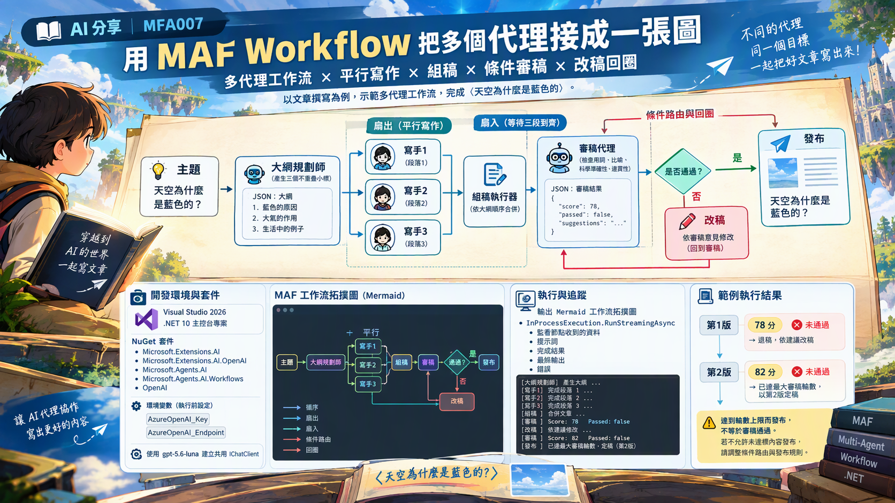

# MFA008 Session 序列化與記憶持久化

在上一篇關於 Microsoft Agent Framework 系列教學文章 "MFA007 用 MAF 的 Workflow 把多個代理接成一張圖" 中，我們學會了如何使用多代理工作流將多個 AI 代理串接成一個完整的工作流，並且了解了如何設計代理之間的協作流程。

在這篇文章中，我們將學習如何將 AI 代理的對話狀態進行序列化，並將其持久化到檔案中，從而實現代理的記憶保存與恢復。在此將會產生一個睡前故事的示範，但是這個故事並不會一次說完，而是會分多次進行，每次都會保存當前的對話狀態，並在下次繼續時恢復。當在第二次重新這個專案程式碼的時候，代理將會從上次的對話狀態繼續故事，而不會忘記之前的內容。



在完成這篇文章的練習，我們將會學會如何讓 AI 代理記住之前的對話內容，並在下次繼續時恢復，從而實現持久化的對話記憶。

接下來看看如何做到這樣的效果。

# 建立 Console 專案
* 開啟 Visual Studio 2026
* 選擇「建立新專案」
* 在 [建立新的專案] 視窗中，在右方清單內，找到並選擇「主控台應用程式」 項目
* 然後點擊右下方「下一步」按鈕
* 此時將會看到 [設定新的專案] 對話窗
* 在該對話窗的 [專案名稱] 欄位中，輸入專案名稱，例如 "csPersistSessionAgent"
* 然後點擊右下方「下一步」按鈕
* 接著會看到 [其他資訊] 對話窗
* 在這個對話窗內，確認使用底下的選項
    * 架構：.NET 10.0 (或更新版本)
    * 勾選 不要使用最上層陳述式 (這是我的個人習慣)
* 然後點擊右下方「建立」按鈕
* 現在，已經完成了這個 Console 主控台 專案的建立

## 安裝需要用到的 NuGet 套件

要完成這個第一次接觸 Microsoft Agent Framework 練習專案，需要安裝以下幾個 NuGet 套件：

### Microsoft.Extensions.AI

這個套件將會為生成式 AI 定義的一層「統一抽象介面 + Middleware 管線」，讓開發者可以更方便地整合不同的生成式 AI 模型，並且在應用程式中使用一致的方式進行呼叫與管理。

* 滑鼠右擊 [csPersistSessionAgent] 專案節點
* 點選彈出功能表的 [管理 NuGet 套件] 項
* 在 [瀏覽] 索引標籤中，搜尋並且安裝底下的 NuGet 套件
    * Microsoft.Extensions.AI
    
### Microsoft.Extensions.AI.OpenAI

這個套件是微軟官方為 .NET 整合 AI 服務所提供的擴充套件。它實現了 IChatClient 與 IEmbeddingGenerator 核心抽象介面，讓開發人員能以一致的程式碼，輕鬆串接 OpenAI 或相容的 API 端點（例如 Azure OpenAI、GitHub Models 等）。

* 滑鼠右擊 [csPersistSessionAgent] 專案節點
* 點選彈出功能表的 [管理 NuGet 套件] 項
* 在 [瀏覽] 索引標籤中，搜尋並且安裝底下的 NuGet 套件
    * Microsoft.Extensions.AI.OpenAI
    
### Microsoft.Agents.AI

這個套件是微軟官方推出 Microsoft Agent Framework（微軟智慧代理框架）的核心 .NET 套件。它主要用於在 .NET 環境中建構、協調與部署 AI 代理（AI Agents） 及多代理工作流（Multi-agent workflows），是用來取代舊版 AutoGen 的企業級解決方案。

* 滑鼠右擊 [csPersistSessionAgent] 專案節點
* 點選彈出功能表的 [管理 NuGet 套件] 項
* 在 [瀏覽] 索引標籤中，搜尋並且安裝底下的 NuGet 套件
    * Microsoft.Agents.AI
     
### OpenAI

這個套件為官方的 OpenAI .NET 客戶端類別庫，是 OpenAI NuGet 套件。此套件由 OpenAI 與 Microsoft 合作開發，提供直接存取 OpenAI 官方 REST API 的便利管道。

* 滑鼠右擊 [csPersistSessionAgent] 專案節點
* 點選彈出功能表的 [管理 NuGet 套件] 項
* 在 [瀏覽] 索引標籤中，搜尋並且安裝底下的 NuGet 套件
    * OpenAI

# 宣告 API 端點與 Key 環境變數

關於這個小節的內容，將會在這個系列每篇文章中都會用到，因此，可以參考 [MFA001 Microsoft Agent Framework 初次體驗開發出 AI 代理](https://csharpkh.blogspot.com/2026/10/mfa001-microsoft-agent-framework-ai.html) 文章中的 [宣告 API 端點與 Key 環境變數] 說明內容，若這裡提到的環境變數已經建立好了，則可以跳過這個小節內容。

# 修改 Program.cs 程式碼

為了要完成這個需求 : 如何用 Azure OpenAI 的 gpt-5.6-luna 聊天模型建立一個簡單 AI 代理，並產生一篇與鵝有關的詩。
因此，我們需要修改 Program.cs 程式碼，這時需要完成底下的操作。

* 在專案內，找到並且開啟 [Program.cs] 檔案
* 使用底下程式碼內容來取代 [Program.cs] 檔案的內容

```csharp
using Microsoft.Agents.AI;
using Microsoft.Extensions.AI;
using OpenAI;
using OpenAI.Chat;
using System.ClientModel;
using System.Text;
using System.Text.Encodings.Web;
using System.Text.Json;

namespace csPersistSessionAgent;

internal class Program
{
    private const string StoryStart = "請開始說一個關於一隻叫小熊的睡前故事，只講開頭一小段（約 100 字），講到一個懸念就停下來，先不要講完。";
    private const string StoryResume = "我們昨天講到哪裡了？請先用一句話提醒我，然後接著往下講一小段。";

    private const int PreviewLines = 8;   // JSON 節錄要印幾行

    private static readonly string SessionPath = Path.Combine(AppContext.BaseDirectory, "session.json");

    private static readonly JsonSerializerOptions JsonWriteOptions = new()
    {
        WriteIndented = true,
        Encoder = JavaScriptEncoder.UnsafeRelaxedJsonEscaping,
    };

    static async Task Main(string[] args)
    {
        Console.OutputEncoding = Encoding.UTF8;

        var apiKey = Environment.GetEnvironmentVariable("AzureOpenAI_Key");
        var endpoint = Environment.GetEnvironmentVariable("AzureOpenAI_Endpoint");
        var model = "gpt-5.6-luna";

        if (string.IsNullOrWhiteSpace(apiKey) || string.IsNullOrWhiteSpace(endpoint))
        {
            Console.WriteLine("請先設定環境變數 AzureOpenAI_Key 與 AzureOpenAI_Endpoint 後再執行。");
            return;
        }

        IChatClient chatClient =
            new ChatClient(
                    model,
                    new ApiKeyCredential(apiKey),
                    new OpenAIClientOptions { Endpoint = new Uri(endpoint) })
                .AsIChatClient();

        AIAgent agent = new ChatClientAgent(
            chatClient,  // 聊天用戶端
            "你是一位溫柔的睡前故事說書人，請用繁體中文，每次只講一小段（約 100 字），語氣輕柔適合小朋友入睡。",  // 系統提示詞 instructions
            "說書人",  // 代理名稱   name
            null); // 代理描述   description

        Console.WriteLine($"{DateTime.Now} 使用的模型: {model}");

        if (File.Exists(SessionPath))
        {
            await TomorrowAsync(agent);   // 明天：載入存檔，故事接著講
        }
        else
        {
            await TonightAsync(agent);    // 今晚：開一個新故事，講到一半就存檔
        }
    }

    private static async Task TonightAsync(AIAgent agent)
    {
        Header("今晚 / 找不到 session.json —— 開一個新故事");

        var session = await agent.CreateSessionAsync();

        Say("你", StoryStart);
        var answer = await agent.RunAsync(StoryStart, session);
        Say("說書人", answer.Text);

        await SaveSessionAsync(agent, session);

        Console.WriteLine();
        Console.WriteLine("👉 現在關掉程式，再執行一次 dotnet run，故事會從這裡接下去。");
    }

    private static async Task TomorrowAsync(AIAgent agent)
    {
        Header("明天 / 找到 session.json —— 故事接著講");

        Console.WriteLine();
        Console.WriteLine("── 對照組：全新 session（沒有昨晚的記憶）──");

        var freshSession = await agent.CreateSessionAsync();

        Say("你", StoryResume);
        var forgotten = await agent.RunAsync(StoryResume, freshSession);
        Say("說書人", forgotten.Text);

        Console.WriteLine();
        Console.WriteLine("---------------------------------------------------");
        Console.WriteLine();
        Console.WriteLine("── 正解：載入 session.json 還原昨晚的 session ──");

        var session = await LoadSessionAsync(agent);

        Say("你", StoryResume);
        var continued = await agent.RunAsync(StoryResume, session);
        Say("說書人", continued.Text);

        await ChatUntilBedtimeAsync(agent, session);
        await SaveSessionAsync(agent, session);

        Console.WriteLine();
        Console.WriteLine("👉 想重新開始一個新故事，把 session.json 刪掉即可。");
    }

    private static async Task ChatUntilBedtimeAsync(AIAgent agent, AgentSession session)
    {
        Console.WriteLine();
        Console.WriteLine("（想繼續聊就輸入一句話，直接按 Enter 結束並存檔）");

        while (true)
        {
            Console.Write("  你 ▸ ");
            var input = Console.ReadLine();

            if (string.IsNullOrWhiteSpace(input))
            {
                break;
            }

            var answer = await agent.RunAsync(input, session);
            Say("說書人", answer.Text);
        }
    }

    private static async Task SaveSessionAsync(AIAgent agent, AgentSession session)
    {
        JsonElement state = await agent.SerializeSessionAsync(session);
        await File.WriteAllTextAsync(SessionPath, JsonSerializer.Serialize(state, JsonWriteOptions));

        ShowSavedFile();
    }

    private static async Task<AgentSession> LoadSessionAsync(AIAgent agent)
    {
        var json = await File.ReadAllTextAsync(SessionPath);

        using var document = JsonDocument.Parse(json);
        return await agent.DeserializeSessionAsync(document.RootElement);
    }

    private static void ShowSavedFile()
    {
        var bytes = new FileInfo(SessionPath).Length;

        Console.WriteLine();
        Console.WriteLine($"💾 已存檔：{SessionPath}（{bytes:N0} bytes）");

        foreach (var line in File.ReadLines(SessionPath).Take(PreviewLines))
        {
            Console.WriteLine($"  │ {(line.Length > 70 ? line[..70] + "…" : line)}");
        }

        Console.WriteLine("  │ …（略）");
    }

    private static void Header(string title)
    {
        Console.WriteLine();
        Console.WriteLine(new string('=', 74));
        Console.WriteLine($"  {title}");
        Console.WriteLine(new string('=', 74));
    }

    private static void Say(string who, string? text)
    {
        Console.WriteLine();
        Console.WriteLine($"  {who} ▸ {text}");
    }
}
```

這個程式一開始將會讀取 API Key 與服務端點的數據，接著如同前面的範例相同，先建立一個 IChatClient 物件。接者建立 AIAgent 物件，該代理人綁定的系統提示詞為 "你是一位溫柔的睡前故事說書人，請用繁體中文，每次只講一小段（約 100 字），語氣輕柔適合小朋友入睡。"。

接下來會先檢查是否有任何之前的對話 session 內容存在，若有的話，這表示存在著昨天還未說完的故事，此時，將會把昨天講的故事讀取進來，並恢復到代理的對話狀態中，從而可以接著昨天的故事繼續講下去。否則，將會從頭開始一個新的故事。

當要讀取昨天的故事內容，將會呼叫 TomorrowAsync 方法來載入並還原之前的對話 session。在這個方法內，不過，在這個方法內，將會使用兩種做法，使得可以看到兩者間的差異，第一個就是採用 對照組：全新 session（沒有昨晚的記憶） 方式。在這裡，將會使用 `var freshSession = await agent.CreateSessionAsync();` 敘述來建立一個新的對話 session，然後再呼叫 `var forgotten = await agent.RunAsync(StoryResume, freshSession);` ，這裡使用的提示詞為這個變數 StoryResume 的字串： "我們昨天講到哪裡了？請先用一句話提醒我，然後接著往下講一小段。"，當執行完之後，就可以從 forgotten.Text 看到語言模型產生的結果，如下所示。

```plaintext
── 對照組：全新 session（沒有昨晚的記憶）──

  你 ▸ 我們昨天講到哪裡了？請先用一句話提醒我，然後接著往下講一小段。

  說書人 ▸ 我這裡看不到昨天的故事內容，就先從小月亮來到森林邊繼續吧。

小月亮輕輕降下銀色的光，照見一隻迷路的小兔子。牠蜷在草叢旁，耳朵微微發抖。小月亮說：「別怕，我陪你找回家的路。」於是，星星們一顆接一顆亮起，像溫柔的小燈，陪著他們走過安靜的林間小徑。
```

從這句話可以看出 "說書人 ▸ 我這裡看不到昨天的故事內容，就先從小月亮來到森林邊繼續吧。"，也就是說，語言模型並沒有記住昨天的故事內容，因此只能從新的情境開始講故事。這樣的結過並不是符合當初設計的預期，真正的目的是希望語言模型能夠記住之前的故事內容，並在新的對話中延續下去。

因此，在這個方法的後半段，將會要做到 "載入 session.json 還原昨晚的 session" 的操作，從而使語言模型能夠記住之前的故事內容，並在新的對話中延續下去。在這裡將會呼叫 `LoadSessionAsync(agent)` 來載入之前保存的 session，最後將其還原到 freshSession 中。

這裡首先呼叫 `var json = await File.ReadAllTextAsync(SessionPath);` 來讀取 session.json 的內容，接著再呼叫 `JsonDocument.Parse(json)` 來解析 JSON 文件，這裡將會得到型別為 JsonDocument 的物件，之後就可以從中提取出之前保存的對話歷史，並還原到 freshSession 中。最後，執行 `await agent.DeserializeSessionAsync(document.RootElement)` 便可以得到一個代理人物件，並且這個代理人將會記住之前的故事內容。

現在回到 TomorrowAsync 方法內，這裡將會執行 `var continued = await agent.RunAsync(StoryResume, session);`，這裡 StoryResume 的提示詞仍然是 "我們昨天講到哪裡了？請先用一句話提醒我，然後接著往下講一小段。"，現在就來看看，這個代理人物件會得到甚麼故事內容，這裡是測試後， continued.Text 的結果。

```plaintext
昨天說到：小熊在草叢裡發現了一顆會呼吸、閃著藍光的星星。

小熊輕輕捧起星星，感覺它一呼一吸，掌心便暖暖地亮一下。「你是不是迷路了？」小熊小聲問。星星沒有回答，只朝森林深處飄去，留下一串銀色腳印。小熊跟著走啊走，來到一扇從沒見過的小門前，而門後竟傳來自己的聲音……
```

從上面的產生內容，可以看到這個代理人物件，因為有讀取之前對話的紀錄檔案內容，所以能夠記住昨天的故事，並在新的對話中延續下去。並且依照提示詞的指示，繼續往下又說了一段故事。

接著，將會呼叫 ChatUntilBedtimeAsync 方法，在這個方法內，你可以輸入一些文字內容，與這個代理人物件互動，這樣就可以依據剛剛輸入的文字來繼續產生新的故事內容出來，直到你覺得故事可以結束為止。

最後，將會呼叫 SaveSessionAsync 方法，將當前的對話 session 保存到 session.json 文件中，這樣在下次啟動程式時，就可以載入這個 session，繼續延續之前的故事。

若沒有找到之前說故事的記憶檔案，這個程式將會呼叫 TonightAsync 方法，從頭開始一個新的故事。在這個方法內，同樣的會先執行 `var session = await agent.CreateSessionAsync();`，然後再呼叫 `var result = await agent.RunAsync(StoryStart, session);` 來開始新的故事。StoryStart 的提示詞仍然是 "請開始說一個關於一隻叫小熊的睡前故事，只講開頭一小段（約 100 字），講到一個懸念就停下來，先不要講完。" 當新的故事講完之後，同樣的會呼叫 SaveSessionAsync 方法，將當前的對話 session 保存到 session.json 文件中。在這裡也是執行了 `JsonElement state = await agent.SerializeSessionAsync(session)` 敘述，然後再將其寫入 session.json 文件，以便下次啟動程式時可以載入這個 session。

# 執行結果

現在來看看這個範例程式碼的執行結果。

* 在 Visual Studio 2026 下，按下 F5 鍵執行程式，將會看到程式輸出的結果。

```plaintext
2026/10/20 下午 01:15:56 使用的模型: gpt-5.6-luna

==========================================================================
  今晚 / 找不到 session.json —— 開一個新故事
==========================================================================

  你 ▸ 請開始說一個關於一隻叫小熊的睡前故事，只講開頭一小段（約 100 字），講到一個懸念就停下來，先不要講完。

  說書人 ▸ 月亮升上森林時，小熊抱著心愛的星星枕頭，準備回樹洞睡覺。忽然，草叢裡傳來細細的「叮咚」聲，像有人在夜裡敲著小鈴鐺。小熊循聲走去，看見一扇從沒見過的藍色小門，而門縫裡，正透出一點金色的光……

💾 已存檔：C:\Vulcan\Github\CSharp2026\csPersistSessionAgent\csPersistSessionAgent\bin\Debug\net10.0\session.json（1,045 bytes）
  │ {
  │   "stateBag": {
  │     "InMemoryChatHistoryProvider": {
  │       "messages": [
  │         {
  │           "role": "user",
  │           "contents": [
  │             {
  │ …（略）

👉 現在關掉程式，再執行一次 dotnet run，故事會從這裡接下去。
```

從上面的輸出內容，可以看到程式在找不到 session.json 時，會從頭開始一個新的故事。

現在停止這個專案執行，然後再次來執行這個專案

```plaintext
2026/10/20 下午 02:39:55 使用的模型: gpt-5.6-luna

==========================================================================
  明天 / 找到 session.json —— 故事接著講
==========================================================================

── 對照組：全新 session（沒有昨晚的記憶）──

  你 ▸ 我們昨天講到哪裡了？請先用一句話提醒我，然後接著往下講一小段。

  說書人 ▸ 我看不到昨天的對話紀錄，就先從小兔子準備走進月光森林開始吧。

小兔子抱著星星燈，沿著銀白色的小路慢慢前進。林子裡沒有吵鬧的聲音，只有風兒輕輕唱歌。忽然，一片葉子飄到牠耳邊，悄悄說：「別害怕，今晚的月亮會陪著你。」小兔子安心地笑了，踩著柔軟的月光，朝森林深處走去。

---------------------------------------------------

── 正解：載入 session.json 還原昨晚的 session ──

  你 ▸ 我們昨天講到哪裡了？請先用一句話提醒我，然後接著往下講一小段。

  說書人 ▸ 昨天我們說到：小熊在古老樹洞裡，看見深處亮起了兩盞藍色的燈。

小熊屏住呼吸，抱緊蜂蜜罐，輕聲問：「你是誰呀？」藍光慢慢靠近，照出一對圓圓的眼睛，還有一頂歪歪的小帽子。那個神秘身影小聲說：「別害怕，我一直在等你，因為森林的月亮……不見了。」小熊抬頭一看，夜空果然少了一輪月亮，而樹洞裡忽然傳來咚、咚、咚的聲音……

（想繼續聊就輸入一句話，直接按 Enter 結束並存檔）
  你 ▸ 我還想繼續聽一段故事

  說書人 ▸ 小熊望著那頂歪歪的小帽子，鼓起勇氣問：「月亮去哪裡了呢？」小身影指向樹洞深處，說：「它被一陣淘氣的風，吹進了沉睡的雲谷。」於是，小熊牽起神秘朋友的手，沿著微弱的藍光往前走。走著走著，前方出現一扇小小的銀色門，門上刻著一行字：只有說出最溫柔的夢，才能打開它……
  你 ▸

💾 已存檔：C:\Vulcan\Github\CSharp2026\csPersistSessionAgent\csPersistSessionAgent\bin\Debug\net10.0\session.json（3,136 bytes）
  │ {
  │   "stateBag": {
  │     "InMemoryChatHistoryProvider": {
  │       "messages": [
  │         {
  │           "role": "user",
  │           "contents": [
  │             {
  │ …（略）

👉 想重新開始一個新故事，把 session.json 刪掉即可。
```

在文字 "── 正解：載入 session.json 還原昨晚的 session ──" 與 "（想繼續聊就輸入一句話，直接按 Enter 結束並存檔）" 之間，程式會嘗試讀取 session.json，並將其中的對話歷史還原到當前的 session 中，這樣就能接著昨天的故事繼續講下去。我在這裡輸入了 "我還想繼續聽一段故事"，所以就看到了程式便接著又講了一段故事。這也說明了 session 的持久化功能，能夠讓對話在程式重啟後仍然保持連貫。最後，我不想在聽故事了，就可以直接按 Enter 結束，程式會將當前的 session 保存到 session.json 中，以便下次繼續使用。

