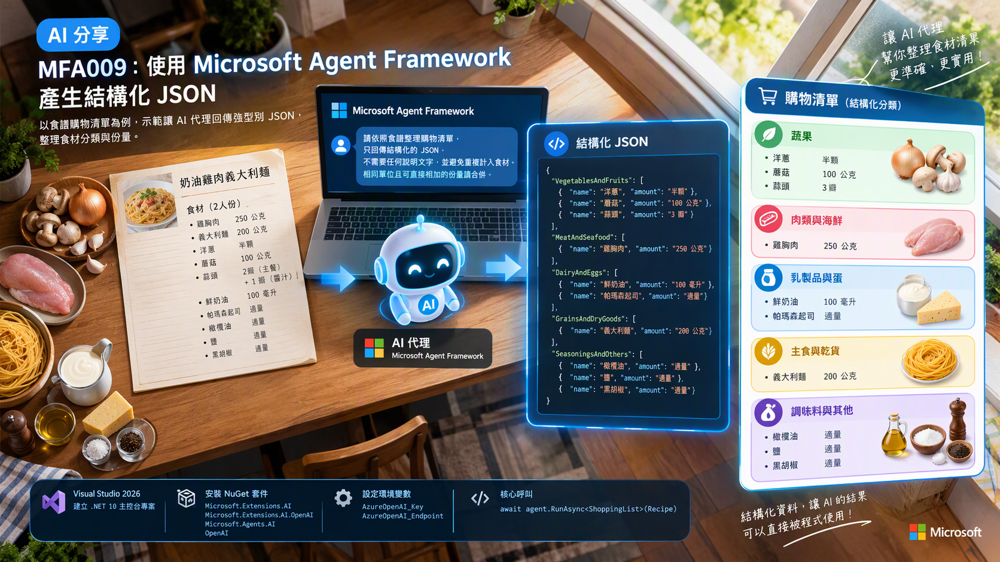
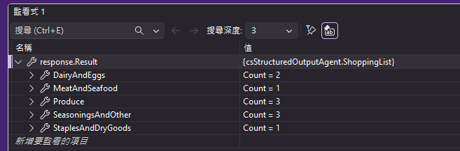

# MFA009 - 結構化輸出（JSON）

在上一篇關於 Microsoft Agent Framework 系列教學文章 "MFA008 Session 序列化與記憶持久化" 中，我們學會了如何使用讓 Agent 的對話記憶進行序列化與持久化。也就是說，Agent 可以記住之前的對話內容，並在下次啟動時恢復，實現持久化的對話記憶。



現在要來面臨另外一個實用的設計做法，通常呼叫 LLM API 的時候，所回傳的內容將會是文字內容，就算當要呼叫模型 API的時候，再提示詞中要求它以特定格式回應，也無法保證回傳的文字一定符合預期。例如，當在提示詞內有提到，將回傳內容使用 json 格式產生，模型仍可能回傳不符合 JSON 格式的文字，因此我們需要在程式中對回傳內容進行解析與驗證，確保資料結構正確。

```plaintext
這裡是妳要的 json 內容
...
這裡是json內容
...
```

或者

```plaintext

` ` `json
這裡是json內容
` ` `
```

從上面的兩個回傳結果，就人類而言，我們可以很容易地辨識出其中的 JSON 內容，但對程式而言，仍需要進行解析與驗證，確保資料結構正確，才能安全地使用。可是，由於大語言模型的回傳內容是隨機的，因此，若回傳的結果超乎程式碼預期，程式就可能無法正確處理，甚至發生錯誤。我想，發生這樣的問題也不是大家需要的。

面對這樣的情況，在這篇文章將會使用傳入一份奶油雞肉義大利麵的食譜內容，將著要讓 AI 可以生成結構化的 JSON 購物清單，並確保每個食材的分類與份量正確，同時處理模型可能回傳的非結構化文字，至於要達到這樣的效果，將會採用 Microsoft Agent Framework 來建立 AI 代理，並透過程式對回傳的 JSON 內容進行解析與驗證。


在完成這篇文章的練習，我們將會學會如何讓 AI 代理生成結構化的 JSON 購物清單，並確保每個食材的分類與份量正確，同時處理模型可能回傳的非結構化文字。若具備這樣的能力，開發者就能夠更可靠地處理大語言模型的回傳結果，確保資料結構正確，並在應用程式中安全地使用這些資料。

接下來看看如何做到這樣的效果。

# 建立 Console 專案
* 開啟 Visual Studio 2026
* 選擇「建立新專案」
* 在 [建立新的專案] 視窗中，在右方清單內，找到並選擇「主控台應用程式」 項目
* 然後點擊右下方「下一步」按鈕
* 此時將會看到 [設定新的專案] 對話窗
* 在該對話窗的 [專案名稱] 欄位中，輸入專案名稱，例如 "csStructuredOutputAgent"
* 然後點擊右下方「下一步」按鈕
* 接著會看到 [其他資訊] 對話窗
* 在這個對話窗內，確認使用底下的選項
    * 架構：.NET 10.0 (或更新版本)
    * 勾選 不要使用最上層陳述式 (這是我的個人習慣)
* 然後點擊右下方「建立」按鈕
* 現在，已經完成了這個 Console 主控台 專案的建立

## 安裝需要用到的 NuGet 套件

要完成這個第一次接觸 Microsoft Agent Framework 練習專案，需要安裝以下幾個 NuGet 套件：

### Microsoft.Extensions.AI

這個套件將會為生成式 AI 定義的一層「統一抽象介面 + Middleware 管線」，讓開發者可以更方便地整合不同的生成式 AI 模型，並且在應用程式中使用一致的方式進行呼叫與管理。

* 滑鼠右擊 [csStructuredOutputAgent] 專案節點
* 點選彈出功能表的 [管理 NuGet 套件] 項
* 在 [瀏覽] 索引標籤中，搜尋並且安裝底下的 NuGet 套件
    * Microsoft.Extensions.AI
    
### Microsoft.Extensions.AI.OpenAI

這個套件是微軟官方為 .NET 整合 AI 服務所提供的擴充套件。它實現了 IChatClient 與 IEmbeddingGenerator 核心抽象介面，讓開發人員能以一致的程式碼，輕鬆串接 OpenAI 或相容的 API 端點（例如 Azure OpenAI、GitHub Models 等）。

* 滑鼠右擊 [csStructuredOutputAgent] 專案節點
* 點選彈出功能表的 [管理 NuGet 套件] 項
* 在 [瀏覽] 索引標籤中，搜尋並且安裝底下的 NuGet 套件
    * Microsoft.Extensions.AI.OpenAI
    
### Microsoft.Agents.AI

這個套件是微軟官方推出 Microsoft Agent Framework（微軟智慧代理框架）的核心 .NET 套件。它主要用於在 .NET 環境中建構、協調與部署 AI 代理（AI Agents） 及多代理工作流（Multi-agent workflows），是用來取代舊版 AutoGen 的企業級解決方案。

* 滑鼠右擊 [csStructuredOutputAgent] 專案節點
* 點選彈出功能表的 [管理 NuGet 套件] 項
* 在 [瀏覽] 索引標籤中，搜尋並且安裝底下的 NuGet 套件
    * Microsoft.Agents.AI
     
### OpenAI

這個套件為官方的 OpenAI .NET 客戶端類別庫，是 OpenAI NuGet 套件。此套件由 OpenAI 與 Microsoft 合作開發，提供直接存取 OpenAI 官方 REST API 的便利管道。

* 滑鼠右擊 [csStructuredOutputAgent] 專案節點
* 點選彈出功能表的 [管理 NuGet 套件] 項
* 在 [瀏覽] 索引標籤中，搜尋並且安裝底下的 NuGet 套件
    * OpenAI

# 宣告 API 端點與 Key 環境變數

關於這個小節的內容，將會在這個系列每篇文章中都會用到，因此，可以參考 [MFA001 Microsoft Agent Framework 初次體驗開發出 AI 代理](https://csharpkh.blogspot.com/2026/10/mfa001-microsoft-agent-framework-ai.html) 文章中的 [宣告 API 端點與 Key 環境變數] 說明內容，若這裡提到的環境變數已經建立好了，則可以跳過這個小節內容。

# 修改 Program.cs 程式碼

為了要完成這個需求 : 如何用 Azure OpenAI 的 gpt-5.6-luna 聊天模型建立一個簡單 AI 代理，並產生一篇與鵝有關的詩。
因此，我們需要修改 Program.cs 程式碼，這時需要完成底下的操作。

* 在專案內，找到並且開啟 [Program.cs] 檔案
* 使用底下程式碼內容來取代 [Program.cs] 檔案的內容

```csharp
using Microsoft.Agents.AI;
using Microsoft.Extensions.AI;
using OpenAI;
using OpenAI.Chat;
using System.ClientModel;
using System.Text;
using System.Text.Json.Serialization;

namespace csStructuredOutputAgent;

internal class Program
{
    private const string Recipe = """
        奶油雞肉義大利麵（2 人份）

        主餐材料：
        義大利麵 200 公克
        雞胸肉 250 公克
        洋蔥 半顆
        蘑菇 100 公克
        蒜頭 2 瓣

        醬汁材料：
        蒜頭 1 瓣
        鮮奶油 150 毫升
        帕瑪森起司 30 公克
        橄欖油 1 大匙
        鹽 1 小匙
        黑胡椒 少許

        做法：
        煮熟義大利麵。用橄欖油炒香洋蔥、蘑菇與蒜頭，加入雞胸肉煎熟。
        倒入鮮奶油，加入帕瑪森起司、鹽與黑胡椒，最後拌入義大利麵。
        """;

    static async Task Main(string[] args)
    {
        Console.OutputEncoding = Encoding.UTF8;

        var apiKey = Environment.GetEnvironmentVariable("AzureOpenAI_Key");
        var endpoint = Environment.GetEnvironmentVariable("AzureOpenAI_Endpoint");
        var model = "gpt-5.6-luna";

        if (string.IsNullOrWhiteSpace(apiKey) || string.IsNullOrWhiteSpace(endpoint))
        {
            Console.WriteLine("請先設定環境變數 AzureOpenAI_Key 與 AzureOpenAI_Endpoint 後再執行。");
            return;
        }

        IChatClient chatClient =
            new ChatClient(
                    model,
                    new ApiKeyCredential(apiKey),
                    new OpenAIClientOptions { Endpoint = new Uri(endpoint) })
                .AsIChatClient();

        AIAgent agent = new ChatClientAgent(
            chatClient,
            "你是食譜採購助理。請從食譜的材料中整理購物清單，使用繁體中文。" +
            "只列出食譜需要的食材，包含鹽、油等調味料；做法中再次提到的食材不要重複計入。" +
            "同名食材只列一次；份量單位相同且能直接相加時合計，否則保留原份量文字，不要猜測換算。" +
            "每項食材都要有名稱和份量文字；未標示份量時填入「未註明」。" +
            "固定使用蔬果、肉類與海鮮、乳製品與蛋、主食與乾貨、調味料與其他五類；沒有食材的類別用空陣列。",
            "食譜採購助理",
            null);

        Console.WriteLine($"使用的模型：{model}");
        Console.WriteLine($"食譜：{Environment.NewLine}{Recipe}");
        Console.WriteLine($"");

        AgentResponse<ShoppingList> response = await agent.RunAsync<ShoppingList>(Recipe);

        Console.WriteLine("模型回傳的 JSON：");
        Console.WriteLine(response.Text);
        Console.WriteLine($"");

        Console.WriteLine();
        Console.WriteLine("分類購物清單：");
        Console.WriteLine($"");

        PrintCategory("蔬果", response.Result.Produce);
        PrintCategory("肉類與海鮮", response.Result.MeatAndSeafood);
        PrintCategory("乳製品與蛋", response.Result.DairyAndEggs);
        PrintCategory("主食與乾貨", response.Result.StaplesAndDryGoods);
        PrintCategory("調味料與其他", response.Result.SeasoningsAndOther);
    }

    private static void PrintCategory(string title, List<Ingredient> items)
    {
        Console.WriteLine($"【{title}】");

        if (items.Count == 0)
        {
            Console.WriteLine("  （無）");
            return;
        }

        foreach (var item in items)
        {
            Console.WriteLine($"  - {item.Name}：{item.Quantity}");
        }
    }
}

internal sealed class ShoppingList
{
    [JsonPropertyName("produce")]
    public List<Ingredient> Produce { get; set; } = [];

    [JsonPropertyName("meatAndSeafood")]
    public List<Ingredient> MeatAndSeafood { get; set; } = [];

    [JsonPropertyName("dairyAndEggs")]
    public List<Ingredient> DairyAndEggs { get; set; } = [];

    [JsonPropertyName("staplesAndDryGoods")]
    public List<Ingredient> StaplesAndDryGoods { get; set; } = [];

    [JsonPropertyName("seasoningsAndOther")]
    public List<Ingredient> SeasoningsAndOther { get; set; } = [];
}

internal sealed class Ingredient
{
    [JsonPropertyName("name")]
    public string Name { get; set; } = string.Empty;

    [JsonPropertyName("quantity")]
    public string Quantity { get; set; } = string.Empty;
}
```

這個程式一開始將會讀取 API Key 與服務端點的數據，接著如同前面的範例相同，先建立一個 IChatClient 物件。接者建立 AIAgent 物件，該代理人將會透過系統提示詞來告訴模型，你是一個食譜採購助理。從系統提示詞中，模型會知道它的角色與任務，並依照提示詞的要求，將食譜中的食材整理成結構化的 JSON 購物清單，分類並合併可直接相加的份量。

接著，這個系統使用底下程式碼來呼叫 LLM API

```csharp
AgentResponse<ShoppingList> response = await agent.RunAsync<ShoppingList>(Recipe);
```

在這裡使用了一個泛型方法 RunAsync<ShoppingList> 來呼叫 LLM API，並將回傳的結果解析成 ShoppingList 類別的實例。這樣可以確保模型回傳的 JSON 結構符合我們預期的資料格式，方便後續程式進行分類與輸出。這樣的設計成果將會是，程式設計師不需要特別去關注 LLM 回傳的內容是否是一個完整的 JSON 物件，還是裡面參雜了非結構化的文字，程式都能夠正確地解析與使用。

呼叫這個方法之後，將會得到一個 AgentResponse<ShoppingList> 物件，對於 AgentResponse 類別，這個定義在 Microsoft.Agents.AI 命名空間內，AgentResponse 是 Microsoft Agent Framework 中用來封裝 AI Agent 執行結果的核心類別，除了提供 Agent 產生的文字回應與訊息集合外，還包含 Token 使用量、Agent 識別資訊、回應識別碼及執行結束原因等相關資料，方便開發人員取得、分析與管理 Agent 的執行結果，而泛型版本 AgentResponse<T> 更支援將回應內容轉換為指定的強型別物件，便於後續程式處理與應用系統整合。

關於 ShoppingList 類別，它定義了購物清單的各個分類，每個分類都是一個 Ingredient 列表。這樣的設計讓程式可以方便地將食材依照類別進行整理與輸出。每個 Ingredient 物件包含食材的名稱與數量，確保了資料的完整性與一致性。

```csharp
internal sealed class ShoppingList
{
    [JsonPropertyName("produce")]
    public List<Ingredient> Produce { get; set; } = [];

    [JsonPropertyName("meatAndSeafood")]
    public List<Ingredient> MeatAndSeafood { get; set; } = [];

    [JsonPropertyName("dairyAndEggs")]
    public List<Ingredient> DairyAndEggs { get; set; } = [];

    [JsonPropertyName("staplesAndDryGoods")]
    public List<Ingredient> StaplesAndDryGoods { get; set; } = [];

    [JsonPropertyName("seasoningsAndOther")]
    public List<Ingredient> SeasoningsAndOther { get; set; } = [];
}
```

當實際執行並且設定程式停止在得到 response 之後，可以觀察到 response.Text 的內容，就是一個單純、純粹的 JSON 

```json
{"produce":[{"name":"洋蔥","quantity":"半顆"},{"name":"蘑菇","quantity":"100 公克"},{"name":"蒜頭","quantity":"3 瓣"}],"meatAndSeafood":[{"name":"雞胸肉","quantity":"250 公克"}],"dairyAndEggs":[{"name":"鮮奶油","quantity":"150 毫升"},{"name":"帕瑪森起司","quantity":"30 公克"}],"staplesAndDryGoods":[{"name":"義大利麵","quantity":"200 公克"}],"seasoningsAndOther":[{"name":"橄欖油","quantity":"1 大匙"},{"name":"鹽","quantity":"1 小匙"},{"name":"黑胡椒","quantity":"少許"}]}
```

從這裡可以看到，關於 蒜頭 這個食材總計需要 3 瓣。再來觀察食譜上的說明內容，在主餐材料中，需要的蒜頭數量為 2 瓣，而在醬汁材料中，需要的蒜頭數量為 1 瓣，總計就是 3 瓣，與 JSON 中的數量一致。這樣可以看到模型有將這樣的數量進行了正確的合併與整理。這樣呈現的效果，可謂相當的好用。

對於 response.Result 屬性，它將會是一個 ShoppingList 類別的實例，開發人員可以直接透過這個物件來存取各個分類的食材列表，而不需要再去解析 JSON 字串。底下將會是實際執行觀察到這個屬性的內容。



# 執行結果

現在來看看這個範例程式碼的執行結果。

* 在 Visual Studio 2026 下，按下 F5 鍵執行程式，將會看到程式輸出的結果。

```plaintext
使用的模型：gpt-5.6-luna
食譜：
奶油雞肉義大利麵（2 人份）

主餐材料：
義大利麵 200 公克
雞胸肉 250 公克
洋蔥 半顆
蘑菇 100 公克
蒜頭 2 瓣

醬汁材料：
蒜頭 1 瓣
鮮奶油 150 毫升
帕瑪森起司 30 公克
橄欖油 1 大匙
鹽 1 小匙
黑胡椒 少許

做法：
煮熟義大利麵。用橄欖油炒香洋蔥、蘑菇與蒜頭，加入雞胸肉煎熟。
倒入鮮奶油，加入帕瑪森起司、鹽與黑胡椒，最後拌入義大利麵。

模型回傳的 JSON：
{"produce":[{"name":"洋蔥","quantity":"半顆"},{"name":"蘑菇","quantity":"100 公克"},{"name":"蒜頭","quantity":"3 瓣"}],"meatAndSeafood":[{"name":"雞胸肉","quantity":"250 公克"}],"dairyAndEggs":[{"name":"鮮奶油","quantity":"150 毫升"},{"name":"帕瑪森起司","quantity":"30 公克"}],"staplesAndDryGoods":[{"name":"義大利麵","quantity":"200 公克"}],"seasoningsAndOther":[{"name":"橄欖油","quantity":"1 大匙"},{"name":"鹽","quantity":"1 小匙"},{"name":"黑胡椒","quantity":"少許"}]}


分類購物清單：

【蔬果】
  - 洋蔥：半顆
  - 蘑菇：100 公克
  - 蒜頭：3 瓣
【肉類與海鮮】
  - 雞胸肉：250 公克
【乳製品與蛋】
  - 鮮奶油：150 毫升
  - 帕瑪森起司：30 公克
【主食與乾貨】
  - 義大利麵：200 公克
【調味料與其他】
  - 橄欖油：1 大匙
  - 鹽：1 小匙
  - 黑胡椒：少許
```

透過這篇文章的展示可以看到，同樣的設計作法若套用到其他應用需求上，將會看到更多的變化與效果。

