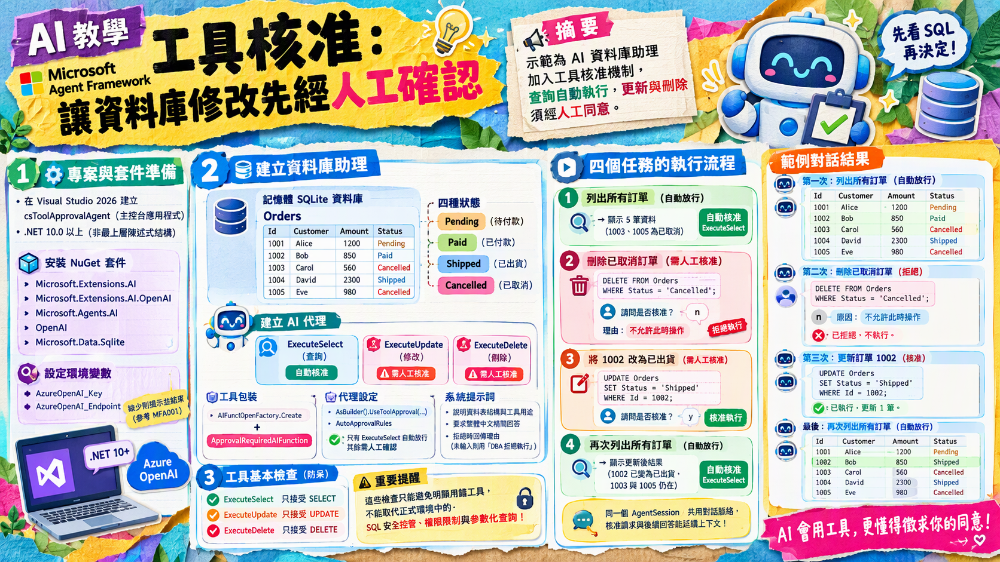

# MFA011 - 工具核准（代理層的人機互動）

在上一篇關於 Microsoft Agent Framework 系列教學文章 "MFA010 - 函式工具呼叫（Function Calling）" 中，我們學會了如何讓 AI 代理根據使用者的需求，自動呼叫工具（Function）來取得所需資訊，並將結果整合到回應中。



在完成這篇文章的練習，將會從範例示範中學到一個有人工核准機制的資料庫助理。它連接 Azure OpenAI，並使用記憶體中的 SQLite 資料庫；程式啟動時會建立 Orders 訂單資料表，並放入幾筆範例訂單。助理有三個資料庫工具：ExecuteSelect 用來查詢、ExecuteUpdate 用來修改、ExecuteDelete 用來刪除。SELECT 查詢會自動放行；修改或刪除則會先顯示 SQL，請使用者輸入 y 核准，或輸入其他內容拒絕。拒絕時也可以提供理由，讓助理轉告使用者。程式依序提出四個任務：列出訂單、刪除已取消的訂單、更新訂單狀態，再次列出訂單確認結果。每個任務都沿用同一個對話 session，因此助理能接續處理核准請求和前後文。此外，各工具也會檢查 SQL 開頭是否符合用途，例如查詢工具只接受 SELECT，避免只靠工具核准規則而執行不符合預期的語句。

接下來看看如何做到這樣的效果。

# 建立 Console 專案
* 開啟 Visual Studio 2026
* 選擇「建立新專案」
* 在 [建立新的專案] 視窗中，在右方清單內，找到並選擇「主控台應用程式」 項目
* 然後點擊右下方「下一步」按鈕
* 此時將會看到 [設定新的專案] 對話窗
* 在該對話窗的 [專案名稱] 欄位中，輸入專案名稱，例如 "csToolApprovalAgent"
* 然後點擊右下方「下一步」按鈕
* 接著會看到 [其他資訊] 對話窗
* 在這個對話窗內，確認使用底下的選項
    * 架構：.NET 10.0 (或更新版本)
    * 勾選 不要使用最上層陳述式 (這是我的個人習慣)
* 然後點擊右下方「建立」按鈕
* 現在，已經完成了這個 Console 主控台 專案的建立

## 安裝需要用到的 NuGet 套件

要完成這個第一次接觸 Microsoft Agent Framework 練習專案，需要安裝以下幾個 NuGet 套件：

### Microsoft.Extensions.AI

這個套件將會為生成式 AI 定義的一層「統一抽象介面 + Middleware 管線」，讓開發者可以更方便地整合不同的生成式 AI 模型，並且在應用程式中使用一致的方式進行呼叫與管理。

* 滑鼠右擊 [csToolApprovalAgent] 專案節點
* 點選彈出功能表的 [管理 NuGet 套件] 項
* 在 [瀏覽] 索引標籤中，搜尋並且安裝底下的 NuGet 套件
    * Microsoft.Extensions.AI
    
### Microsoft.Extensions.AI.OpenAI

這個套件是微軟官方為 .NET 整合 AI 服務所提供的擴充套件。它實現了 IChatClient 與 IEmbeddingGenerator 核心抽象介面，讓開發人員能以一致的程式碼，輕鬆串接 OpenAI 或相容的 API 端點（例如 Azure OpenAI、GitHub Models 等）。

* 滑鼠右擊 [csToolApprovalAgent] 專案節點
* 點選彈出功能表的 [管理 NuGet 套件] 項
* 在 [瀏覽] 索引標籤中，搜尋並且安裝底下的 NuGet 套件
    * Microsoft.Extensions.AI.OpenAI
    
### Microsoft.Agents.AI

這個套件是微軟官方推出 Microsoft Agent Framework（微軟智慧代理框架）的核心 .NET 套件。它主要用於在 .NET 環境中建構、協調與部署 AI 代理（AI Agents） 及多代理工作流（Multi-agent workflows），是用來取代舊版 AutoGen 的企業級解決方案。

* 滑鼠右擊 [csToolApprovalAgent] 專案節點
* 點選彈出功能表的 [管理 NuGet 套件] 項
* 在 [瀏覽] 索引標籤中，搜尋並且安裝底下的 NuGet 套件
    * Microsoft.Agents.AI
     
### OpenAI

這個套件為官方的 OpenAI .NET 客戶端類別庫，是 OpenAI NuGet 套件。此套件由 OpenAI 與 Microsoft 合作開發，提供直接存取 OpenAI 官方 REST API 的便利管道。

* 滑鼠右擊 [csToolApprovalAgent] 專案節點
* 點選彈出功能表的 [管理 NuGet 套件] 項
* 在 [瀏覽] 索引標籤中，搜尋並且安裝底下的 NuGet 套件
    * OpenAI
     
### Microsoft.Data.Sqlite

這個套件為官方的 SQLite .NET 客戶端類別庫，是 Microsoft.Data.Sqlite NuGet 套件。此套件由 Microsoft 提供，方便在 .NET 應用程式中操作 SQLite 資料庫。

* 滑鼠右擊 [csToolApprovalAgent] 專案節點
* 點選彈出功能表的 [管理 NuGet 套件] 項
* 在 [瀏覽] 索引標籤中，搜尋並且安裝底下的 NuGet 套件
    * Microsoft.Data.Sqlite

# 宣告 API 端點與 Key 環境變數

關於這個小節的內容，將會在這個系列每篇文章中都會用到，因此，可以參考 [MFA001 Microsoft Agent Framework 初次體驗開發出 AI 代理](https://csharpkh.blogspot.com/2026/10/mfa001-microsoft-agent-framework-ai.html) 文章中的 [宣告 API 端點與 Key 環境變數] 說明內容，若這裡提到的環境變數已經建立好了，則可以跳過這個小節內容。

# 修改 Program.cs 程式碼

為了要完成這個需求 : 如何用 Azure OpenAI 的 gpt-5.6-luna 聊天模型建立一個簡單 AI 代理，並產生一篇與鵝有關的詩。
因此，我們需要修改 Program.cs 程式碼，這時需要完成底下的操作。

* 在專案內，找到並且開啟 [Program.cs] 檔案
* 使用底下程式碼內容來取代 [Program.cs] 檔案的內容

```csharp
using Microsoft.Agents.AI;
using Microsoft.Data.Sqlite;
using Microsoft.Extensions.AI;
using OpenAI;
using OpenAI.Chat;
using System.ClientModel;
using System.ComponentModel;
using System.Text;
using ChatMessage = Microsoft.Extensions.AI.ChatMessage; // OpenAI.Chat 也有 ChatMessage，這裡指定用 MEAI 的

namespace csToolApprovalAgent;

internal class Program
{
    private static readonly SqliteConnection Db = new("Data Source=:memory:");

    static async Task Main(string[] args)
    {
        Console.OutputEncoding = Encoding.UTF8;
        Console.InputEncoding = Encoding.UTF8;

        var apiKey = Environment.GetEnvironmentVariable("AzureOpenAI_Key");
        var endpoint = Environment.GetEnvironmentVariable("AzureOpenAI_Endpoint");
        var model = "gpt-5.6-luna";

        if (string.IsNullOrWhiteSpace(apiKey) || string.IsNullOrWhiteSpace(endpoint))
        {
            Console.WriteLine("請先設定環境變數 AzureOpenAI_Key 與 AzureOpenAI_Endpoint 後再執行。");
            return;
        }

        SeedDatabase();

        IChatClient chatClient =
            new ChatClient(
                    model,
                    new ApiKeyCredential(apiKey),
                    new OpenAIClientOptions { Endpoint = new Uri(endpoint) })
                .AsIChatClient();

        AIAgent innerAgent = new ChatClientAgent(
            chatClient,
            """
            你是資料庫維運助理，用繁體中文精簡回答。
            資料庫是 SQLite，只有一張資料表：Orders(Id INTEGER, Customer TEXT, Amount INTEGER, Status TEXT)。
            Status 只有四種值：Pending（待付款）、Paid（已付款）、Shipped（已出貨）、Cancelled（已取消）。
            查詢用 ExecuteSelect、修改用 ExecuteUpdate、刪除用 ExecuteDelete，每次只傳一句 SQL。
            如果操作被拒絕，請把拒絕理由轉告使用者，不要改用其他方式重試。
            """, // 系統提示詞
            "資料庫維運助理", // 代理名稱
            null, // 代理描述
            [
                new ApprovalRequiredAIFunction(AIFunctionFactory.Create(ExecuteSelect)),
                new ApprovalRequiredAIFunction(AIFunctionFactory.Create(ExecuteUpdate)),
                new ApprovalRequiredAIFunction(AIFunctionFactory.Create(ExecuteDelete)),
            ]);

        AIAgent agent = innerAgent.AsBuilder()
            .UseToolApproval(new ToolApprovalAgentOptions { AutoApprovalRules = [AutoApproveSelect] })
            .Build();

        AgentSession session = await agent.CreateSessionAsync();

        string[] tasks =
        [
            "列出所有訂單",
            "刪除所有已取消的訂單",
            "把訂單 1002 的狀態改成已出貨",
            "再列一次所有訂單，確認目前狀態",
        ];

        Console.WriteLine($"使用的模型：{model}");

        foreach (var task in tasks)
        {
            Console.WriteLine();
            Console.WriteLine($"🧑 {task}");

            var response = await agent.RunAsync(task, session);

            while (GetApprovalRequests(response) is { Count: > 0 } requests)
            {
                List<AIContent> answers = [.. requests.Select(AskHuman)];
                response = await agent.RunAsync(new ChatMessage(ChatRole.User, answers), session);
            }

            Console.WriteLine($"🤖 {response.Text}");
        }
    }

    private static ValueTask<bool> AutoApproveSelect(ToolAutoApprovalRuleContext context)
    {
        var name = context.FunctionCallContent.Name;
        var approved = name == nameof(ExecuteSelect);
        Console.WriteLine(approved ? $"⚡ {name} 自動放行" : $"✋ {name} 需要人工核准");
        return ValueTask.FromResult(approved);
    }

    private static List<ToolApprovalRequestContent> GetApprovalRequests(AgentResponse response) =>
        [.. response.Messages.SelectMany(m => m.Contents).OfType<ToolApprovalRequestContent>()];

    private static AIContent AskHuman(ToolApprovalRequestContent request)
    {
        var call = (FunctionCallContent)request.ToolCall;
        Console.WriteLine($"🔐 代理要求執行 {call.Name}");
        Console.WriteLine($"   SQL: {call.Arguments?["sql"]}");
        Console.Write("   是否核准？(y/n) > ");

        if (Console.ReadLine()?.Trim().ToLowerInvariant() == "y")
        {
            return request.CreateResponse(true);
        }

        Console.Write("   拒絕理由（直接 Enter 使用預設）> ");
        var reason = Console.ReadLine();
        return request.CreateResponse(false, string.IsNullOrWhiteSpace(reason) ? "DBA 拒絕執行" : reason);
    }

    [Description("執行唯讀的 SELECT 查詢，回傳查詢結果")]
    private static string ExecuteSelect([Description("一句 SELECT 語法")] string sql)
    {
        Console.WriteLine($"🔧 呼叫 ExecuteSelect(sql: {sql})");
        if (!sql.TrimStart().StartsWith("SELECT", StringComparison.OrdinalIgnoreCase))
        {
            return "錯誤：ExecuteSelect 只接受 SELECT 語法";
        }

        using var command = Db.CreateCommand();
        command.CommandText = sql;
        using var reader = command.ExecuteReader();

        var columns = Enumerable.Range(0, reader.FieldCount);
        var result = new StringBuilder();
        result.AppendLine(string.Join(" | ", columns.Select(reader.GetName)));
        while (reader.Read())
        {
            result.AppendLine(string.Join(" | ", columns.Select(reader.GetValue)));
        }
        return result.ToString();
    }

    [Description("執行 UPDATE 修改資料（需要 DBA 核准）")]
    private static string ExecuteUpdate([Description("一句 UPDATE 語法")] string sql)
    {
        Console.WriteLine($"🔧 呼叫 ExecuteUpdate(sql: {sql})");
        return ExecuteNonQuery("UPDATE", sql);
    }

    [Description("執行 DELETE 刪除資料（需要 DBA 核准）")]
    private static string ExecuteDelete([Description("一句 DELETE 語法")] string sql)
    {
        Console.WriteLine($"🔧 呼叫 ExecuteDelete(sql: {sql})");
        return ExecuteNonQuery("DELETE", sql);
    }

    private static string ExecuteNonQuery(string verb, string sql)
    {
        if (!sql.TrimStart().StartsWith(verb, StringComparison.OrdinalIgnoreCase))
        {
            return $"錯誤：只接受 {verb} 語法";
        }

        using var command = Db.CreateCommand();
        command.CommandText = sql;
        return $"{verb} 完成，影響 {command.ExecuteNonQuery()} 筆資料";
    }

    private static void SeedDatabase()
    {
        Db.Open();
        using var command = Db.CreateCommand();
        command.CommandText =
            """
            CREATE TABLE Orders (Id INTEGER PRIMARY KEY, Customer TEXT, Amount INTEGER, Status TEXT);
            INSERT INTO Orders VALUES
                (1001, '王小明', 1200, 'Paid'),
                (1002, '陳美麗',  850, 'Pending'),
                (1003, '林大華', 3200, 'Cancelled'),
                (1004, '張志強',  560, 'Shipped'),
                (1005, '李雅婷', 1500, 'Cancelled');
            """;
        command.ExecuteNonQuery();
    }
}
```

這個程式一開始將會讀取 API Key 與服務端點的數據，接著如同前面的範例相同，先建立一個 IChatClient 物件。接者建立 AIAgent 物件，這裡將會指定這個 AI Agent 的系統提示詞為 : "你是資料庫維運助理，用繁體中文精簡回答。資料庫是 SQLite，只有一張資料表：Orders(Id INTEGER, Customer TEXT, Amount INTEGER, Status TEXT)。Status 只有四種值：Pending（待付款）、Paid（已付款）、Shipped（已出貨）、Cancelled（已取消）。查詢用 ExecuteSelect、修改用 ExecuteUpdate、刪除用 ExecuteDelete，每次只傳一句 SQL。如果操作被拒絕，請把拒絕理由轉告使用者，不要改用其他方式重試。"。

另外，在建立這個 AI Agent 的時候，也會綁定三個方法呼叫到這個代理人內，分別是 ExecuteSelect、ExecuteUpdate 與 ExecuteDelete。這樣當助理需要查詢、修改或刪除資料時，就會透過這些方法執行，並依照工具核准規則進行人工核准。

對於 ExecuteSelect 方法，將會使用 "執行唯讀的 SELECT 查詢，回傳查詢結果" 說明文字，讓 AI 代理人知道，甚麼時候需要呼叫這個工具，並且也會檢查是否為 SELECT 的命令，否則將會拒絕執行。一旦這個方法被呼叫，將會顯示需要執行的 SQL 命令，例如，在這個範例中，將會需要執行 "SELECT * FROM Orders;" 命令，接著將查詢結果組合成為底下的內容，並且回傳給 AI Agent。

```plaintext
Id | Customer | Amount | Status
1001 | 王小明 | 1200 | Paid
1002 | 陳美麗 | 850 | Pending
1003 | 林大華 | 3200 | Cancelled
1004 | 張志強 | 560 | Shipped
1005 | 李雅婷 | 1500 | Cancelled
```

對於 ExecuteUpdate 與 ExecuteDelete 方法，其使用 Description 來定義 "執行 UPDATE 修改資料（需要 DBA 核准）" & "執行 DELETE 刪除資料（需要 DBA 核准）"，明確告知 AI 代理人，甚麼時候才需要呼叫這兩個方法，也會檢查 SQL 開頭是否符合用途，否則將會拒絕執行。一旦這些方法被呼叫，將會顯示需要執行的 SQL 命令，並等待使用者輸入核准或拒絕。

回到城市進入點的方法內，將會執行 `AIAgent agent = innerAgent.AsBuilder().UseToolApproval(new ToolApprovalAgentOptions { AutoApprovalRules = [AutoApproveSelect] }).Build();` 敘述，這表示建立的 AI Agent 將會自動核准所有 SELECT 查詢，而對於 UPDATE 與 DELETE 則仍需人工核准。

UseToolApproval 這個方法位於 Microsoft.Agents.AI 命名空間內，這個方法將會允許中介軟體的執行時期，對特定工具的呼叫進行核准，根據設定的規則自動核准或等待人工核准。而 ToolApprovalAgentOptions 這個類別，也位於同一個命名空間，用來設定工具核准的選項，例如自動核准規則。因此，根據前命定義的三個方法的描述，套上 ToolApprovalAgent 中介層：AutoApprovalRules 依工具名稱分流，只有 SELECT 自動放行，其餘的 UPDATE 與 DELETE 則仍需人工核准。這一切看起來僅需要做出合適的宣告與定義，便能完成工具核准的設定。

此時得到的代理人物件，也就是這個變數，便可以對他依序送出預先定義好的四個問題提示詞。這個 AI Agent 將會依照工具核准的規則，自動核准 SELECT 查詢，而對於 UPDATE 與 DELETE 則會等待使用者的人工核准。

# 執行結果

現在來看看這個範例程式碼的執行結果。

* 在 Visual Studio 2026 下，按下 F5 鍵執行程式，將會看到程式輸出的結果。

```plaintext
使用的模型：gpt-5.6-luna

🧑 列出所有訂單
⚡ ExecuteSelect 自動放行
🔧 呼叫 ExecuteSelect(sql: SELECT Id, Customer, Amount, Status FROM Orders;)
🤖 所有訂單如下：

| Id | 客戶 | 金額 | 狀態 |
|---:|---|---:|---|
| 1001 | 王小明 | 1200 | 已付款 |
| 1002 | 陳美麗 | 850 | 待付款 |
| 1003 | 林大華 | 3200 | 已取消 |
| 1004 | 張志強 | 560 | 已出貨 |
| 1005 | 李雅婷 | 1500 | 已取消 |

🧑 刪除所有已取消的訂單
✋ ExecuteDelete 需要人工核准
🔐 代理要求執行 ExecuteDelete
   SQL: DELETE FROM Orders WHERE Status = 'Cancelled';
   是否核准？(y/n) > n
   拒絕理由（直接 Enter 使用預設）> 不允許此時操作
🤖 刪除操作被拒絕：目前不允許執行此操作。

🧑 把訂單 1002 的狀態改成已出貨
✋ ExecuteUpdate 需要人工核准
🔐 代理要求執行 ExecuteUpdate
   SQL: UPDATE Orders SET Status = 'Shipped' WHERE Id = 1002;
   是否核准？(y/n) > y
🔧 呼叫 ExecuteUpdate(sql: UPDATE Orders SET Status = 'Shipped' WHERE Id = 1002;)
🤖 訂單 1002 的狀態已更新為「已出貨」。

🧑 再列一次所有訂單，確認目前狀態
⚡ ExecuteSelect 自動放行
🔧 呼叫 ExecuteSelect(sql: SELECT Id, Customer, Amount, Status FROM Orders;)
🤖 目前所有訂單狀態如下：

| Id | 客戶 | 金額 | 狀態 |
|---:|---|---:|---|
| 1001 | 王小明 | 1200 | 已付款 |
| 1002 | 陳美麗 | 850 | 已出貨 |
| 1003 | 林大華 | 3200 | 已取消 |
| 1004 | 張志強 | 560 | 已出貨 |
| 1005 | 李雅婷 | 1500 | 已取消 |
```


