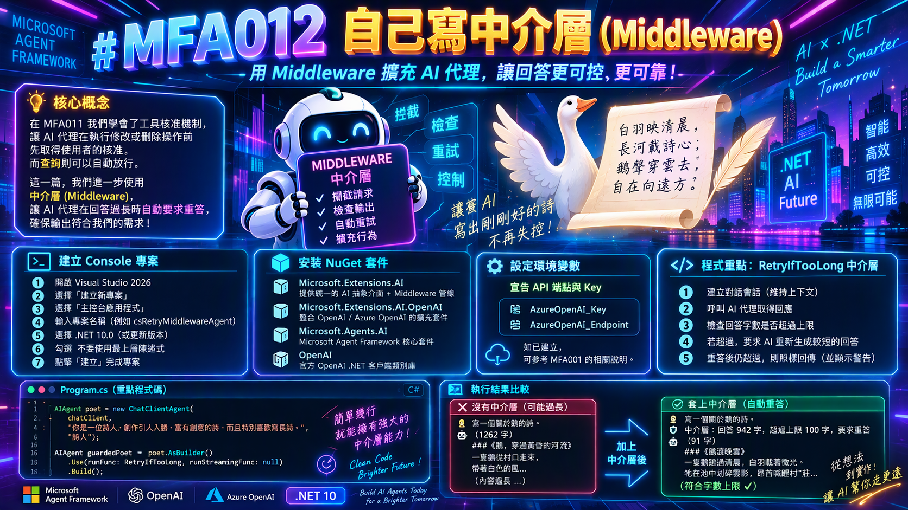

# MFA012 - 自己寫中介層（Middleware）

在上一篇關於 Microsoft Agent Framework 系列教學文章 "MFA011 - 工具核准（代理層的人機互動）" 中，我們學會了使用 MAF 提供的工具核准機制，讓 AI 代理在執行修改或刪除操作前，先取得使用者的核准。這裡舉出的例子為資料庫助理在執行修改或刪除訂單前，會先向使用者確認。但是若要對資料庫做查詢需求時，則可以自動放行，不需要額外的核准。



在完成這篇文章的練習，將會學會與理解到如何在 MAF 中使用與開發出適合自己使用的中介層（Middleware），並且能夠在 AI 代理的執行流程中，靈活地加入自訂的邏輯與控制。在這篇文章中，所建立起來的中介層方法將會用來檢查 AI 代理的回應是否超過字數上限，若超過則自動重試。

接下來看看如何做到這樣的效果。

# 建立 Console 專案
* 開啟 Visual Studio 2026
* 選擇「建立新專案」
* 在 [建立新的專案] 視窗中，在右方清單內，找到並選擇「主控台應用程式」 項目
* 然後點擊右下方「下一步」按鈕
* 此時將會看到 [設定新的專案] 對話窗
* 在該對話窗的 [專案名稱] 欄位中，輸入專案名稱，例如 "csRetryMiddlewareAgent"
* 然後點擊右下方「下一步」按鈕
* 接著會看到 [其他資訊] 對話窗
* 在這個對話窗內，確認使用底下的選項
    * 架構：.NET 10.0 (或更新版本)
    * 勾選 不要使用最上層陳述式 (這是我的個人習慣)
* 然後點擊右下方「建立」按鈕
* 現在，已經完成了這個 Console 主控台 專案的建立

## 安裝需要用到的 NuGet 套件

要完成這個第一次接觸 Microsoft Agent Framework 練習專案，需要安裝以下幾個 NuGet 套件：

### Microsoft.Extensions.AI

這個套件將會為生成式 AI 定義的一層「統一抽象介面 + Middleware 管線」，讓開發者可以更方便地整合不同的生成式 AI 模型，並且在應用程式中使用一致的方式進行呼叫與管理。

* 滑鼠右擊 [csRetryMiddlewareAgent] 專案節點
* 點選彈出功能表的 [管理 NuGet 套件] 項
* 在 [瀏覽] 索引標籤中，搜尋並且安裝底下的 NuGet 套件
    * Microsoft.Extensions.AI
    
### Microsoft.Extensions.AI.OpenAI

這個套件是微軟官方為 .NET 整合 AI 服務所提供的擴充套件。它實現了 IChatClient 與 IEmbeddingGenerator 核心抽象介面，讓開發人員能以一致的程式碼，輕鬆串接 OpenAI 或相容的 API 端點（例如 Azure OpenAI、GitHub Models 等）。

* 滑鼠右擊 [csRetryMiddlewareAgent] 專案節點
* 點選彈出功能表的 [管理 NuGet 套件] 項
* 在 [瀏覽] 索引標籤中，搜尋並且安裝底下的 NuGet 套件
    * Microsoft.Extensions.AI.OpenAI
    
### Microsoft.Agents.AI

這個套件是微軟官方推出 Microsoft Agent Framework（微軟智慧代理框架）的核心 .NET 套件。它主要用於在 .NET 環境中建構、協調與部署 AI 代理（AI Agents） 及多代理工作流（Multi-agent workflows），是用來取代舊版 AutoGen 的企業級解決方案。

* 滑鼠右擊 [csRetryMiddlewareAgent] 專案節點
* 點選彈出功能表的 [管理 NuGet 套件] 項
* 在 [瀏覽] 索引標籤中，搜尋並且安裝底下的 NuGet 套件
    * Microsoft.Agents.AI
     
### OpenAI

這個套件為官方的 OpenAI .NET 客戶端類別庫，是 OpenAI NuGet 套件。此套件由 OpenAI 與 Microsoft 合作開發，提供直接存取 OpenAI 官方 REST API 的便利管道。

* 滑鼠右擊 [csRetryMiddlewareAgent] 專案節點
* 點選彈出功能表的 [管理 NuGet 套件] 項
* 在 [瀏覽] 索引標籤中，搜尋並且安裝底下的 NuGet 套件
    * OpenAI

# 宣告 API 端點與 Key 環境變數

關於這個小節的內容，將會在這個系列每篇文章中都會用到，因此，可以參考 [MFA001 Microsoft Agent Framework 初次體驗開發出 AI 代理](https://csharpkh.blogspot.com/2026/10/mfa001-microsoft-agent-framework-ai.html) 文章中的 [宣告 API 端點與 Key 環境變數] 說明內容，若這裡提到的環境變數已經建立好了，則可以跳過這個小節內容。

# 修改 Program.cs 程式碼

為了要完成這個需求 : 如何用 Azure OpenAI 的 gpt-5.6-luna 聊天模型建立一個簡單 AI 代理，並產生一篇與鵝有關的詩。
因此，我們需要修改 Program.cs 程式碼，這時需要完成底下的操作。

* 在專案內，找到並且開啟 [Program.cs] 檔案
* 使用底下程式碼內容來取代 [Program.cs] 檔案的內容

```csharp
using Microsoft.Agents.AI;
using Microsoft.Extensions.AI;
using OpenAI;
using OpenAI.Chat;
using System.ClientModel;
using System.Text;
using ChatMessage = Microsoft.Extensions.AI.ChatMessage; // OpenAI.Chat 也有 ChatMessage，這裡指定用 MEAI 的

namespace csRetryMiddlewareAgent;

internal class Program
{
    // 回答的字數上限（直接用 response.Text.Length 計算，中文一個字算 1，標點與換行也算）
    private const int MaxChars = 100;

    static async Task Main(string[] args)
    {
        Console.OutputEncoding = Encoding.UTF8;

        var apiKey = Environment.GetEnvironmentVariable("AzureOpenAI_Key");
        var endpoint = Environment.GetEnvironmentVariable("AzureOpenAI_Endpoint");
        var model = "gpt-5.6-luna";

        if (string.IsNullOrWhiteSpace(apiKey) || string.IsNullOrWhiteSpace(endpoint))
        {
            Console.WriteLine("請先設定環境變數 AzureOpenAI_Key 與 AzureOpenAI_Endpoint 後再執行。");
            return;
        }

        IChatClient chatClient =
            new ChatClient(
                    model,
                    new ApiKeyCredential(apiKey),
                    new OpenAIClientOptions { Endpoint = new Uri(endpoint) })
                .AsIChatClient();

        AIAgent poet = new ChatClientAgent(
            chatClient,
            "你是一位詩人，創作引人入勝、富有創意的詩，而且特別喜歡寫長詩。", // 系統提示詞
            "詩人");                                                         // 代理名稱

        AIAgent guardedPoet = poet.AsBuilder()
            .Use(runFunc: RetryIfTooLong, runStreamingFunc: null)
            .Build();

        Console.WriteLine($"使用的模型：{model}／字數上限：{MaxChars} 字");

        Console.WriteLine();
        Console.WriteLine("===== 對照組：沒有中介層 =====");
        await AskAsync(poet, "寫一個關於鵝的詩。");

        Console.WriteLine();
        Console.WriteLine("===== 套上中介層 =====");
        await AskAsync(guardedPoet, "寫一個關於鵝的詩。");
    }

    private static async Task AskAsync(AIAgent agent, string question)
    {
        Console.WriteLine($"🧑 {question}");
        var response = await agent.RunAsync(question);
        Console.WriteLine($"🤖（{response.Text.Length} 字）");
        Console.WriteLine(response.Text);
    }

    private static async Task<AgentResponse> RetryIfTooLong(
        IEnumerable<ChatMessage> messages,
        AgentSession? session,
        AgentRunOptions? options,
        AIAgent innerAgent,
        CancellationToken cancellationToken)
    {
        session ??= await innerAgent.CreateSessionAsync(cancellationToken);

        var response = await innerAgent.RunAsync(messages, session, options, cancellationToken);
        if (response.Text.Length <= MaxChars)
        {
            return response;
        }

        Console.WriteLine($"🛡️ 中介層：回答 {response.Text.Length} 字，超過上限 {MaxChars} 字，要求重答");
        var retry = await innerAgent.RunAsync(
            $"你的回答有 {response.Text.Length} 字，超過 {MaxChars} 字的上限。請把同一首詩精簡到 {MaxChars} 字以內重新回答。",
            session, options, cancellationToken);

        if (retry.Text.Length > MaxChars)
        {
            Console.WriteLine($"⚠️ 中介層：重答後仍有 {retry.Text.Length} 字，照樣回傳");
        }
        return retry;
    }
}
```

這個程式一開始將會讀取 API Key 與服務端點的數據，接著如同前面的範例相同，先建立一個 IChatClient 物件。接者建立 AIAgent 物件，變數名稱為 poet，這裡將會指定這個 AI Agent 的系統提示詞為 : 你是一位詩人，創作引人入勝、富有創意的詩，而且特別喜歡寫長詩。"。

接著，對於這個代理人物件，使用 Use 方法，套用一個中介層，這個中介層會在回答過長時自動要求 AI 代理人重答，直到回答符合字數上限為止。也就是說，我們不需要擔心這個 AI 代理人會給出過長的回答，超過我們設定的字數限制。在以往若要做出這樣的效果，將會需要擁有非常有經驗的開發人員與擁有豐富的技術知識與能力，現在，當透過AI代理人這樣工具之後，就可以輕鬆的處理這樣的需求。

這裡開發出一個 RetryIfTooLong 方法，這個方法內會收到 ChatMessage 集合參數、AgentSession、AgentRunOptions、AIAgent 以及 CancellationToken。對於 messages 這個參數是用於傳遞使用者與 AI 代理人之間的對話內容，有了這個物件便可以取得完整的對話歷史，session 則是用來維持代理人的對話狀態，所以，這個物件可以提供對話的上下文，因此，在這個方法內使用這個物件可以做到保持對話的連貫性，options 則包含執行時的選項，在這個範例專案中，這個參數將會為 null，也就是不使用額外的執行選項，innerAgent 是實際執行請求的 AI 代理人，因此有了這個物件便可以發送請求並取得回答，而 cancellationToken 則用於取消操作。

首先，透過 innerAgent.CreateSessionAsync 方法建立一個對話會話，如果 session 為 null，便會使用這個方法創建新的會話。接著，使用 innerAgent.RunAsync 方法發送請求，在這裡，對於 messages 這個引數將會為 "寫一個關於鵝的詩。"，session 因為為第一次使用到，所以裡面沒有任何資料，options 為 null，cancellationToken 則用於取消操作。中介層會檢查回答的字數是否超過 MaxChars，如果超過，便會要求 AI 代理人重答，直到回答符合字數上限為止。

當 `await innerAgent.RunAsync` 這個非同步方法執行完成後，接下來就是檢查回應的詩是否符合字數上限。如果回答的字數沒有超過 MaxChars，便直接回傳這個回答；否則，螢幕上將會顯示警告訊息文字，例如： "🛡️ 中介層：回答 942 字，超過上限 100 字，要求重答" ，接著會再次呼叫 innerAgent.RunAsync，並告知 AI 代理人回答過長，要求重新生成符合字數上限的詩。若第二次再度執行 AI Agent 之後，得到的回應詩文字長度超過 MaxChars，仍會照樣回傳，但會在螢幕上顯示警告訊息，例如： "⚠️ 中介層：重答後仍有 115 字，照樣回傳" 。

現在回到程式進入點的程式碼， 將會得到第二個 AI 代理人物件 guardedPoet ，接下來就是分別使用 poet 與 guardedPoet 來傳入到 AsAsync 方法內，用來生成詩。這裡對於 poet 來說，沒有套用中介層，因此可能會得到超過字數上限的長詩；而 guardedPoet 則套用了 RetryIfTooLong 中介層，會自動檢查回答的字數，並在回答過長時要求 AI 代理人重答，直到符合字數上限為止。

# 執行結果

現在來看看這個範例程式碼的執行結果。

* 在 Visual Studio 2026 下，按下 F5 鍵執行程式，將會看到程式輸出的結果。

```plaintext
使用的模型：gpt-5.6-luna／字數上限：100 字

===== 對照組：沒有中介層 =====
🧑 寫一個關於鵝的詩。
🤖（868 字）
### 《鵝渡長河》

清晨，霜還伏在井沿，
一群鵝從柴門後走出來——
白羽像未寄出的信，
一封一封，
在薄霧裡慢慢展開。

牠們踱過石橋，
踱過昨夜落滿楓葉的路，
腳掌敲著秋天的鼓點：
喀、喀、喀——
把沉睡的村莊叫醒。

最前面的老鵝，
頸項高得像一枝彎月，
牠看過許多河流，
看過南方潮濕的雨，
看過北方雪原上
一盞孤獨的燈。

牠知道，
天空並不總是藍的，
河水也不總是溫柔；
有時風從遠山奔來，
把羽毛吹亂，
把方向吹得像一個謎。

可是鵝仍然叫著——
嘎！嘎！
那聲音粗糲、明亮，
像一把生鏽的鑰匙，
卻能打開清晨的門。

牠們走到河邊，
先把影子放進水裡，
再把身體放進水裡，
最後才把天空
一寸一寸地帶走。

河面忽然遼闊，
彷彿大地在此刻
有了兩隻白色的翅膀；
蘆葦低頭，
魚兒停在水下，
連風也屏住呼吸，
看牠們穿過倒映的雲。

有一隻小鵝落在後面，
牠的羽毛還不夠潔白，
腳步也總被水草纏住。
老鵝回過頭，
沒有催促，
只是把長長的脖子
彎成一座溫柔的橋。

於是小鵝跟上了。
牠們一起游向河心，
游向遠處閃耀的水路，
游向沒有人知道名字的地方。

午後，村人回家，
看見籬笆旁少了幾片羽毛；
孩子撿起它們，
插在草帽上，
以為自己也能飛翔。

夕陽沉入稻田，
鵝群沿著土路歸來，
身上沾著水光，
像從另一個世界
帶回了幾枚金色的鐘。

牠們仍然高聲叫著：
嘎！嘎！
彷彿在說：

不要因為翅膀沉重，
就忘了天空；
不要因為道路漫長，
就停止歌唱。

夜裡，月亮升過屋脊，
鵝群睡在溫暖的草垛旁。
牠們把脖子藏進羽翼，
把白日的河流
夢成一條銀色的長路。

而在夢的盡頭，
仍有一隻老鵝
站在星光下守望——
守望潮汐，守望遠方，
守望每一個
尚未學會飛翔的黎明。

===== 套上中介層 =====
🧑 寫一個關於鵝的詩。
🛡️ 中介層：回答 1102 字，超過上限 100 字，要求重答
🤖（91 字）
### 《鵝渡晚雲》

一隻鵝踏過清晨，
白羽載著微光。
牠在池中划碎雲影，
昂首喊醒村莊。
風起時萬物沉睡，
唯牠守著水岸，
以不滅的潔白，
迎向黎明。
```

這次的執行結果可以看到，guardedPoet 透過中介層的檢查，成功生成了符合字數上限的詩，而不會像 poet 那樣生成過長的詩。接下來再度重新執行一次，可以從底下的輸出結果看到，guardedPoet 依然會檢查回答的字數，並在超過上限時要求重答。

```plaintext
使用的模型：gpt-5.6-luna／字數上限：100 字

===== 對照組：沒有中介層 =====
🧑 寫一個關於鵝的詩。
🤖（1262 字）
### 《鵝，穿過黃昏的河流》

一隻鵝從村口走來，
帶著白色的風，
帶著一小片未曾融化的冬天，
牠的腳掌踩過泥土，
踩過昨夜的露水，
也踩過孩子們遺落在路旁的笑聲。

牠走得很慢，
彷彿大地是一張尚未寫完的信，
每一步，
都要先讀過石頭的沉默，
再讀過稻穗低頭的原因。

「嘎——」
牠忽然叫了一聲。

池塘裡的月亮便碎了，
碎成許多銀色的小魚，
游向蘆葦深處；
遠山也微微抬頭，
像一位年老的牧人，
聽見遙遠年代的召喚。

鵝不知道自己有多潔白。
牠只知道清晨很冷，
知道霜落在羽毛上時，
世界會暫時變得安靜；
知道一顆穀子，
可以使漫長的午後
有了溫暖的方向。

牠曾在春天見過雨，
雨絲像細小的琴弦，
一根一根落在背上；
牠曾在夏天見過荷花，
荷花把粉紅的火焰
舉到水面之上；
牠曾在秋天見過稻田，
金色的波浪一陣陣湧來，
彷彿整片大地
正在為誰鼓掌。

只有冬天，
冬天沒有掌聲。

冬天的河面結著薄冰，
天空低低地壓著村莊，
屋簷下的風
把每一個名字吹得很遠。
鵝便站在雪裡，
把脖子彎成一枚問號，
問白茫茫的世界：

春天呢？
春天還會回來嗎？

沒有人回答。
但遠處的炊煙升起，
一縷，兩縷，三縷，
像有人在灰色天幕上
慢慢縫補破洞。

於是鵝又叫了一聲——
不是為了恐嚇誰，
也不是為了宣告自己的勇敢，
只是因為沉默太厚，
厚得像一扇關久了的門，
總該有人
用一點聲音把它推開。

牠的叫聲穿過院牆，
穿過枯井，
穿過睡夢中翻身的孩子，
穿過老樹上最後一片葉子，
最後落進河裡，
成為水波一圈一圈
向外擴張的心。

黃昏時，鵝回到籬笆旁。
牠的影子被夕陽拉得很長，
長得像一條白色的道路，
通往屋後，
通往田野，
通往那些尚未發生的日子。

牠低下頭，
在草叢裡尋找一顆遲到的種子。
天邊有雲，
雲中有金色的火，
火焰慢慢熄滅，
而鵝仍然站著。

多麼平凡的一隻鵝啊——
白羽毛，紅腳掌，
一雙總是略帶驚訝的眼睛；
牠不懂星辰的名字，
不懂人間為何有戰爭、離別與謊言，
不懂人們為何匆忙地愛，
又匆忙地告別。

但牠懂得守住門前的清晨，
懂得在黑夜靠近時發出聲響，
懂得把一條小路
走成回家的方向。

所以，當夜色終於落下，
當村莊一盞盞亮起燈，
當每扇窗後
都有人把孤單藏進晚餐的熱氣裡——

請聽，
那隻鵝又在叫了。

嘎——
像一面小小的旗幟，
插在寂靜的土地上；

嘎——
像遠方尚未歸來的船，
在黑暗裡試探潮汐；

嘎——
像一顆不肯熄滅的心，
對著沉沉的世界說：

我在這裡。
我還醒著。
我仍然相信，
明天的河流，
會把天上的光
帶回人間。

===== 套上中介層 =====
🧑 寫一個關於鵝的詩。
🛡️ 中介層：回答 942 字，超過上限 100 字，要求重答
⚠️ 中介層：重答後仍有 115 字，照樣回傳
🤖（115 字）
### 《河岸上的鵝》

晨霧未散，鵝群抖落露水，
嘎聲喚醒沉睡的村莊。
牠們沿河而行，
足印如花，翅膀如帆。
夕陽西下，白影歸草坡；
老鵝仰望星空：
即使道路泥濘，
仍向風與光，
唱出活著的響亮。
```
