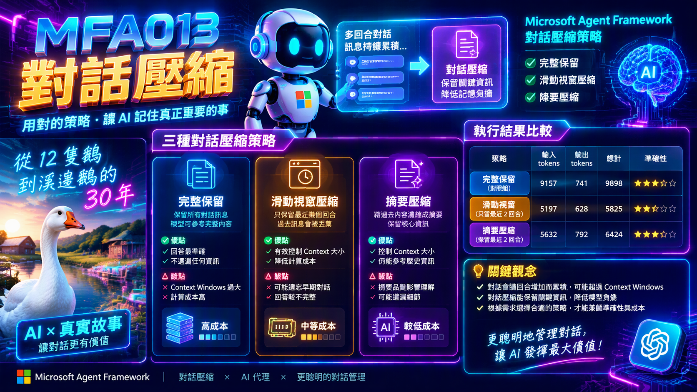

# MFA013 - 對話壓縮

在上一篇關於 Microsoft Agent Framework 系列教學文章 "MFA012 - 自己寫中介層（Middleware）" 中，我們學會了使用 MAF 提供的中介層機制，能夠在 AI 代理的執行流程中，插入自訂的邏輯與控制。



當在進行多回合對話時，訊息會隨著回合數增加而累積，若不加以管理，將會有可能造成模型 Context Windows 超過大小的問題，又或者模型無法有效記住早期的對話內容，影響回答的準確性。因此，我們需要透過對話壓縮策略，來有效管理訊息的累積，保留關鍵資訊，同時降低模型的記憶負擔。然而，當在進行多回合對話時，如何選擇適當的壓縮策略，並確保模型仍能取得核心資訊，便成為一個重要的課題。

在完成這篇文章的練習，將會體驗三種作法，分別是完整保留、滑動視窗壓縮以及摘要壓縮。這三種做法各有其優缺點，開發者可以根據實際需求選擇最適合的策略。簡單說明這三種做法的差異與優缺點如下：

* 完整保留：保留所有對話訊息，模型可以參考完整的對話內容，但容易造成 Context Windows 過大，增加計算成本。
* 滑動視窗壓縮：只保留最近幾個回合的訊息，過去的訊息會被丟棄，能有效控制 Context Windows 大小，但模型可能遺忘早期的對話內容。
* 摘要壓縮：將過去的對話內容進行摘要，保留核心資訊，既能控制 Context Windows 大小，又能讓模型參考歷史訊息，但摘要的品質可能影響模型的理解。

接下來看看如何做到這樣的效果。

# 建立 Console 專案
* 開啟 Visual Studio 2026
* 選擇「建立新專案」
* 在 [建立新的專案] 視窗中，在右方清單內，找到並選擇「主控台應用程式」 項目
* 然後點擊右下方「下一步」按鈕
* 此時將會看到 [設定新的專案] 對話窗
* 在該對話窗的 [專案名稱] 欄位中，輸入專案名稱，例如 "csCompactionAgent"
* 然後點擊右下方「下一步」按鈕
* 接著會看到 [其他資訊] 對話窗
* 在這個對話窗內，確認使用底下的選項
    * 架構：.NET 10.0 (或更新版本)
    * 勾選 不要使用最上層陳述式 (這是我的個人習慣)
* 然後點擊右下方「建立」按鈕
* 現在，已經完成了這個 Console 主控台 專案的建立

## 安裝需要用到的 NuGet 套件

要完成這個第一次接觸 Microsoft Agent Framework 練習專案，需要安裝以下幾個 NuGet 套件：

### Microsoft.Extensions.AI

這個套件將會為生成式 AI 定義的一層「統一抽象介面 + Middleware 管線」，讓開發者可以更方便地整合不同的生成式 AI 模型，並且在應用程式中使用一致的方式進行呼叫與管理。

* 滑鼠右擊 [csCompactionAgent] 專案節點
* 點選彈出功能表的 [管理 NuGet 套件] 項
* 在 [瀏覽] 索引標籤中，搜尋並且安裝底下的 NuGet 套件
    * Microsoft.Extensions.AI
    
### Microsoft.Extensions.AI.OpenAI

這個套件是微軟官方為 .NET 整合 AI 服務所提供的擴充套件。它實現了 IChatClient 與 IEmbeddingGenerator 核心抽象介面，讓開發人員能以一致的程式碼，輕鬆串接 OpenAI 或相容的 API 端點（例如 Azure OpenAI、GitHub Models 等）。

* 滑鼠右擊 [csCompactionAgent] 專案節點
* 點選彈出功能表的 [管理 NuGet 套件] 項
* 在 [瀏覽] 索引標籤中，搜尋並且安裝底下的 NuGet 套件
    * Microsoft.Extensions.AI.OpenAI
    
### Microsoft.Agents.AI

這個套件是微軟官方推出 Microsoft Agent Framework（微軟智慧代理框架）的核心 .NET 套件。它主要用於在 .NET 環境中建構、協調與部署 AI 代理（AI Agents） 及多代理工作流（Multi-agent workflows），是用來取代舊版 AutoGen 的企業級解決方案。

* 滑鼠右擊 [csCompactionAgent] 專案節點
* 點選彈出功能表的 [管理 NuGet 套件] 項
* 在 [瀏覽] 索引標籤中，搜尋並且安裝底下的 NuGet 套件
    * Microsoft.Agents.AI
     
### OpenAI

這個套件為官方的 OpenAI .NET 客戶端類別庫，是 OpenAI NuGet 套件。此套件由 OpenAI 與 Microsoft 合作開發，提供直接存取 OpenAI 官方 REST API 的便利管道。

* 滑鼠右擊 [csCompactionAgent] 專案節點
* 點選彈出功能表的 [管理 NuGet 套件] 項
* 在 [瀏覽] 索引標籤中，搜尋並且安裝底下的 NuGet 套件
    * OpenAI

# 宣告 API 端點與 Key 環境變數

關於這個小節的內容，將會在這個系列每篇文章中都會用到，因此，可以參考 [MFA001 Microsoft Agent Framework 初次體驗開發出 AI 代理](https://csharpkh.blogspot.com/2026/10/mfa001-microsoft-agent-framework-ai.html) 文章中的 [宣告 API 端點與 Key 環境變數] 說明內容，若這裡提到的環境變數已經建立好了，則可以跳過這個小節內容。

# 修改 Program.cs 程式碼

為了要完成這個需求 : 如何用 Azure OpenAI 的 gpt-5.6-luna 聊天模型建立一個簡單 AI 代理，並產生一篇與鵝有關的詩。
因此，我們需要修改 Program.cs 程式碼，這時需要完成底下的操作。

* 在專案內，找到並且開啟 [Program.cs] 檔案
* 使用底下程式碼內容來取代 [Program.cs] 檔案的內容

```csharp
#pragma warning disable MAAI001

using Microsoft.Agents.AI;
using Microsoft.Agents.AI.Compaction;
using Microsoft.Extensions.AI;
using OpenAI;
using OpenAI.Chat;
using System.ClientModel;
using System.Text;
using ChatMessage = Microsoft.Extensions.AI.ChatMessage;

namespace csCompactionAgent;

internal class Program
{
    private const string Instructions =
        "你是一位資深記者，正在逐段研讀一篇訪談稿並回答追問。請用繁體中文在 120 字內回答。" +
        "只能根據對話中出現過的內容回答；對話中找不到的資訊請直說「不記得」，不要猜。";

    private static readonly string[] Segments =
    [
        """
        記者：林阿伯，您是怎麼開始養鵝的？
        林阿伯：1987 年我退伍回到濁水溪邊的老家，田裡種稻賺不了錢。我跟舅舅借了三萬塊，
        買了 12 隻白羅曼鵝的雛鵝，就養在豬舍旁邊的空地。其中有一隻特別貪吃、走路一搖一擺，
        每天跟在我後面討飯吃，我就叫牠「阿肥」。那時候什麼都不懂，晚上還抱著手電筒去看牠們有沒有著涼，
        我媽都笑我說養鵝比養小孩還認真。
        """,
        """
        記者：後來規模是怎麼擴大的？
        林阿伯：前十年都是一點一點加，最多養到一千多隻。可是 1998 年那個颱風，溪水一夜之間漫進來，
        鵝舍整個泡在水裡，我划著塑膠桶去救，最後還是死了八百多隻。那陣子我真的想放棄，
        欠了農會一屁股債，每天凌晨三點就醒來，看著空空的鵝舍發呆。是隔壁的陳伯拉我去喝酒，
        跟我說「鵝會再生，人不能倒」，我才咬牙重新來過。
        """,
        """
        記者：重建之後，經營方式有什麼改變？
        林阿伯：我學乖了，鵝舍全部墊高一公尺，也不再只賣活鵝給盤商，因為價格被壓得很低。
        2003 年我太太在路口擺了一個小攤子賣鵝肉飯和煙燻鵝，自己養、自己殺、自己賣，
        一隻鵝的利潤多了快三倍。後來連台中的客人都專程開車來買，攤子變成店面，
        店名就叫「溪邊鵝」，到現在還是假日要排隊的店。
        """,
        """
        記者：這中間有遇過比颱風更難的關卡嗎？
        林阿伯：2015 年的禽流感。附近鵝場驗出病毒，防疫人員來了，整個場區三公里內全部撲殺，
        我們家兩千多隻鵝一天之內就沒了。那種感覺跟颱風不一樣，颱風是天災，這次是眼睜睜看著。
        政府有補償，但錢補不回心情。之後我把場區改成全密閉的負壓鵝舍，進出都要消毒換鞋，
        花了將近四百萬，但從那之後再也沒出過事。
        """,
        """
        記者：聽說現在場裡主要是女兒在管？
        林阿伯：對，小惠在台北做了八年的軟體工程師，2020 年疫情那年決定回來。
        她在鵝舍裝了溫溼度感測器和攝影機，手機上就能看每一區的狀況，飼料也改成依體重自動配給，
        一年省下快兩成成本。她還開了網路商店賣真空包的煙燻鵝，現在網購已經佔營收一半。
        我一開始覺得那些東西是花拳繡腿，後來半夜不用再起來巡場，才知道年輕人是對的。
        """,
        """
        記者：最後，您對鵝場的未來有什麼想像？
        林阿伯：我今年六十多歲了，想做的事只剩一件：讓小孩子知道食物是從哪裡來的。
        我們明年要開放鵝場導覽，跟附近三間國小合作食農教育，讓學生來餵鵝、撿鵝蛋，
        再到店裡吃一碗鵝肉飯。小惠說要做成 APP 預約，我說好啦好啦，你們年輕人決定。
        只要鵝場還在，這條溪邊就會一直有鵝叫聲，這樣我就滿足了。
        """
    ];

    private static readonly string[] FollowUps =
    [
        "從這段看來，林阿伯當初創業最大的風險是什麼？",
        "颱風之後他能重新站起來，關鍵是什麼？",
        "自產自銷為什麼能讓利潤變成將近三倍？",
        "禽流感和颱風對他的打擊，本質上有什麼不同？",
        "小惠導入的改變裡，哪一項對林阿伯的生活影響最大？",
        "林阿伯對未來的想像，和他當初創業的動機有什麼不同？"
    ];

    private const string DetailQuestion = "回到第一段：林阿伯一開始養了幾隻鵝？那隻愛跟在他後面的鵝叫什麼名字？";
    private const string SynthesisQuestion = "請用三點總結整篇訪談中，林阿伯人生的重大轉折與年份。";

    private const string SummaryPrompt =
        "你是對話摘要員。請用繁體中文把以下對話濃縮成一份摘要。" +
        "如果對話中已經有先前的摘要（[Summary] 開頭），要保留它的重點，再把新內容合併進去。" +
        "每段訪談只寫一行、不超過 40 字，只留人名、數量、金額與年份等關鍵事實，不要寫分析與問答過程。";

    private static int lastSentMessages;

    static async Task Main(string[] args)
    {
        Console.OutputEncoding = Encoding.UTF8;

        var apiKey = Environment.GetEnvironmentVariable("AzureOpenAI_Key");
        var endpoint = Environment.GetEnvironmentVariable("AzureOpenAI_Endpoint");
        var model = "gpt-5.6-luna";

        if (string.IsNullOrWhiteSpace(apiKey) || string.IsNullOrWhiteSpace(endpoint))
        {
            Console.WriteLine("請先設定環境變數 AzureOpenAI_Key 與 AzureOpenAI_Endpoint 後再執行。");
            return;
        }

        IChatClient chatClient =
            new ChatClient(
                    model,
                    new ApiKeyCredential(apiKey),
                    new OpenAIClientOptions { Endpoint = new Uri(endpoint) })
                .AsIChatClient();

        IChatClient agentClient = chatClient.AsBuilder().Use(CountMessages, null).Build();

        IChatClient summarizerClient = chatClient.AsBuilder().Use(PrintSummary, null).Build();

        var trigger = CompactionTriggers.TurnsExceed(3);

        Console.WriteLine($"使用的模型：{model}／訪談共 {Segments.Length} 段，加上 2 題總結追問");

        await RunInterviewAsync(agentClient, "執行 1 / 不壓縮（對照組）", null);

        await RunInterviewAsync(agentClient, "執行 2 / 滑動視窗：只留最近 2 個回合",
            new SlidingWindowCompactionStrategy(trigger, 2));

        await RunInterviewAsync(agentClient, "執行 3 / 摘要：舊回合交給 LLM 濃縮成一則摘要",
            new SummarizationCompactionStrategy(summarizerClient, trigger, 4, SummaryPrompt));
    }

    private static async Task RunInterviewAsync(IChatClient client, string title, CompactionStrategy? strategy)
    {
        Header(title);

        AIAgent agent = new ChatClientAgent(client, new ChatClientAgentOptions
        {
            Name = "訪談分析師",
            ChatOptions = new ChatOptions { Instructions = Instructions },
            // 重點就這一行：把壓縮策略包成 CompactionProvider 掛到代理上
            AIContextProviders = strategy is null ? null : [new CompactionProvider(strategy)]
        });

        var session = await agent.CreateSessionAsync();
        var rows = new List<(string Turn, int Sent, long Input, long Output)>();

        async Task AskAsync(string turn, string question, string prompt)
        {
            Say($"🧑 {turn}", question);
            var response = await agent.RunAsync(prompt, session);
            Say("🤖 分析師", response.Text);
            rows.Add((turn, lastSentMessages,
                response.Usage?.InputTokenCount ?? 0, response.Usage?.OutputTokenCount ?? 0));
        }

        for (int i = 0; i < Segments.Length; i++)
        {
            // 畫面上只印追問，實際送給代理的是「整段訪談 + 追問」
            await AskAsync($"第 {i + 1} 段", FollowUps[i], $"【第 {i + 1} 段】\n{Segments[i]}\n\n問題：{FollowUps[i]}");
        }
        await AskAsync("細節題", DetailQuestion, DetailQuestion);
        await AskAsync("綜合題", SynthesisQuestion, SynthesisQuestion);

        Console.WriteLine();
        Console.WriteLine($"  【{title}】每回合統計");
        Console.WriteLine("  回合      送出訊息數  輸入 tokens  輸出 tokens");
        foreach (var row in rows)
        {
            Console.WriteLine($"  {row.Turn,-6}  {row.Sent,10}  {row.Input,11}  {row.Output,11}");
        }
        Console.WriteLine($"  {"合計",-6}  {"",10}  {rows.Sum(r => r.Input),11}  {rows.Sum(r => r.Output),11}");
    }

    private static Task<ChatResponse> CountMessages(
        IEnumerable<ChatMessage> messages, ChatOptions? options, IChatClient innerClient, CancellationToken cancellationToken)
    {
        var list = messages.ToList();
        lastSentMessages = list.Count;
        return innerClient.GetResponseAsync(list, options, cancellationToken);
    }

    private static async Task<ChatResponse> PrintSummary(
        IEnumerable<ChatMessage> messages, ChatOptions? options, IChatClient innerClient, CancellationToken cancellationToken)
    {
        var response = await innerClient.GetResponseAsync(messages, options, cancellationToken);
        Console.WriteLine();
        Console.WriteLine($"  📝 產生摘要（輸入 {response.Usage?.InputTokenCount} ／輸出 {response.Usage?.OutputTokenCount} tokens）：");
        Console.WriteLine($"     {response.Text.ReplaceLineEndings("\n     ")}");
        return response;
    }

    private static void Header(string title)
    {
        Console.WriteLine();
        Console.WriteLine(new string('=', 74));
        Console.WriteLine($"  {title}");
        Console.WriteLine(new string('=', 74));
    }

    private static void Say(string who, string? text)
    {
        Console.WriteLine();
        Console.WriteLine($"  {who} ▸ {text}");
    }
}
```

這個程式一開始將會讀取 API Key 與服務端點的數據，接著如同前面的範例相同，先建立一個 IChatClient 物件。接者建立 IChatClient 物件，變數名稱為 chatClient，接著將會建立第二個 IChatClient 物件，變數名稱為 agentClient ，並透過 CountMessages 中介函式來統計每回合送出的訊息數。

在這裡先來了解 CountMessages 中介函式做了甚麼事情：

在這個方法內，將會收到這四個參數，分別是，1. messages：傳入的聊天訊息集合。2. options：聊天選項，可能包含模型、溫度等設定。3. innerClient：實際的聊天客戶端，用來取得模型回應。4. cancellationToken：取消操作的標記。

1. 它會將傳入的訊息集合轉成清單。 `var list = messages.ToList();`
2. 記錄清單的數量到 lastSentMessages 變數，這樣就能統計每回合送出的訊息數。由聊天用戶端中介層記錄：這一輪模型「實際收到」幾則訊息
3. 最後呼叫 innerClient 的 GetResponseAsync 方法，將訊息傳給實際的聊天模型，並回傳回應。

回到主程式進入點，接者建立摘要用的用戶端 summarizerClient ，同樣的，這裡也會多包一層，把每次產生的摘要印出來，方便追蹤每回合的摘要內容。同樣的，這裡也是透過中介軟體來做到，這裡將會使用 PrintSummary 這個方法來處理。

對於這個方法，會收到與 PrintSummary 相同的四個參數，分別是 messages、options、innerClient 與 cancellationToken。它的主要功能將會提供做到摘要策略呼叫 LLM 時，把產生的摘要與花費的 token 印出來，方便追蹤每回合的摘要內容。底下為其處理流程：

1. 呼叫 innerClient 的 GetResponseAsync 方法，取得模型回應。
2. 將回應的摘要內容印出，方便追蹤每回合的摘要。在此將會取得模型回應的使用統計數據中的輸入與輸出 token 數，並印出來。
3. 回傳模型的回應。

再度回到主程式的流程，接下來將會依序執行 `CompactionTriggers.TurnsExceed(3)` 這個壓縮觸發條件，當對話回合數超過 3 回合時，將會觸發對話壓縮策略。在此將會得到 trigger 物件，這個物件將會在執行2階段，傳入到 RunInteractionAsync 方法中，在第二個參數內，將會傳入到 SlidingWindowCompactionStrategy 建構函式內。這個方法位於 Microsoft.Agents.AI.Compaction 命名空間內，而這個類別將會用於管理對話壓縮的策略，確保在對話回合數超過設定值時，能夠自動進行摘要與壓縮。

這樣的設計可以確保在對話過程中，當訊息量累積到一定程度時，系統會自動進行摘要與壓縮，避免訊息過多導致模型處理效率下降，同時也能保留對話的核心內容，提升整體互動體驗。

現在又回到主程式的流程，接下來會開始執行 RunInterviewAsync 方法三次，第一次將會做到不壓縮（對照組），第二次則會依照設定的壓縮觸發條件進行對話壓縮，第三次則會再次執行，觀察壓縮策略的效果。

現在要來看看 RunInterviewAsync 做了甚麼事情。這個方法主要負責執行整個訪談流程，首先在這裡建立了一個 AI Agent 物件，agent，在這裡提供的系統提示詞為 "你是一位資深記者，正在逐段研讀一篇訪談稿並回答追問。請用繁體中文在 120 字內回答。只能根據對話中出現過的內容回答；對話中找不到的資訊請直說「不記得」，不要猜。" ， 這個系統提示詞將會引導模型在整個訪談過程中，依照設定的規則進行回答。這些規則將會做到：
1. 只能根據對話中出現過的內容回答，對話中找不到的資訊要直說「不記得」。
2. 回答需控制在 120 字以內。
3. 以資深記者的角度，逐段研讀訪談稿並回答追問。

對於 ChatClientAgentOptions 這個類別，在建立的時候，對於第三個傳入的參數，AIContextProviders，若得到的 strategy 為非 null，將會把它加入到上下文提供者的集合中，這樣在每次與模型互動時，都能夠依照設定的策略來管理對話上下文，確保對話壓縮與摘要策略能夠正確運作。在此將會建立一個 CompactionProvider，並將其加入到 AIContextProviders 的集合中。在這個建構函式將會傳入 strategy 物件，以便在每次對話中依照策略進行壓縮與摘要。

接下來，將會透過代理人物件的 CreateSessionAsync 方法來建立一個新的對話會話，這個方法會回傳一個 session 物件，代表一次完整的對話流程。透過這個 session，將會依序處理每個回合的對話，並根據設定的壓縮策略決定是否進行對話壓縮。

對於接下來的 AskAsync 方法，將會是一個 Inline 方法，用來向模型提出問題並取得回應。這個方法會接收使用者的提問，並將其轉換成模型可理解的訊息格式，然後透過代理用的聊天用戶端，也就是 agent 物件，發送給模型，同時也會傳送對話物件 session 到 RunAsync 內，以便模型能夠知道當前的對話上下文，最後回傳模型的回應結果。

現在將會根據 Segments 這個字串型別的集合型別物件，這裡代表虛構的長篇訪談稿：鵝農林阿伯的三十多年（第一段埋了最後要考的細節：12 隻、阿肥），逐一將每一個字串取出來，透過迴圈依序呼叫剛剛說明的 Inline 方法，也就是 AskAsync 方法，將每個段落的內容傳給模型，並取得模型的回應。這樣可以模擬整個訪談過程，逐段與模型互動，並在每回合結束後，依照設定的壓縮策略決定是否進行對話壓縮。

對於 FollowUps 這個字串型別的集合型別物件，表示每一段配一個預先寫好的追問：三次執行的輸入完全相同，比較才公平。每個追問都對應到 Segments 中的相應段落。將會依序處理每一個追問，透過迴圈依序呼叫 AskAsync 方法，將每個追問傳給模型，並取得模型的回應。這樣可以模擬整個訪談過程中，使用者對每個段落的追問，並在每回合結束後，依照設定的壓縮策略決定是否進行對話壓縮。

例如，在第一輪呼叫 RunInterviewAsync 方法時，對於第一次觸發 AskAsync 方法，對於 prompt 參數，將會是底下內容

```plaintext
【第 1 段】
記者：林阿伯，您是怎麼開始養鵝的？
林阿伯：1987 年我退伍回到濁水溪邊的老家，田裡種稻賺不了錢。我跟舅舅借了三萬塊，
買了 12 隻白羅曼鵝的雛鵝，就養在豬舍旁邊的空地。其中有一隻特別貪吃、走路一搖一擺，
每天跟在我後面討飯吃，我就叫牠「阿肥」。那時候什麼都不懂，晚上還抱著手電筒去看牠們有沒有著涼，
我媽都笑我說養鵝比養小孩還認真。

問題：從這段看來，林阿伯當初創業最大的風險是什麼？
```

在整個迴圈執行完成後，將會對模型提出 "細節題" 與 "綜合題"，以檢驗模型對整篇訪談的理解與摘要能力。前者將會詢問 "回到第一段：林阿伯一開始養了幾隻鵝？那隻愛跟在他後面的鵝叫什麼名字？" 後者將會詢問 "請用三點總結整篇訪談中，林阿伯人生的重大轉折與年份。"，接下來看看三次呼叫 RunInterviewAsync 方法的執行結果。

第一輪（不壓縮對照組）將會得到 "細節題" 與 "綜合題" 的回答，並且每回合的訊息都不會被壓縮，完整保留所有對話內容。

```plaintext
  🧑 細節題 ▸ 回到第一段：林阿伯一開始養了幾隻鵝？那隻愛跟在他後面的鵝叫什麼名字？

  🤖 分析師 ▸ 一開始養了12隻白羅曼鵝雛鵝，那隻愛跟在他後面的鵝叫「阿肥」。

  🧑 綜合題 ▸ 請用三點總結整篇訪談中，林阿伯人生的重大轉折與年份。

  🤖 分析師 ▸ 1. 1987年：退伍返鄉，借錢買12隻雛鵝，開始養鵝
```

在第一輪的執行中，所有回合的訊息都完整保留，沒有進行任何壓縮，因此模型可以參考整篇訪談的內容來回答細節題與綜合題。

第二輪（滑動視窗：只留最近 2 個回合）將會得到 "細節題" 與 "綜合題" 的回答，每回合只保留最近兩個回合的對話內容，其餘的會被壓縮或丟棄。

```plaintext
  🧑 細節題 ▸ 回到第一段：林阿伯一開始養了幾隻鵝？那隻愛跟在他後面的鵝叫什麼名字？

  📝 產生摘要（輸入 497 ／輸出 224 tokens）：
     [Summary]
     1987年林阿伯借3萬元買12隻雛鵝創業。
     前十年擴至千餘隻；1998年颱風死800多隻。
     2003年改養鵝並販售鵝肉飯、煙燻鵝，成立溪邊鵝。
     2015年禽流感撲殺2,000多隻，改建密閉鵝舍花近400萬元。

  🤖 分析師 ▸ 一開始養了12隻雛鵝；那隻愛跟在他後面的鵝叫什麼名字，我不記得。

  🧑 綜合題 ▸ 請用三點總結整篇訪談中，林阿伯人生的重大轉折與年份。

  📝 產生摘要（輸入 481 ／輸出 292 tokens）：
     1987年林阿伯借3萬元買12隻雛鵝創業。
     前十年擴至千餘隻；1998年颱風死800多隻。
     2003年改養鵝並販售鵝肉飯、煙燻鵝，成立溪邊鵝。
     2015年禽流感撲殺2,000多隻，改建密閉鵝舍花近400萬元。
     2020年女兒小惠返鄉，導入智慧養鵝，省近兩成成本。
     小惠經營網路商店，網購營收占一半，林阿伯免夜間巡場。

  🤖 分析師 ▸ 1. 1987年：借3萬元買12隻雛鵝，開始養鵝創業。
2. 1998年：颱風造成800多隻鵝死亡，成為重大打擊。
3. 2003年至2020年：轉型販售鵝肉；2015年禽流感後升級鵝舍，2020年女兒返鄉導入智慧養鵝。
```

在第二輪的執行中，由於採用了滑動視窗的壓縮策略，只保留最近兩個回合的對話內容，其餘的會被壓縮或丟棄，因此模型在回答細節題時，對於第一段的資訊可能無法完整回憶。這也說明了在使用滑動視窗策略時，模型的記憶是有限的，過去的訊息可能會被遺忘。

第三輪（壓縮策略：保留最近 2 個回合，其他回合壓縮）將會得到 "細節題" 與 "綜合題" 的回答，每回合只保留最近兩個回合的對話內容，其餘的會被壓縮，但壓縮後的內容仍可供模型參考。

```plaintext
  🧑 細節題 ▸ 回到第一段：林阿伯一開始養了幾隻鵝？那隻愛跟在他後面的鵝叫什麼名字？

  📝 產生摘要（輸入 478 ／輸出 224 tokens）：
     1987年林阿伯借3萬元買12隻白羅曼鵝創業。
     1998年颱風淹鵝舍，死800多隻；陳伯鼓勵重振。
     2003年自產自銷鵝肉飯、燻鵝，利潤增近3倍，成立溪邊鵝。
     2015年禽流感撲殺兩千多隻鵝，花近400萬元改建負壓鵝舍。

  🤖 分析師 ▸ 一開始養了12隻白羅曼鵝；那隻愛跟在他後面的鵝叫什麼名字，我不記得。

  🧑 綜合題 ▸ 請用三點總結整篇訪談中，林阿伯人生的重大轉折與年份。

  📝 產生摘要（輸入 491 ／輸出 265 tokens）：
     1987年林阿伯借3萬元買12隻白羅曼鵝創業。
     1998年颱風淹鵝舍，死800多隻；陳伯鼓勵重振。
     2003年自產自銷鵝肉飯、燻鵝，利潤增近3倍，成立溪邊鵝。
     2015年禽流感撲殺兩千多隻鵝，花近400萬元改建負壓鵝舍。
     2020年小惠返鄉導入智慧養鵝，省近兩成成本，網購占營收半數。

  🤖 分析師 ▸ 1. 1987年：借3萬元買12隻鵝，開始養鵝創業。
```

在第三輪的執行中，採用了壓縮策略，保留最近兩個回合的對話內容，其餘的回合會被壓縮，但壓縮後的內容仍可供模型參考。這樣可以在有限的記憶下，仍保留對話的核心資訊，幫助模型回答細節題與綜合題。

在實務應用中，這種壓縮策略適合用於長篇訪談或多回合對話，能有效降低模型的記憶負擔，同時保留關鍵資訊，提升回答的準確性與一致性。

# 執行結果

現在來看看這個範例程式碼的執行結果。

* 在 Visual Studio 2026 下，按下 F5 鍵執行程式，將會看到程式輸出的結果。

```plaintext
使用的模型：gpt-5.6-luna／訪談共 6 段，加上 2 題總結追問

==========================================================================
  執行 1 / 不壓縮（對照組）
==========================================================================

  🧑 第 1 段 ▸ 從這段看來，林阿伯當初創業最大的風險是什麼？

  🤖 分析師 ▸ 文中未明說「最大風險」。可看出他借三萬元投入，且當時毫無養鵝經驗，若飼養失敗，可能面臨資金損失與生計壓力。

  🧑 第 2 段 ▸ 颱風之後他能重新站起來，關鍵是什麼？

  🤖 分析師 ▸ 關鍵是陳伯的支持與鼓勵，讓他沒有因重大損失和債務倒下；他也靠著堅持重新開始養鵝。

  🧑 第 3 段 ▸ 自產自銷為什麼能讓利潤變成將近三倍？

  🤖 分析師 ▸ 因為不再只把活鵝低價賣給盤商，而是自行屠宰、加工成鵝肉飯與煙燻鵝，再直接銷售給消費者，省去盤商抽成並提高產品附加價值。

  🧑 第 4 段 ▸ 禽流感和颱風對他的打擊，本質上有什麼不同？

  🤖 分析師 ▸ 颱風屬於突發天災，鵝舍遭洪水淹沒；禽流感則是疫情防疫下的撲殺，雖非直接天災，卻是眼睜睜看著鵝群被消失，心理打擊更深。

  🧑 第 5 段 ▸ 小惠導入的改變裡，哪一項對林阿伯的生活影響最大？

  🤖 分析師 ▸ 溫溼度感測器和攝影機影響最大，讓林阿伯能用手機掌握各區狀況，半夜不用再起來巡場，直接改善了生活作息。

  🧑 第 6 段 ▸ 林阿伯對未來的想像，和他當初創業的動機有什麼不同？

  🤖 分析師 ▸ 當初創業是因稻作收入不佳，為了改善生計而養鵝；如今則不以賺錢為主要目標，而是希望透過導覽與食農教育，讓孩子認識食物來源，延續鵝場與地方記憶。

  🧑 細節題 ▸ 回到第一段：林阿伯一開始養了幾隻鵝？那隻愛跟在他後面的鵝叫什麼名字？

  🤖 分析師 ▸ 一開始養了12隻白羅曼鵝雛鵝；那隻愛跟在他後面的鵝叫「阿肥」。

  🧑 綜合題 ▸ 請用三點總結整篇訪談中，林阿伯人生的重大轉折與年份。

  🤖 分析師 ▸ 1. **1987年**：退伍返鄉，借款三萬元開始養鵝。
2. **1998年**：颱風淹沒鵝舍、死傷八百多隻，在陳伯鼓勵下重新振作。
3. **2003年後**：改採自產自銷，創立「溪邊鵝」；2015年禽流感後升級防疫，2020年由女兒導入科技經營。

  【執行 1 / 不壓縮（對照組）】每回合統計
  回合      送出訊息數  輸入 tokens  輸出 tokens
  第 1 段            1          285          136
  第 2 段            3          544           45
  第 3 段            5          791           66
  第 4 段            7         1064           72
  第 5 段            9         1350           83
  第 6 段           11         1608           71
  細節題             13         1723           39
  綜合題             15         1792          229
  合計                         9157          741

==========================================================================
  執行 2 / 滑動視窗：只留最近 2 個回合
==========================================================================

  🧑 第 1 段 ▸ 從這段看來，林阿伯當初創業最大的風險是什麼？

  🤖 分析師 ▸ 不記得。段落只提到借三萬元買雛鵝、缺乏養鵝經驗，未明確說明最大的風險。

  🧑 第 2 段 ▸ 颱風之後他能重新站起來，關鍵是什麼？

  🤖 分析師 ▸ 關鍵是陳伯的支持與鼓勵。陳伯拉他喝酒，告訴他「鵝會再生，人不能倒」，讓他在欠債、幾乎想放棄時咬牙重新開始。

  🧑 第 3 段 ▸ 自產自銷為什麼能讓利潤變成將近三倍？

  🤖 分析師 ▸ 因為不再只把活鵝低價賣給盤商，而是自行養殖、屠宰並製成鵝肉飯和煙燻鵝直接販售，省去盤商壓價與中間環節，因此每隻鵝利潤多了快三倍。

  🧑 第 4 段 ▸ 禽流感和颱風對他的打擊，本質上有什麼不同？

  🤖 分析師 ▸ 颱風屬於突如其來的天災，鵝舍被洪水淹沒；禽流感則是眼睜睜看著防疫撲殺，兩千多隻鵝一天全沒了。前者偏向意外破壞，後者帶來更強的心理煎熬。

  🧑 第 5 段 ▸ 小惠導入的改變裡，哪一項對林阿伯的生活影響最大？

  🤖 分析師 ▸ 對林阿伯生活影響最大的是裝設溫溼度感測器和攝影機，讓他能用手機掌握各區狀況，半夜不用再起來巡場，生活因此輕鬆許多。

  🧑 第 6 段 ▸ 林阿伯對未來的想像，和他當初創業的動機有什麼不同？

  🤖 分析師 ▸ 對話中沒有提到林阿伯當初創業的動機，因此無法比較。不過，他現在的想像是透過鵝場導覽與食農教育，讓孩子了解食物來源，並守住溪邊的鵝叫聲。

  🧑 細節題 ▸ 回到第一段：林阿伯一開始養了幾隻鵝？那隻愛跟在他後面的鵝叫什麼名字？

  🤖 分析師 ▸ 不記得，對話中沒有提供第一段的內容。

  🧑 綜合題 ▸ 請用三點總結整篇訪談中，林阿伯人生的重大轉折與年份。

  🤖 分析師 ▸ 目前對話只提供第六段，無法總結整篇或列出三個轉折與年份。已知內容是：

1. 林阿伯今年六十多歲。
2. 明年將開放鵝場導覽。
3. 將與附近三間國小合作食農教育。


  【執行 2 / 滑動視窗：只留最近 2 個回合】每回合統計
  回合      送出訊息數  輸入 tokens  輸出 tokens
  第 1 段            1          285           42
  第 2 段            3          528           60
  第 3 段            5          790           76
  第 4 段            5          815           83
  第 5 段            5          851          114
  第 6 段            5          839          112
  細節題              5          657           17
  綜合題              5          432          124
  合計                         5197          628

==========================================================================
  執行 3 / 摘要：舊回合交給 LLM 濃縮成一則摘要
==========================================================================

  🧑 第 1 段 ▸ 從這段看來，林阿伯當初創業最大的風險是什麼？

  🤖 分析師 ▸ 最大的風險是缺乏養鵝經驗，卻借了三萬元投入購買十二隻雛鵝；一旦飼養失敗，可能無法回收資金。

  🧑 第 2 段 ▸ 颱風之後他能重新站起來，關鍵是什麼？

  🤖 分析師 ▸ 關鍵是陳伯的支持與鼓勵，讓他沒有被重大損失和債務擊倒，重新振作、咬牙再來。

  🧑 第 3 段 ▸ 自產自銷為什麼能讓利潤變成將近三倍？

  🤖 分析師 ▸ 因為不再只把活鵝低價賣給盤商，而是自行屠宰、加工成鵝肉飯與煙燻鵝，再直接販售給消費者，省去中間商並提高產品附加價值。

  🧑 第 4 段 ▸ 禽流感和颱風對他的打擊，本質上有什麼不同？

  📝 產生摘要（輸入 373 ／輸出 115 tokens）：
     1987年林阿伯借3萬元買12隻白羅曼鵝雛鵝創業。

  🤖 分析師 ▸ 颱風是突發天災，鵝舍被洪水淹沒；禽流感則因鄰近鵝場染病，遭防疫撲殺，眼睜睜看著鵝消失，心理打擊更深。

  🧑 第 5 段 ▸ 小惠導入的改變裡，哪一項對林阿伯的生活影響最大？

  📝 產生摘要（輸入 383 ／輸出 158 tokens）：
     1987年林阿伯借3萬元買12隻白羅曼鵝雛鵝創業。
     1998年颱風淹死800多隻，陳伯鼓勵他重振養鵝事業。

  🤖 分析師 ▸ 裝設溫溼度感測器和攝影機，讓他能用手機掌握鵝舍狀況，半夜不用再起來巡場，對生活影響最大。

  🧑 第 6 段 ▸ 林阿伯對未來的想像，和他當初創業的動機有什麼不同？

  📝 產生摘要（輸入 437 ／輸出 146 tokens）：
     [Summary]
     1987年林阿伯借3萬元買12隻白羅曼鵝創業。
     1998年颱風淹死800多隻，陳伯鼓勵重振養鵝。
     2003年墊高鵝舍1公尺，自產自銷，利潤增近3倍。
     「溪邊鵝」由攤變店，台中客人專程來買。

  🤖 分析師 ▸ 當初創業是為了經營鵝場、謀生；如今則不只追求生意，而是希望透過導覽與食農教育，讓孩子認識食物來源，延續鵝場與地方記憶。

  🧑 細節題 ▸ 回到第一段：林阿伯一開始養了幾隻鵝？那隻愛跟在他後面的鵝叫什麼名字？

  📝 產生摘要（輸入 488 ／輸出 291 tokens）：
     [Summary]
     1987年林阿伯借3萬元買12隻白羅曼鵝創業。
     1998年颱風淹死800多隻，陳伯鼓勵重振養鵝。
     2003年墊高鵝舍1公尺，自產自銷，利潤增近3倍。
     「溪邊鵝」由攤變店，台中客人專程來買。
     2015年禽流感撲殺2000多隻鵝，改建負壓鵝舍近400萬元。

  🤖 分析師 ▸ 一開始養了12隻鵝；那隻愛跟在他後面的鵝叫什麼名字，我不記得。

  🧑 綜合題 ▸ 請用三點總結整篇訪談中，林阿伯人生的重大轉折與年份。

  📝 產生摘要（輸入 509 ／輸出 267 tokens）：
     [Summary]
     1987年林阿伯借3萬元買12隻白羅曼鵝創業。
     1998年颱風淹死800多隻，陳伯鼓勵重振養鵝。
     2003年墊高鵝舍1公尺，自產自銷，利潤增近3倍。
     「溪邊鵝」由攤變店，台中客人專程來買。
     2015年禽流感撲殺2000多隻，改建負壓鵝舍近400萬元。
     2020年小惠返鄉導入智慧管理，省近兩成成本，網購占營收一半。

  🤖 分析師 ▸ 1. **1987年**：借3萬元買12隻白羅曼鵝，開始養鵝創業。
2. **1998年**：颱風淹死800多隻，在陳伯鼓勵下重振鵝場。
3. **2015年至2020年**：歷經禽流感撲殺與改建，後由小惠返鄉導入智慧管理，轉型升級。

  【執行 3 / 摘要：舊回合交給 LLM 濃縮成一則摘要】每回合統計
  回合      送出訊息數  輸入 tokens  輸出 tokens
  第 1 段            1          285          109
  第 2 段            3          538           41
  第 3 段            5          781           64
  第 4 段            6          820           65
  第 5 段            6          887           83
  第 6 段            6          922          197
  細節題              6          786           70
  綜合題              6          613          163
  合計                         5632          792
```
